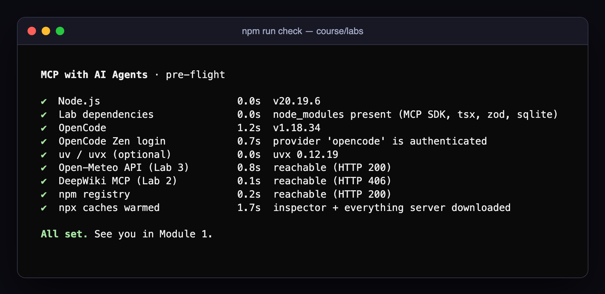
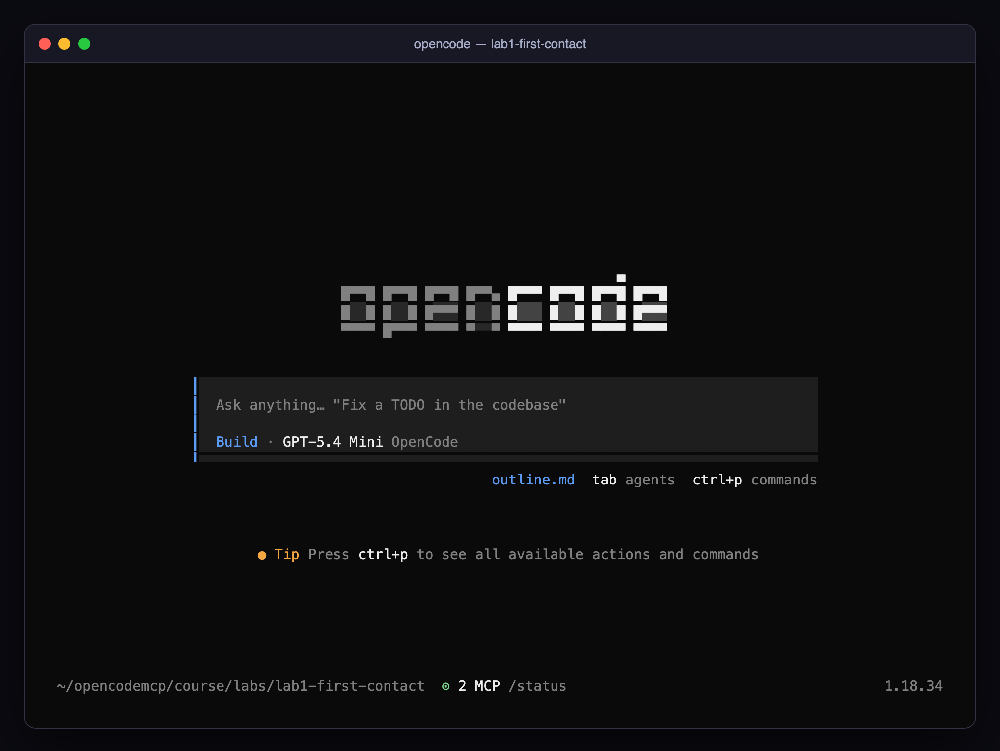
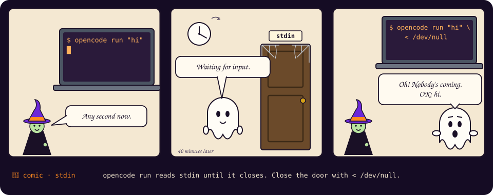

# 00 · Setup (10 minutes, ideally before class)

> 🎬 **Cold open.** In four hours you will give an AI agent hands, watch it use them on things you care about, and then take some of them away again. None of that works if the first ten minutes of class go to `npm install`. Do this page the day before.

🎯 **Mission**

- [ ] `npm run check` ends with **All set.**
- [ ] OpenCode starts in `lab1-first-contact` and the footer reads `⊙ 2 MCP`
- [ ] You can get around the TUI without a mouse (section 5)

## 1. Install the tools

| Tool | Why | Check |
|---|---|---|
| **Node.js 20+** and npm | runs every MCP server in this course | `node --version` |
| **OpenCode 1.18+** | the AI agent / MCP host | `opencode --version` |
| **uv** (optional) | runs the official Python `time` server via `uvx` | `uvx --version` |
| **git** (optional) | lets OpenCode's `/undo` work; not required | `git --version` |

Install OpenCode from <https://opencode.ai>: `curl -fsSL https://opencode.ai/install | bash`, or `npm install -g opencode-ai`, or `brew install anomalyco/tap/opencode` (macOS/Linux), or `scoop install opencode` / `choco install opencode` (Windows; WSL is recommended). Install uv from <https://docs.astral.sh/uv/>. If you cannot install uv, Lab 1 has a drop-in fallback server.

## 2. Log in to OpenCode Zen

Zen is OpenCode's own pay-as-you-go model gateway; the course uses it so nobody needs their own provider keys.

```bash
opencode auth login        # pick "OpenCode (recommended)" from the provider list, paste the API key from your OpenCode console
opencode auth list         # should show:  ● OpenCode api
```

Inside the TUI the same thing is `/connect`. The lab configs already select `opencode/gpt-5.4-mini`; you never have to type a model id.

> 🍬 **Treat: what a model gateway is, and why the course uses one.** Every model provider has its own API, its own key and its own bill. Zen sits in front of several of them behind one login and one invoice, and OpenCode talks to it as a provider called `opencode`. That is why a model id in this course looks like `opencode/gpt-5.4-mini`: *provider*, slash, *model*. Each lab's `opencode.json` sets `"model"` for the agent and `"small_model"` for OpenCode's cheap background work such as naming sessions. The first line of every one of those files, `"$schema": "https://opencode.ai/config.json"`, is for your editor: with it, VS Code and friends autocomplete field names and underline mistakes as you type. Module 2 is where you will be glad of that.

## 3. Install the lab dependencies (once)

```bash
cd course/labs
npm install
npm run check
```

`npm run check` runs nine checks and prints each one the moment it finishes:



The last line matters: it pre-downloads the MCP Inspector and the demo server so the first `opencode` start in class takes seconds, not minutes. (A 406 from DeepWiki is expected: MCP endpoints only accept POST.)

What each check is for, so you know which ones you can live without:

| Check | Needed by | If it fails |
|---|---|---|
| Node.js 20+ | every lab | nothing works; install Node 20 or newer |
| Lab dependencies | every lab | run `npm install` in `course/labs` |
| OpenCode | every lab | install it and open a new shell |
| OpenCode Zen login | every lab | `opencode auth login`; without it the model never answers |
| uv / uvx | Lab 1's official time server | optional; the lab has a Node fallback |
| Open-Meteo reachable | Lab 3 (your weather server calls it) | a corporate proxy or firewall; see section 6 |
| DeepWiki reachable | Lab 2's remote server | same; Lab 2 still works with local servers only |
| npm registry reachable | `npx` downloads (the Inspector, the demo server) | same; the warm-up will not run |
| npx caches warmed | the first start in class | cosmetic; the first `opencode` start will just be slow |

> [!NOTE]
> One `node_modules` for all labs. Each lab folder deliberately has **no** `package.json`; Node resolves imports by walking up to `course/labs/`, which is also where `"type": "module"` lives. If you copy a lab somewhere else, copy `package.json` and run `npm install` there too.

## 4. First launch

```bash
cd course/labs/lab1-first-contact
opencode
```

You should see the OpenCode home screen with **`⊙ 2 MCP /status`** in the footer. The two servers take a few seconds to start the first time.



Type `/exit` (or press `ctrl+x` then `q`) to leave.

## 5. Ninety-second TUI refresher

| Want to… | Do |
|---|---|
| See MCP server status | `/status` (or look at the footer) |
| Turn an MCP server on/off for this session | `/mcps`, then `space` on an entry |
| Start a fresh conversation | `/new` |
| Switch agent (Build ↔ Plan ↔ your own) | `Tab` |
| Attach a file or an MCP resource | type `@` and pick |
| Run an MCP prompt | type `/` and look for `server:prompt:mcp` entries |
| Run a shell command inline | start the message with `!` |
| See every command | `ctrl+p` |
| Approve or reject a tool call | `⇆` to pick *Allow once / Allow always / Reject*, `enter` |
| Toggle tool-call details | `/details` |
| Quit | `/exit` |
| Ask one question without the TUI | `opencode run "your question" < /dev/null` (the `< /dev/null` matters: without it `run` waits for stdin) |

You will use the TUI for almost everything. `opencode run` shows up in two late challenges, where you script the agent instead of talking to it. One difference to know now: `run` cannot show approval dialogs, so any tool that would *ask* is automatically rejected.



> 🍬 **Treat: two terminals, side by side.** Most labs put the agent in one terminal and a live viewer in another, so set up a split now and keep it for the day. VS Code: the *Terminal: Split Terminal* command (`⌘\` on macOS, `Ctrl+Shift+5` elsewhere). iTerm2: `⌘D`. Windows Terminal: `Alt+Shift+D`. tmux: `Ctrl+b` then `%`. Anything that gives you two shells in one window, both `cd`'d into the lab folder, is right.

## 6. If something is off

| Symptom | Fix |
|---|---|
| `npm install` fails | use Node 20 or newer (`nvm use 20`), delete `node_modules` and retry |
| `opencode: command not found` | re-run the installer, open a new shell |
| Footer shows `⊙ 1 MCP` instead of 2 | you probably lack `uvx`; in `lab1-first-contact/opencode.json` set `time` to `"enabled": false` and `time-js` to `true` |
| The model name in the footer is not GPT-5.4 Mini | you started OpenCode outside a lab folder; `cd` into one |
| "Permission required" pops up for a file read | that is OpenCode protecting you (default rules for `.env` files and directories outside the project); it is covered in Module 4 |
| `opencode run "…"` prints nothing and never returns | it is waiting on stdin; add `< /dev/null` |
| A lab works in its folder but not in a copy elsewhere | lab servers import the MCP SDK from `course/labs/node_modules`; keep copies inside `course/labs/` |
| The three network checks fail behind a corporate proxy | set `HTTPS_PROXY` in the shell you start OpenCode from (child processes inherit it, as Module 2 explains), and ask whoever runs the proxy to allow `open-meteo.com`, `mcp.deepwiki.com` and `registry.npmjs.org` |
| Windows: servers start in a shell but not in OpenCode | run the course under WSL; OpenCode on Windows resolves `npx`/`uvx` through a different `PATH` than your shell, and the labs assume a Unix shell for `< /dev/null` and `export` |

📼 **Next episode.** You ask a model what time it is in Tokyo, and find out what it takes for it to actually know. [Module 1 · Connecting AI agents to external systems with MCP →](01-connecting-agents-with-mcp.md)
