# Module 1 · Connecting AI Agents to External Systems with MCP

| | |
|---|---|
| **Time** | 40 minutes (15 concepts · 25 lab) |
| **Lab folder** | `course/labs/lab1-first-contact` |
| **You will** | connect OpenCode to two pre-built MCP servers, inspect what they expose, make the agent call a tool, and watch the raw protocol go by |
| **You'll pull off** | a second terminal lights up with every JSON-RPC message your agent exchanges with a server, timed to the millisecond, while you watch it answer |

> 🎬 **Cold open.** It is 02:00 and checkout is down. Your coding agent can read the repo, run the tests and grep the logs, and it knows nothing else: not the incident tracker, not the customer database, not even what time it is in the region that is on fire. Every one of those systems has an API, and nobody wants to write the glue for each one, for each agent, again. By the end of this module you will have watched an agent find tools it has never seen, pick one, and call it, and you will have read every byte it sent while it did.

## 1.0 Start with a question the model cannot answer

Ask a plain chat model, one with no tools, *"What time is it right now in Tokyo?"* It guesses, refuses, or tells you to check a clock. It has no clock. It also has no database, no ticket system, no deploy pipeline, and no idea what happened after its training cut-off.

An AI *agent* is a model plus the ability to act: call functions, read data, change things. OpenCode already gives its model a few hands (read, edit, grep, bash), which is why it can answer the Tokyo question by shelling out to `date`. But your ticket system is not a shell command, your company's databases are not files in the project, and a SaaS API needs credentials. The question this module answers is: **how does an agent get hands for everything else, and who decides what those hands may touch?**

## 1.1 The problem MCP solves

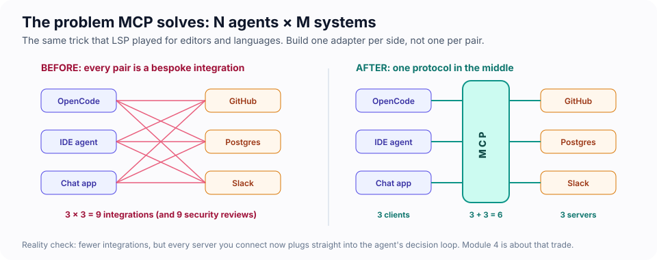

Before MCP, every AI application wrote its own GitHub integration, its own Postgres integration, its own Slack integration. Every tool vendor did the same for every AI app. N apps × M systems, each pair a bespoke, differently-secured piece of glue.

The Model Context Protocol (MCP) is an open standard (announced by Anthropic in November 2024, now governed by a community working group) that defines **one way for an AI application to discover and use capabilities offered by an external program**. Write one server for your system and every MCP-capable agent can use it. Write one client in your agent and it can use every server.

> [!TIP]
> 💡 **Insight: MCP is to agents what LSP is to editors.** The Language Server Protocol let any editor talk to any language's tooling through one protocol. MCP was explicitly modelled on it, down to JSON-RPC and the "server" naming. If you have ever configured a language server, you already know the shape of this.

## 1.2 The architecture

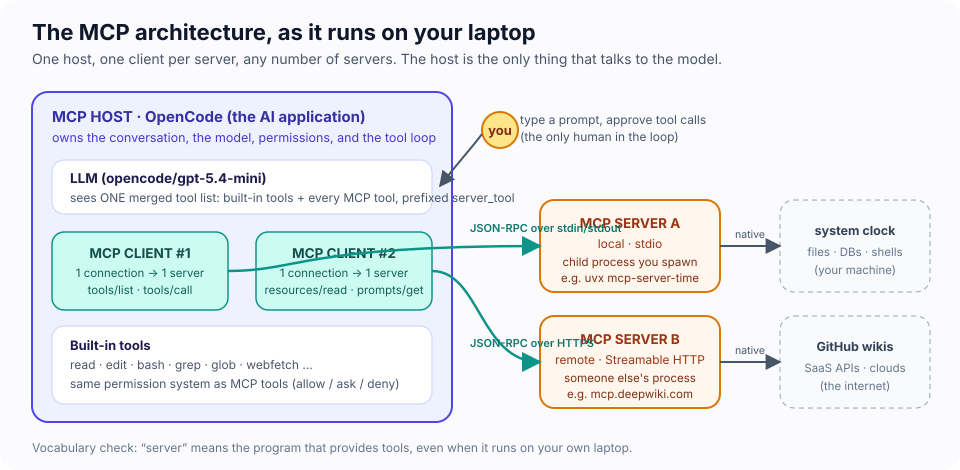

| Term | What it is | In this course |
|---|---|---|
| **Host** | The AI application. Owns the model, the conversation, the UI, and the permission decisions. | OpenCode |
| **Client** | A connection object inside the host; exactly one per server. Speaks the protocol. | created by OpenCode for each entry under `mcp` in `opencode.json` |
| **Server** | A program that exposes capabilities. Runs locally (a child process) or remotely (over HTTPS). | `uvx mcp-server-time`, `npx @modelcontextprotocol/server-everything`, your own code in Module 3 |
| **External system** | Whatever the server actually touches: a clock, a database, an API, your filesystem. | SQLite, Open-Meteo, a fake incident API |

The host is the only thing that talks to the model. Servers never see the conversation; they only see the specific requests the client sends them. That boundary is the whole point, and in Module 4 we will see exactly where it leaks.

> [!NOTE]
> "Server" means *the program that serves capabilities*, even when it runs on your laptop as a child process of OpenCode. Resist the instinct to read "server" as "remote".

## 1.3 Three kinds of capability, and who pulls the trigger

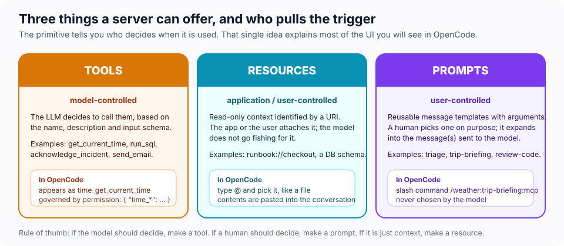

The single most useful way to tell the three primitives apart is **who decides when they are used**:

- **Tools are model-controlled.** The LLM reads the tool's name, description and input schema, and decides on its own to call it. `get_current_time`, `run_sql`, `send_email`.
- **Resources are application-controlled.** Read-only context behind a URI (`runbook://checkout`, `file:///…`, `demo://resource/…`). The app or the user attaches them; they are *data*, not actions.
- **Prompts are user-controlled.** Reusable message templates a human invokes on purpose. They expand into messages for the model.

How OpenCode surfaces each one:

| Primitive | Where you see it in OpenCode | Example from the lab |
|---|---|---|
| Tool | the model's tool list, prefixed `server_tool`; shown as `⚙ time_get_current_time […]` in the transcript | `time_get_current_time`, `everything_get-sum` |
| Resource | the `@` picker, next to project files; also two built-in tools, `list_mcp_resources` and `read_mcp_resource` | `@arch` → `architecture.md` from the everything server |
| Prompt | a slash command named `/server:prompt:mcp` | `/everything:simple-prompt:mcp` |

> [!TIP]
> 💡 **Insight:** the spec says resources are *application-controlled*, but OpenCode also hands the model `list_mcp_resources` / `read_mcp_resource` tools. In OpenCode, then, the model *can* go and read a resource by itself if it decides to. Hosts differ; always check how yours maps the primitives before you rely on "the model can't see that".

## 1.4 Local or remote: the same messages, a different pipe

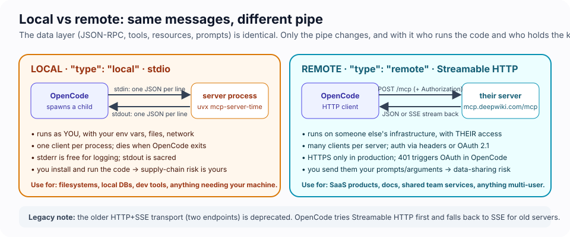

MCP has two layers. The **data layer** is JSON-RPC 2.0: requests, responses and notifications with methods like `tools/list` and `tools/call`. The **transport layer** moves those messages:

- **stdio** for local servers. OpenCode spawns the server as a child process and writes JSON to its stdin, one message per line; the server answers on stdout. It inherits *your* user, *your* environment variables, *your* network.
- **Streamable HTTP** for remote servers. OpenCode POSTs JSON to a URL; the server answers with JSON or an SSE stream. Authentication is headers or OAuth 2.1.

Rule number one of stdio servers: **stdout is the protocol channel**. A stray `console.log("starting…")` is a corrupted message. Log to stderr.

## 1.5 What actually goes over the wire

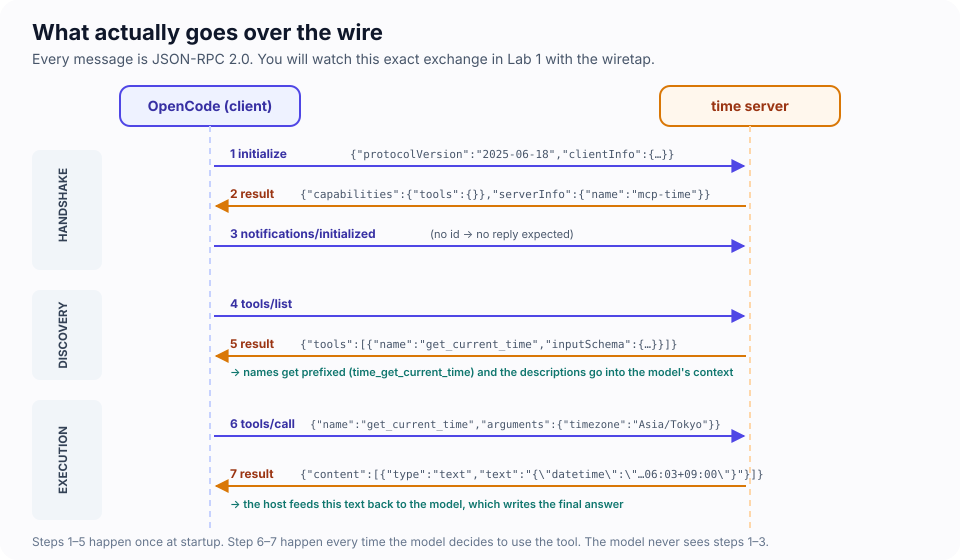

When OpenCode starts, each client performs this exchange with its server:

1. `initialize` — the client proposes a protocol version and declares its capabilities; the server replies with its own version, capabilities (`tools`, `resources`, `prompts`, …) and identity.
2. `notifications/initialized` — a notification (no `id`, no reply) that says "ready".
3. `tools/list` — the client asks for every tool: name, description, JSON Schema for inputs, optional annotations.
4. `resources/list` and `prompts/list` — OpenCode asks for those too, and then fetches every prompt body (`prompts/get`) so it can register the slash commands.

From then on, every time the model decides to use a tool: `tools/call` with the tool name and arguments, and a result whose `content` is an array of parts (usually one text part) that the host hands back to the model.

> 🔬 **Under the hood: three shapes of message.** Every line on the wire is one of these:
>
> ```jsonc
> {"jsonrpc":"2.0","id":3,"method":"tools/call","params":{…}}   // request: has id + method, MUST get exactly one reply
> {"jsonrpc":"2.0","id":3,"result":{…}}                          // response: same id, result OR error, never both
> {"jsonrpc":"2.0","method":"notifications/initialized"}         // notification: no id, so nobody may reply
> ```
>
> The `id` is how a reply finds its request. Replies may arrive in any order, so a client keeps a table of open ids. Each side numbers its *own* requests, which is why you will see two different `#0`s when a server asks the client something. On stdio the framing is as simple as it gets: **one JSON object per line**, with no length header. That is why a stray `console.log` matters: the client reads every stdout line as a message.

> [!TIP]
> 💡 **Insight: the model never sees the handshake.** Steps 1–4 happen before the conversation starts. What the model *does* see is the output of step 3: every tool description and schema is pasted into its context on every turn. Tool descriptions are prompts. Write them like prompts (Module 3), and budget them like prompts (see the token counter in the footer).

**Protocol versions.** MCP revises its spec a few times a year (`2024-11-05`, `2025-03-26`, `2025-06-18`, `2025-11-25`, `2026-07-28`). Clients and servers negotiate during `initialize`: OpenCode 1.18 proposes `2025-11-25`; servers built with the current TypeScript SDK (v2) speak `2026-07-28` natively *and* answer the older handshake, so everything in this course interoperates. You will see the negotiated version in the wiretap.

## 1.6 How an agent picks and runs a tool

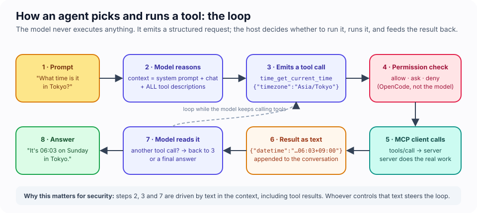

1. Your prompt plus the whole tool catalogue go to the model.
2. The model emits a *structured request*: tool name + JSON arguments. It does not execute anything.
3. OpenCode checks its permission rules for that tool (`allow`, `ask`, `deny`).
4. The MCP client sends `tools/call`; the server does the real work.
5. The result text is appended to the conversation and the model reads it.
6. The model either calls another tool (back to 2) or writes its answer.

Two consequences you will rely on later: **(a)** the host, not the model, is where enforcement lives; **(b)** anything that lands in the context — including tool results — can steer the next decision.

---

## Lab 1 · First contact (25 minutes)

### 🎯 Mission

- [ ] Connect OpenCode to two MCP servers and see both say **Connected**
- [ ] Get the agent to call a tool you never named
- [ ] Take that tool away and catch the agent finding another way in
- [ ] Use all three primitives: a tool, a resource and a prompt
- [ ] Read the raw protocol live, in a second terminal, while the agent works
- [ ] Speak MCP to a server yourself, with no agent and no SDK

Open `course/labs/lab1-first-contact/opencode.json`. It defines four servers; two are enabled:

```jsonc
"time":       { "type": "local", "command": ["uvx", "mcp-server-time"], "enabled": true, "timeout": 60000 },
"time-js":    { "type": "local", "command": ["node", "time-server.mjs"], "enabled": false },   // fallback if you have no uvx
"everything": { "type": "local", "command": ["npx", "-y", "@modelcontextprotocol/server-everything@2.0.0"], "enabled": true, "timeout": 60000 },
"time-tap":   { "type": "local", "command": ["node", "mcp-tap.mjs", "mcp-traffic.log", "--", "uvx", "mcp-server-time"], "enabled": false }
```

`time` is the official reference server for timezones. `everything` is the MCP project's demo server: it exists purely to exercise every feature of the protocol (tools, resources, prompts, images, long-running operations), which makes it perfect for a tour.

### 🧪 Exercise 1.A — Connect and inspect

```bash
cd course/labs/lab1-first-contact
opencode
```

1. Wait for the footer to show `⊙ 2 MCP /status`. Type `/status` and press enter: both servers should read **Connected**.

   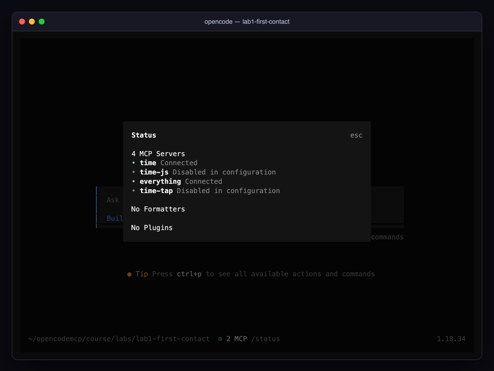

2. Type `/mcps`. This dialog toggles servers for the current session (space to toggle, esc to close). Leave both enabled for now.

   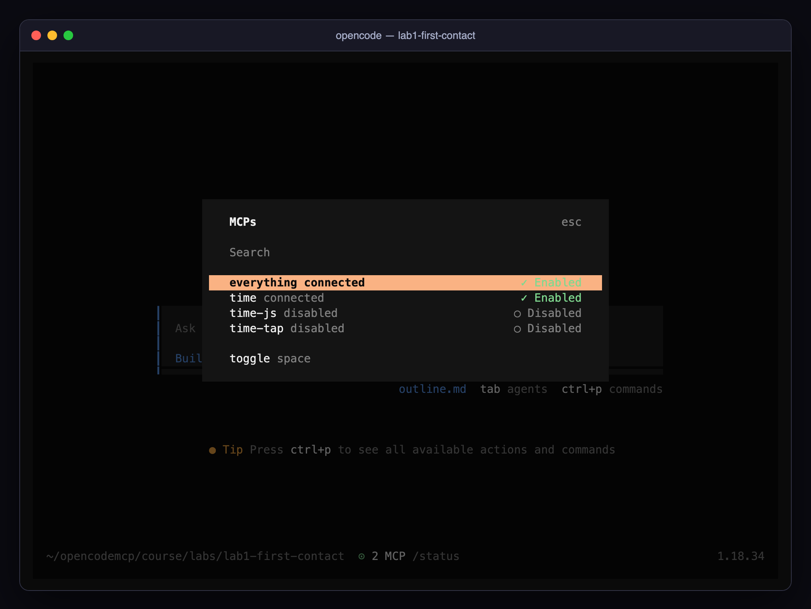

3. Press `esc` until you are back at the prompt.

### 🧪 Exercise 1.B — Make the agent use a tool

> 🔮 **Predict.** You are about to ask a one-line question. The footer will show how many input tokens it cost. Write down a number before you press enter: 500? 2,000? 10,000?

Ask: **What time is it right now in Tokyo?**

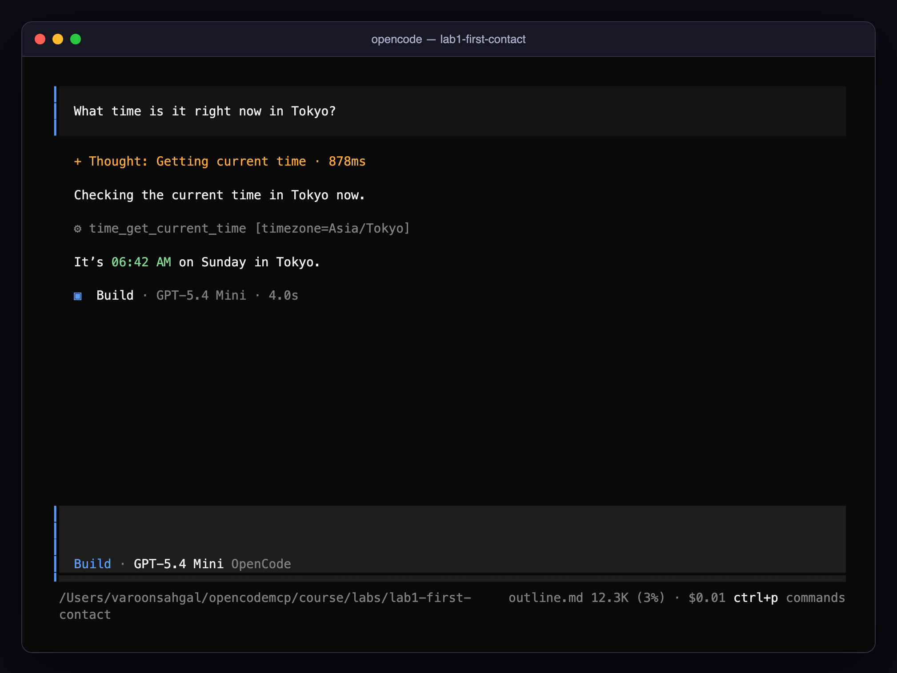

Read the transcript carefully:

- `⚙ time_get_current_time [timezone=Asia/Tokyo]` is the tool call. The prefix `time_` is the server name from your config; `get_current_time` is the tool's own name. The model chose the IANA timezone itself from the tool's schema description. You never named the tool.
- The footer now shows something like `12.3K (3%) · $0.01`: twelve thousand input tokens for a one-line question. Roughly ten thousand of them are the system prompt and the descriptions of the 19 MCP tools your two servers expose (17 from `everything`, 2 from `time`). That is the **context tax** of MCP, and it is paid on every turn. How close was your guess?

Now the A/B test. Type `/mcps`, move to `time`, press `space` to disable it, `esc`. Start a fresh conversation with `/new`.

> 🔮 **Predict.** The time tool is gone. Will the agent (a) say it cannot know, (b) guess from its training data, or (c) get the answer some other way? Pick one, then ask the same question.

> [!IMPORTANT]
> 🤯 **Removing a tool did not remove the capability.** In our run the agent reached for the built-in `bash` tool and ran `TZ=Asia/Tokyo date`. Capable agents route around a missing tool using whatever else they can reach. Keep this in mind for Module 4: there you remove tools on purpose, and you need to know everything else the agent can still reach.

Re-enable `time` the same way.

### 🧪 Exercise 1.C — Tour the three primitives

With the `everything` server you can see all three capability types in one place.

1. **Tools.** Ask: **Use the get-sum tool to add 40 and 2, then echo the result with the echo tool.** Two tool calls, chained, from one server.

   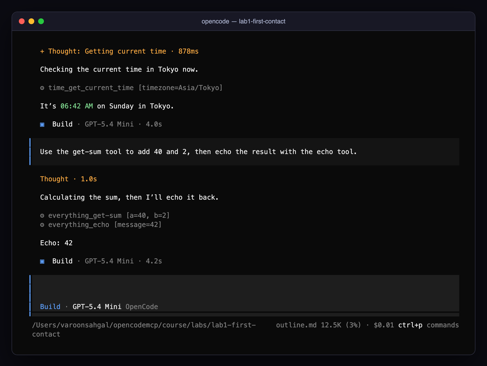

2. **Resources.** Type `@arch` and watch the picker offer `architecture.md`, a resource served by `everything` (not a file on your disk). Select it, add *"summarise this in one line"*, send.

   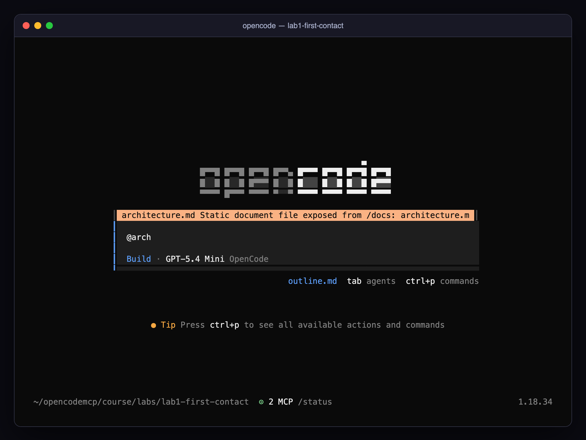

3. **Prompts.** Type `/every` and look at the entries named `/everything:…:mcp`. Run `/everything:simple-prompt:mcp`. The server-provided template is expanded into your message; you chose it, the model did not.

   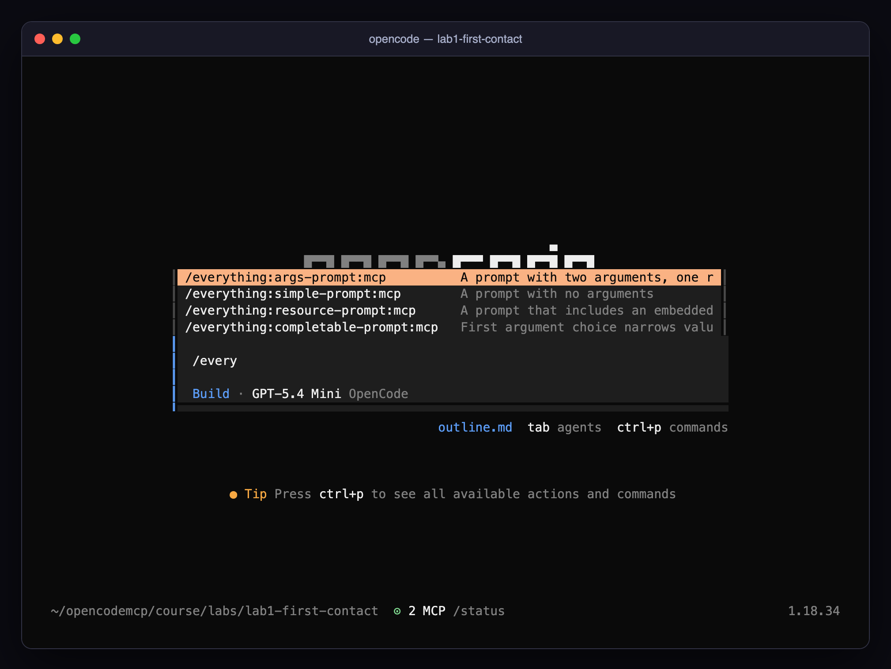

### 🧪 Exercise 1.D — Wiretap the protocol

Everything so far happened behind the transcript. Now you listen in.

`mcp-tap.mjs` is a 60-line transparent proxy: it starts the real server, forwards every byte in both directions unchanged, and writes a copy of each JSON-RPC message to a log file. `wiretap-view.mjs` follows that log and draws it as a live sequence diagram: who spoke, which method, how long the answer took, and the part of the payload that matters. The protocol does not change; you are just listening.

🖥️ **Split screen.** Put two terminals side by side, both in the lab folder:

```
┌─ Terminal 1 · the agent ───────────────┐  ┌─ Terminal 2 · the wire ─────────────────────┐
│ $ opencode                             │  │ $ node wiretap-view.mjs mcp-traffic.log     │
│ > What time is it in Berlin right now? │  │   (a row appears for every message)         │
└────────────────────────────────────────┘  └─────────────────────────────────────────────┘
```

1. Quit OpenCode (`/exit`). In `opencode.json`, set `time` to `"enabled": false` and `time-tap` to `"enabled": true`.
2. **Terminal 2:** `cd course/labs/lab1-first-contact && node wiretap-view.mjs mcp-traffic.log`. It says it is waiting; the log appears when OpenCode starts the server.
3. **Terminal 1:** start `opencode`. Do not type anything yet.

> 🔮 **Predict.** (1) How many messages cross the wire before you type a single character? (2) Your question is one sentence. How many *requests* will the whole exchange contain, startup included? (3) OpenCode will propose protocol version `2025-11-25`. Will the server accept it?

Watch Terminal 2 fill in as OpenCode starts. Then ask **What time is it in Berlin right now?** in Terminal 1, and keep your eyes on Terminal 2.

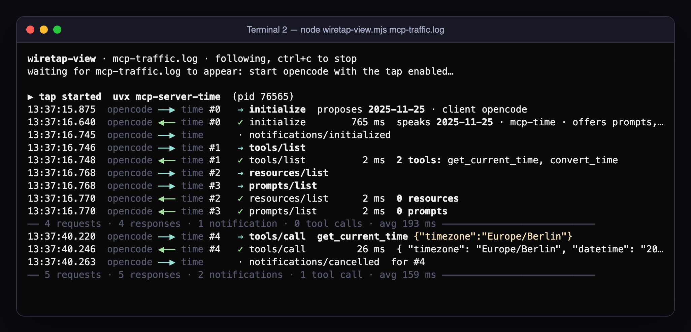

Read it top to bottom. That is the whole life of a connection:

- **Startup, before you typed:** `initialize` → `notifications/initialized` → `tools/list` → `resources/list` and `prompts/list`, sent back to back. This server has no resources or prompts, but it advertised both capabilities in its `initialize` reply, so OpenCode asks. The dim tally line marks the pause while the server waited for you.
- **Your question:** one `tools/call` with `{"timezone":"Europe/Berlin"}`, answered in about 25 ms. The model's thinking time does not show up on the wire. All the server sees is the request.
- **The tidy-up:** a `notifications/cancelled` for a request that has already completed. Servers ignore it; it is the client tidying up.
- **Version negotiation:** the `initialize` row shows what OpenCode proposed, and the reply shows what the server will speak. On 24 October our server answered `2025-06-18`; on 27 October `uvx` fetched a newer `mcp-server-time` release that answered `2025-11-25`. Either way, both sides carried on. That is negotiation working, and also a live demonstration of why Module 2 tells you to pin versions.

> [!IMPORTANT]
> 🤯 **The server never learned who was asking.** In Terminal 1 the tool is `time-tap_get_current_time`. On the wire it is `get_current_time`. The prefix, the model, your prompt and the rest of the conversation never left OpenCode. The server received one JSON object and returned one. This is the boundary from 1.2, now visible on screen. In Module 4 you will see what crosses it anyway: the arguments.

The raw log is still there if you prefer it unrendered (`tail -f mcp-traffic.log`). Here is a copy from a non-interactive `opencode run` on 24 October, with the long payloads trimmed. `opencode run` skips `resources/list` and `prompts/list`, which is why its `tools/call` is `#2` and yours is `#4`:

```
22:31:42.504 client → server REQUEST   #0 initialize        {"method":"initialize","params":{"protocolVersion":"2025-11-25","capabilities":{…},"clientInfo":{"name":"opencode",…}}}
22:31:42.765 server → client RESPONSE  #0                   {"jsonrpc":"2.0","id":0,"result":{"protocolVersion":"2025-06-18","capabilities":{"prompts":{…},"resources":{…},"tools":{…}},"serverInfo":{"name":"mcp-time",…}}}
22:31:42.768 client → server NOTIFY    notifications/initialized
22:31:42.768 client → server REQUEST   #1 tools/list
22:31:42.768 server → client RESPONSE  #1                   {"result":{"tools":[{"name":"get_current_time","description":"Get current time in a specific timezones","inputSchema":{…}},{"name":"convert_time",…}]}}
22:31:45.825 client → server REQUEST   #2 tools/call        {"method":"tools/call","params":{"name":"get_current_time","arguments":{"timezone":"Europe/Berlin"}}}
22:31:45.834 server → client RESPONSE  #2                   {"result":{"content":[{"type":"text","text":"{\n  \"timezone\": \"Europe/Berlin\",\n  \"datetime\": \"2026-10-24T23:31:45+02:00\", …}"}]}}
22:31:45.847 client → server NOTIFY    notifications/cancelled
```

<details><summary>Check your predictions</summary>

1. Nine: four requests (`initialize`, `tools/list`, `resources/list`, `prompts/list`), their four responses, and one notification. A server with prompts costs more: OpenCode then fetches every prompt body with `prompts/get` (see Challenge 1A).
2. Five requests: four at startup, one for your question. Only the `tools/call` belongs to the question; everything else is startup.
3. It depends on the server release. The negotiation is designed so that both answers work.
</details>

Put the config back when you are done (`time` on, `time-tap` off), or keep the tap on for Challenge 1A. Stop the viewer with `ctrl+c`; it prints a final tally.

> [!TIP]
> 💡 **Insight:** a wiretap you fully understand is also an **audit log**. Module 4's challenge turns this exact script into one that flags dangerous tool calls.

### 🧪 Exercise 1.E — Speak MCP by hand (4 minutes)

You have watched OpenCode talk to a server. Now you do the talking: no agent, no SDK, just a file of JSON lines. `hello-mcp.jsonl` in the lab folder holds seven messages: the handshake, a `tools/list`, and four `tools/call`s. One is fine, one asks for a timezone on Mars, one has no arguments at all, and one names a tool this server does not have.

```bash
cat hello-mcp.jsonl                          # read the seven lines first
node time-server.mjs < hello-mcp.jsonl       # the fallback time server; replies go to stdout
```

> 🔮 **Predict.** (1) The requests have ids 1 to 6. In what order will the replies come back? (2) The Mars call, the empty call and the missing tool are all mistakes. Will they come back as the same kind of failure?

<details><summary>Our run (three times in a row, same answer)</summary>

Replies arrived as **1, 2, 6, 5, 3, 4**. The two calls the SDK rejected before running any code (#6, unknown tool; #5, missing argument) came back first. The two that reached the handler (#3, Tokyo; #4, Mars) came back after it finished.

And no, the mistakes are not the same kind:

| id | Mistake | What came back | Who reads it |
|---|---|---|---|
| 6 | tool does not exist | `"error": {"code": -32602, "message": "Tool get_weather not found"}` | the **client's code**. It is a JSON-RPC *protocol error* |
| 5 | no `timezone` | `"result": {"isError": true, "content": [… "Input validation error …"]}` | the **model**. It is a *tool error* |
| 4 | `Mars/Olympus_Mons` | `"result": {"isError": true, "content": [… "Unknown timezone … Use an IANA name like 'Europe/Paris'"]}` | the **model**, with a hint written by the server author |
</details>

> [!IMPORTANT]
> 🤯 **That is the entire protocol.** OpenCode, the Inspector and every other MCP host do what you just did with `<`: write lines, read lines, match ids. Out-of-order replies are why ids exist. The split between a *protocol error* (addressed to code) and a *tool error* (addressed to the model) is the most useful idea in Module 3, and you have just seen both on the wire. Edit the file (add a `convert_time`-style mistake of your own, or a garbage line that is not JSON) and run it again.

### 🎲 Fun — Tool scavenger hunt (fast finishers, 5 minutes)

Using only the OpenCode TUI, answer:

1. One `everything` tool would put every environment variable on your machine into the model's context. Which one? Ask the agent to *describe* it, not call it. (Module 2 explains why this matters.)
2. Which `everything` tool returns an image, and what does OpenCode do with it?
3. Make the agent call tools from **both** servers in a single reply. What prompt did it take?
4. Run `npx -y @modelcontextprotocol/inspector --cli npx -y @modelcontextprotocol/server-everything@2.0.0 --method tools/list` and count the tools. The Inspector sees 16; OpenCode's model sees 17. Which tool is missing from the Inspector's list, and why does the server offer it to OpenCode only?

<details><summary>Answer to 4</summary>

`get-roots-list`. OpenCode's `initialize` declares the client capability `roots` (it can tell a server which folders it works in); the Inspector's does not. The everything server reads the client's capabilities and registers that tool only when the client can answer `roots/list`. This is **capability negotiation**: the handshake is not a formality, and the same server can look different to different hosts.
</details>

### 🏅 Mission complete

- **Connected** an agent to two MCP servers it had never seen and watched it choose a tool from 19 on its own.
- **Caught** the agent routing around a tool you removed. You now know a missing tool does not mean a missing capability.
- **Read the protocol live**: every message, every millisecond, and the prefix that never left OpenCode.
- **Spoke it yourself**: seven lines of JSON, replies out of order, and two different kinds of error.

### ✅ Check yourself

<details><summary>1. Which component decides whether a tool call is allowed to run: the model, the MCP client, the MCP server, or the host?</summary>

The **host** (OpenCode). The model only emits a request; the server only executes what it is sent. Permission rules live in the host, and they are the first security control you own.
</details>

<details><summary>2. A server exposes a tool called <code>search</code>. You named the server <code>docs</code> in <code>opencode.json</code>. What does the model see?</summary>

`docs_search`. The server name becomes the prefix, so two servers can both have a `search` tool without colliding. The server itself never sees the prefix.
</details>

<details><summary>3. Why is the token counter higher after adding an MCP server, even before you call any tool?</summary>

Every tool's name, description and input schema is sent to the model on every turn. More servers → more tools → more context per turn (and more cost). Enable only the servers you need.
</details>

<details><summary>4. You attached <code>@arch</code> and the model summarised the document. Which primitive did you use, and who decided to use it?</summary>

A **resource**. You decided (application/user-controlled). If you had instead asked "read the architecture doc", OpenCode's `read_mcp_resource` tool would have let the *model* decide — the same data, a different trigger.
</details>

<details><summary>5. What breaks if a stdio server prints a progress message to stdout?</summary>

The client parses every stdout line as a JSON-RPC message. Non-JSON lines are garbage on the protocol channel; strict clients fail the connection, lenient ones (OpenCode included) skip the line. Either way it is a bug: log to stderr. (Put a tap in front of such a server and `wiretap-view.mjs` flags the line as `✗ not JSON on the protocol channel`.)
</details>

### 🏆 Challenge 1A — Wiretap detective (10 minutes, optional)

Switch the tap to the `everything` server: add a `everything-tap` entry that runs `node mcp-tap.mjs everything-traffic.log -- npx -y @modelcontextprotocol/server-everything@2.0.0`, disable `everything`, restart OpenCode, attach `@arch`, run `/everything-tap:simple-prompt:mcp`, then read the log and answer:

1. List every JSON-RPC **method** OpenCode called before you typed anything, in order. Why does it fetch `prompts/get` for every prompt at startup?
2. The server sent at least one message that was **not** a response. What was it, and what did OpenCode do with it?
3. Find a request where the roles are reversed: the *server* asks and the *client* answers. What did it ask for, and why might that matter for privacy?
4. When exactly was `resources/read` sent, relative to your keystrokes?

`wiretap-view.mjs` renders this log too: `node wiretap-view.mjs everything-traffic.log`. Your instructor has the answer key.

### 🏆 Challenge 1B — Be the client (20 minutes, harder)

Exercise 1.E was a client with no brain: it wrote its lines and never waited for an answer. Write a real one. `mini-client.mjs`, in the lab folder, with **no dependencies** (only `node:child_process` and `node:readline`), that:

```bash
node mini-client.mjs -- node time-server.mjs
#   connected to time 1.0.0 · protocol 2025-11-25 · offers tools
#     get_current_time(timezone)  Get the current date and time in an IANA timezone …
node mini-client.mjs get_current_time '{"timezone":"Asia/Tokyo"}' -- uvx mcp-server-time
#   result: { "timezone": "Asia/Tokyo", "datetime": "…+09:00", … }
node mini-client.mjs nope '{}' -- node time-server.mjs
#   protocol error -32602: Tool nope not found
```

It must spawn the server, do the handshake (`initialize`, wait for the reply, then `notifications/initialized`), list the tools with their argument names, and optionally call one. The three rules that make it correct, each of which you have now seen on the wire:

1. **Match replies by `id`**, never by arrival order (Exercise 1.E).
2. **Skip lines that are not JSON** instead of crashing (1.5's stray `console.log`).
3. **Answer the server's own requests.** Point your client at the `everything` server: it sends a `roots/list` request while you wait. A request must get a reply, so return a JSON-RPC error `-32601` ("Method not found") rather than ignoring it.

Done when all three commands above work **and** `node mini-client.mjs get-sum '{"a":40,"b":2}' -- npx -y @modelcontextprotocol/server-everything@2.0.0` prints `The sum of 40 and 2 is 42.` The reference solution is under 40 lines of code. Keep yours: Module 3's `tool-card.mjs` is the same idea, grown up.

📼 **Next episode.** Today both servers came pre-wired. Next you wire them yourself: a server running on someone else's machine, a secret that has to reach a child process without landing in a file, and three servers that refuse to start until you work out why.

[Module 2 · Configuring MCP servers with OpenCode →](02-configuring-mcp-in-opencode.md)
