# Module 2 · Configuring MCP Servers with OpenCode

| | |
|---|---|
| **Time** | 30 minutes (10 concepts · 20 lab) |
| **Lab folder** | `course/labs/lab2-configure` |
| **You will** | add a remote server by hand and another through the CLI wizard, pass environment variables into a local server, break three servers on purpose and fix them, verify everything with the MCP Inspector, and put a number on what your setup costs every turn |
| **You'll pull off** | a live board in a second terminal that turns red servers green as you fix them, and prices every server you add in tokens |

> 🎬 **Cold open.** A teammate drops a snippet in the team chat: *"add this to your opencode.json, it's great."* You paste it, restart, and the footer goes from `⊙ 2 MCP` to `⊙ 3 MCP`. So: what did you just start, running as whom, with which of your secrets in its environment? What does it now add to every message you send? And tomorrow, when it says `Connection closed`, where do you look first? This module is the operator's manual.

## 2.1 Anatomy of an MCP entry

Every server you will ever run in OpenCode is one entry in one JSON object. Learn the nine fields and you can read anyone's config.

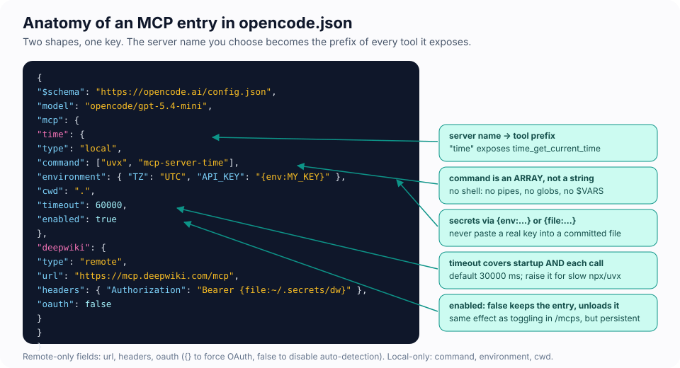

Before the field-by-field tour, here is a complete, working file. It is Lab 1's config with two entries removed:

```jsonc
{
  "$schema": "https://opencode.ai/config.json",     // editor autocomplete and validation
  "model": "opencode/gpt-5.4-mini",                  // provider/model the agent uses
  "small_model": "opencode/gpt-5.4-nano",            // for OpenCode's own housekeeping (titles, summaries)
  "mcp": {
    "time": { "type": "local", "command": ["uvx", "mcp-server-time"], "enabled": true, "timeout": 60000 }
  }
}
```

Everything MCP-related lives under the `mcp` key of `opencode.json` (or `opencode.jsonc` if you like comments). The **key** you choose is the server's name and the prefix of all its tools, so pick something short and stable.

| Field | Applies to | Meaning |
|---|---|---|
| `type` | both | `"local"` (stdio child process) or `"remote"` (Streamable HTTP, with SSE fallback) |
| `enabled` | both | `false` keeps the entry but never starts it |
| `timeout` | both | milliseconds for startup **and** for each tool call; default 30 000. Raise it for `npx`/`uvx` cold starts |
| `command` | local | an **array**: program and arguments. No shell is involved, so no pipes, globs or `$VARS` |
| `environment` | local | extra environment variables for the child; it also inherits all of yours (see 2.3) |
| `cwd` | local | working directory; relative paths resolve from the project |
| `url` | remote | the MCP endpoint, usually ending in `/mcp` |
| `headers` | remote | static headers such as `Authorization: Bearer …` or an API key |
| `oauth` | remote | `{}` to force OAuth, `{ clientId, clientSecret, scope }` for pre-registered apps, `false` to disable auto-detection |

Two substitutions keep secrets out of files you might commit:

- `{env:NAME}` → the value of an environment variable (empty string if unset)
- `{file:~/.secrets/token}` → the contents of a file

> 🍬 **Treat: JSONC, and why `$schema` goes first.** OpenCode reads its config as JSONC: ordinary JSON plus `//` comments and trailing commas. The `"$schema"` line is not for OpenCode at all; it is for your editor. VS Code and most others fetch that schema and then autocomplete field names, show each field's documentation on hover, and underline a `command` written as a string instead of an array before you ever save the file. Challenge 2B has a bug that only a schema-aware editor catches instantly.

## 2.2 Where configuration lives, and who wins

The file in your project is not the whole story. Six layers merge into the config OpenCode actually runs.

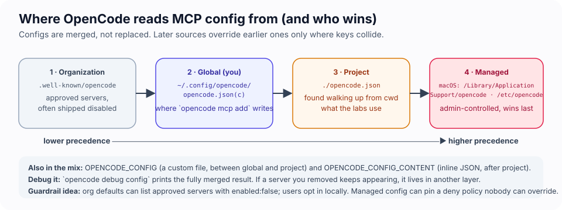

Configs are **merged**, in this order (later wins on conflicting keys): organisation defaults from a `.well-known/opencode` endpoint → your global `~/.config/opencode/opencode.json` → a file named by `OPENCODE_CONFIG` → the project's `opencode.json` (found by walking up from where you started OpenCode) → `OPENCODE_CONFIG_CONTENT` (inline JSON) → managed/MDM config that admins control.

Two consequences:

- The interactive wizard `opencode mcp add` writes to your **global** file, not the project. Handy for personal servers, surprising when you expected a project entry.
- When a server "will not go away", it is defined in another layer. `opencode debug config` prints the fully merged result.

> 🔬 **Under the hood: the merge goes all the way down.** Layers are merged key by key, not file by file. If an organisation layer defines `deepwiki` in full and leaves it switched off, a project can switch it on with one field, and the URL and everything else come from the layer below. Try it in 60 seconds in the lab folder:
>
> ```bash
> echo '{"mcp":{"orgwiki":{"type":"remote","url":"https://mcp.deepwiki.com/mcp","enabled":false}}}' > /tmp/org.json
> OPENCODE_CONFIG=/tmp/org.json opencode mcp list                                     # orgwiki: disabled
> OPENCODE_CONFIG=/tmp/org.json OPENCODE_CONFIG_CONTENT='{"mcp":{"orgwiki":{"enabled":true}}}' opencode mcp list   # orgwiki: connected
> ```
>
> The second command never mentions a URL, and `orgwiki` still connects. This is how "reviewed servers, off by default, opt in per project" works in Module 4.

## 2.3 Local servers: what they inherit

A local server is not a sandboxed plugin. It is a program running as you.

A local server is a child process of OpenCode. It runs as **you**, in your home directory's context, with **every environment variable your shell has**, plus whatever you add under `environment`. Your `AWS_PROFILE`, your `GITHUB_TOKEN`, that `OPENAI_API_KEY` you exported in 2024: all visible to the server's code. The server decides what to do with them.

Also: `npx -y some-package` and `uvx some-package` **download and execute code** when the server starts. Pin versions (`@2.0.0`) so that what you reviewed is what runs. Module 4 returns to this.

> 🍬 **Treat: what the `-y` is for.** When a package is not in its cache, `npx` stops to ask *Ok to proceed? (y)*. A server's stdin is wired to OpenCode, which is waiting for JSON and will never type `y`. Depending on the npm version the server then either exits (*npx canceled due to missing packages*, which OpenCode reports as `Connection closed`) or sits there until the `timeout` expires. `-y` answers the question in advance. The same reasoning applies to anything interactive: a server that prompts, pages or waits for a keypress on stdin is a server that never connects.

## 2.4 Remote servers: someone else's process

The trade flips: a remote server cannot see your laptop, but everything you send it leaves your laptop.

A remote server runs on the vendor's infrastructure with the vendor's credentials; you send it tool arguments (and therefore possibly your data). Authentication is either a static header or OAuth 2.1: when a remote server answers `401`, OpenCode starts the browser-based OAuth flow automatically (dynamic client registration when the server supports it) and stores tokens under `~/.local/share/opencode/`. The CLI helps:

```bash
opencode mcp auth <name>     # log in to an OAuth-protected server
opencode mcp logout <name>   # forget its tokens
opencode mcp debug <name>    # test connectivity and the OAuth discovery steps
```

> 🔬 **Under the hood: what "Streamable HTTP" means.** One URL, and every client message is an HTTP `POST` of one JSON-RPC message to it, sent with `Accept: application/json, text/event-stream`. The server answers with plain JSON, or opens a short SSE stream when it has more to say (progress, a request back to the client). It may hand out an `Mcp-Session-Id` header that the client repeats on every later request. A bare `GET` without that `Accept` header is refused, which is the `406` you saw in `npm run check`. Before 2025 the transport was a different, older "HTTP+SSE" design. OpenCode still falls back to it when Streamable HTTP fails, so remote errors often begin `SSE error:` even when SSE has nothing to do with the problem (Challenge 2B).
>
> Handshake with a remote server using nothing but `curl` (the reply comes back as one SSE `data:` line):
>
> ```bash
> curl -s -m 10 -X POST https://mcp.deepwiki.com/mcp -H 'Content-Type: application/json' -H 'Accept: application/json, text/event-stream' \
>   -d '{"jsonrpc":"2.0","id":1,"method":"initialize","params":{"protocolVersion":"2025-11-25","capabilities":{},"clientInfo":{"name":"curl","version":"0"}}}'
> ```

> 🍬 **Treat: OAuth 2.1 in one breath.** It is *"log in with…"* done properly. The client never sees your password: a browser page asks you to approve, and an authorization server hands the client a short-lived access token that is only good for this one resource. The "2.1" is the tidied-up 2.0: the PKCE check is always on, the old implicit flow is gone, and passwords never travel in a token request. Module 6 walks through the MCP flavour of it header by header.

Public servers used in this lab need no login: **DeepWiki** (`https://mcp.deepwiki.com/mcp`, AI-generated documentation for any GitHub repo) and **Microsoft Learn** (`https://learn.microsoft.com/api/mcp`, official Microsoft docs search).

## 2.5 Enabling, disabling, scoping

Four switches, four different scopes. Picking the wrong one is how a "temporarily disabled" server ends up running for the whole team.

| Mechanism | Scope | Use it when |
|---|---|---|
| `"enabled": false` | persistent, everyone who uses that config | a server you keep around but rarely need |
| `/mcps` toggle | this session only | A/B tests, saving context on a long task |
| `permission: { "name_*": "deny" }` | the server still runs, but OpenCode 1.18 removes the denied tools from what the model is offered (it reports it "doesn't have" them) | you want a server running for one agent but not another (Challenge 2A), without editing the server entry |
| per-agent `permission` block | one agent (e.g. a read-only `analyst`) | different trust levels for different jobs (Module 4) |

## 2.6 Verifying and troubleshooting

Four views of the same truth:

```bash
opencode mcp list                                      # status + error message per server, from the CLI
# inside the TUI: /status, or the ⊙ N MCP indicator in the footer
npx -y @modelcontextprotocol/inspector --cli node env-peek.mjs --method tools/list   # talk to a server directly, no OpenCode
node context-tax.mjs --watch                           # (lab folder) status + token cost per server, live as you edit
```

Read them as a ladder, bottom to top. Each rung rules something out, and the fastest debuggers climb exactly as far as they need to:

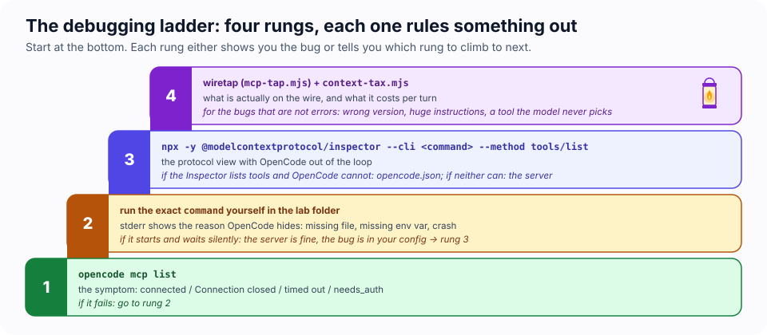

| Symptom in `opencode mcp list` | Usual cause | Fix |
|---|---|---|
| `Executable not found in $PATH` | wrong program name, or OpenCode's PATH differs from your shell's | use the full path, or install the tool |
| `MCP error -32000: Connection closed` | the process died before speaking MCP: typo in a file name, crash on startup, missing env var, syntax error | run the exact `command` yourself in the lab folder and read stderr |
| `Operation timed out after N ms` | slow cold start (`npx`/`uvx` download, Python venv) or the server waits for something | raise `timeout`, pre-warm caches, check the server isn't waiting on stdin |
| `needs_auth` / 401 | remote server wants OAuth or a header | `opencode mcp auth <name>` or add `headers` |
| 403 | the server rejects your Origin/Host (DNS-rebinding protection) | use the documented URL exactly; local HTTP servers must bind to 127.0.0.1 |
| server connected but the model "doesn't have the tool" | wrong prefix in a permission rule, server disabled per agent, or the model simply didn't pick it | name the tool in your prompt once; check `permission` patterns |
| everything connected but answers got worse | too many tools in context | disable what you don't need; prefer servers with few, well-described tools |

## 2.7 MCP tools next to built-in tools

To the model there is one flat tool list: `read`, `edit`, `bash`, `grep`, `webfetch`, … and then `time_get_current_time`, `deepwiki_ask_wiki_question`, and so on. Same loop, same permission system, same transcript rendering. The only visual difference is the `server_` prefix and the `⚙` icon. (Tools are not the only thing a server adds to the context. Exercise 2.F shows what else.)

---

## Lab 2 · Wire it up (20 minutes)

> 🎯 **Mission**
>
> - [ ] A remote server answering questions about OpenCode's own source, with nothing installed on your machine
> - [ ] The config file the wizard wrote to, found and dealt with
> - [ ] A count of the environment variables a local server can read on *your* laptop
> - [ ] Three broken servers diagnosed from their symptoms and fixed
> - [ ] A server verified with OpenCode out of the loop
> - [ ] Your per-turn context tax, in tokens

```bash
cd course/labs/lab2-configure
cat opencode.json
```

The starter config has `everything` (enabled), `env-peek` (enabled, a tiny server that reports what it can see of your environment) and three disabled `dojo-*` entries for the debugging exercise. `context-tax.mjs` is your instrument panel for later.

### 🧪 Exercise 2.A — Add a remote server by hand

Add this entry under `mcp` (keep the others):

```jsonc
"deepwiki": { "type": "remote", "url": "https://mcp.deepwiki.com/mcp", "enabled": true }
```

Run `opencode mcp list` from the lab folder. `deepwiki` should show **connected** within a couple of seconds. Start `opencode` and ask something only live documentation can answer, about the tool you are using:

> Ask DeepWiki: in the anomalyco/opencode repo, what happens when an MCP server returns a tool result? Answer in 4 bullets.

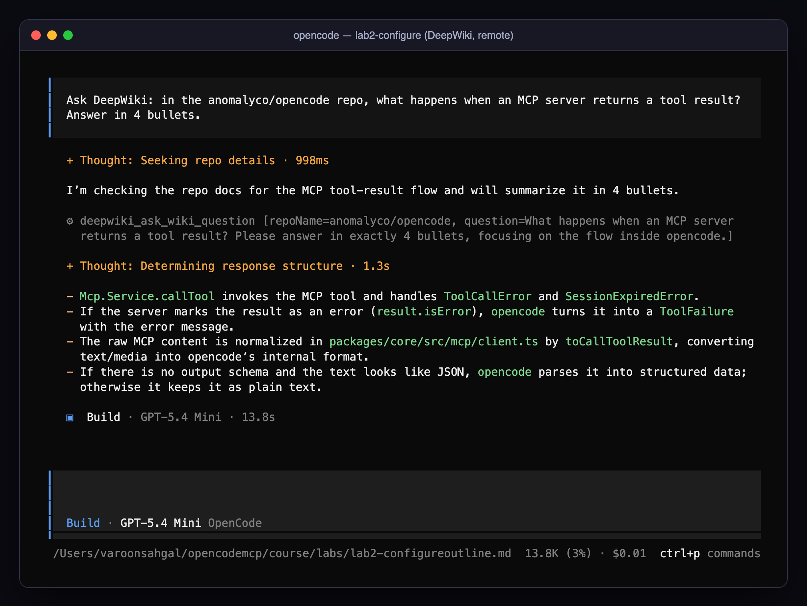

The tool is `deepwiki_ask_wiki_question`; DeepWiki's other tools are `read_wiki_structure` and `read_wiki_contents`. Nothing was installed on your machine: the server runs at DeepWiki, and your question travelled there. One line of JSON, and your agent can read the internals of any public repository.

### 🧪 Exercise 2.B — Add a server with the wizard, then find where it went

Quit OpenCode and run the interactive wizard:

```bash
opencode mcp add
```

Name it `mslearn`, choose **Remote**, URL `https://learn.microsoft.com/api/mcp`, OAuth **No**.

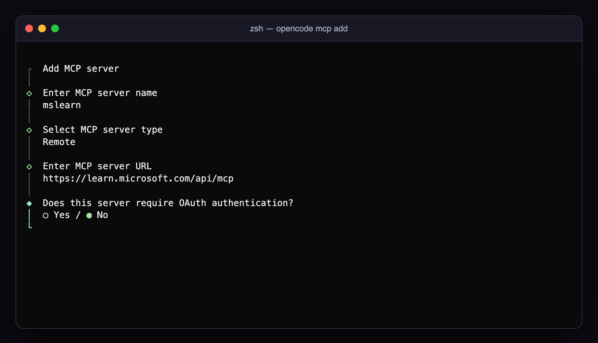

> 🔮 **Predict.** The wizard is running in your lab folder. Which file will it write `mslearn` into?

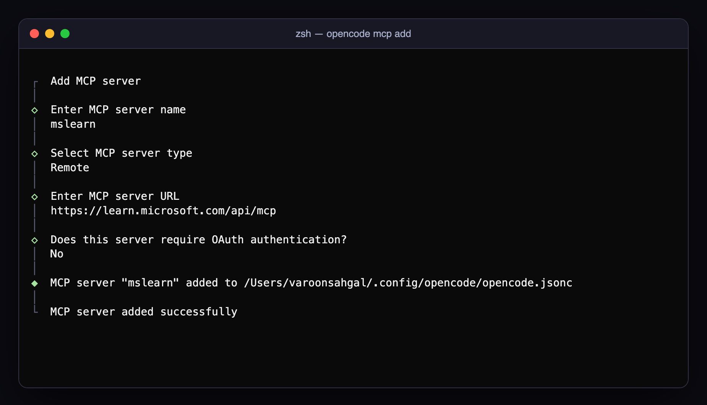

Now look at the last line of the wizard's output and at `opencode.json` in the lab folder: the entry is **not** there. It went to your global config (`~/.config/opencode/opencode.jsonc`). Confirm with:

```bash
opencode debug config | grep -A3 mslearn
```

> 🍬 **Treat: why a global file exists at all.** Global config is for servers that follow *you*: a personal notes server, your company's docs search. Project config is for servers the *project* needs, committed so that a teammate's checkout behaves like yours. The wizard assumes the first because it cannot know the second. The trap is that global servers also follow you into every project's token budget, which Exercise 2.F puts a number on.

Decide where you want it. For this course, move it into the lab's `opencode.json` (or simply delete it from the global file) so your classmates' config and yours stay reproducible. A global entry follows you into *every* project, and into every turn's context. Microsoft Learn's tools are `microsoft_docs_search`, `microsoft_docs_fetch` and `microsoft_code_sample_search`; try *"Using Microsoft Learn, what is the default timeout of an Azure Function on the Consumption plan?"*.

### 🧪 Exercise 2.C — Environment variables (and what the server can see)

In your shell, `export COURSE_SECRET=hunter2-classroom`. The config passes two variables explicitly:

```jsonc
"environment": { "DEPLOY_ENV": "classroom", "COURSE_SECRET": "{env:COURSE_SECRET}" }
```

> 🔮 **Predict.** Besides those two, how many environment variables can the `env-peek` process read? Write down a number. And how many of them are secrets?

Start `opencode` and ask: **Use peek_environment and summarise what it shows.**

The tool reports those two values, plus the **count** of every other variable the server process can see and the **names** of the ones that look like secrets.

> [!IMPORTANT]
> 🤯 **You configured two variables. The server got all of them.** On a typical developer laptop that is 60–100 variables (83 on the machine we tested with), and the names that match `TOKEN|SECRET|KEY|PASSWORD` are usually real credentials. `environment` *adds* to what a local server inherits; it never limits it. The only thing that stopped those values reaching the model was a line of code in `env-peek` that chose not to print them.

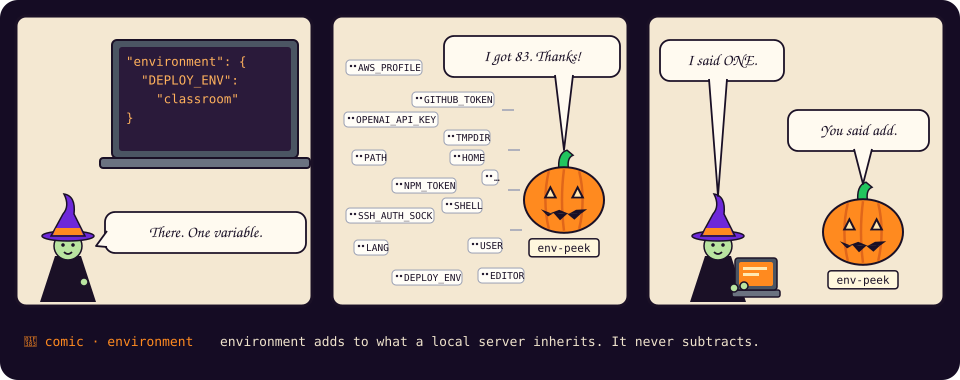

> [!WARNING]
> ⚠️ **Security:** `env-peek` chooses to print names only. The `everything` server's `get-env` tool prints every value, straight into the model's context (and therefore to the model provider). A local MCP server can read anything your shell can. Treat installing one like installing a shell script that runs as you, because that is what it is.

### 🧪 Exercise 2.D — The debugging dojo

Three servers, three different failures, one `opencode mcp list`. Enable `dojo-1`, `dojo-2` and `dojo-3` in `opencode.json` and run:

```bash
opencode mcp list
```

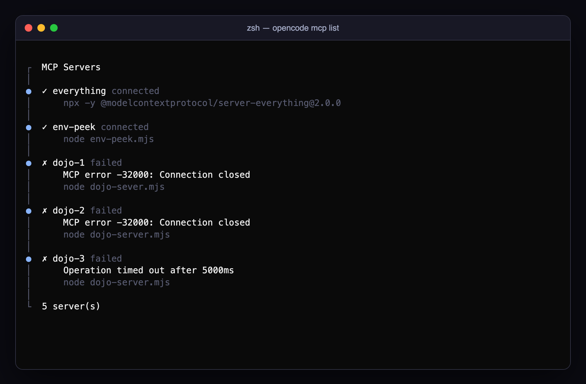

**Step 1 · Diagnose before you touch anything.** Each error message is a clue, and two of them are identical. Read each entry's `command`, `environment` and `timeout` in the config, and fill in this table on paper:

> 🔮 **Predict.**
>
> | server | symptom | my hypothesis | how I will confirm it |
> |---|---|---|---|
> | dojo-1 | `Connection closed` | | |
> | dojo-2 | `Connection closed` | | |
> | dojo-3 | `Operation timed out after 5000ms` | | |

**Step 2 · Confirm.** Run each server's `command` by hand in the lab folder (with any `environment` it has, e.g. `DOJO_API_KEY=dojo-123 node dojo-server.mjs`) and read what it prints to stderr. `opencode mcp list` does not show you stderr; your own terminal does. A healthy stdio server prints a line to stderr and then waits silently for JSON on stdin; press `Ctrl+C` to stop it.

**Step 3 · Fix, with a live board.** Open a second terminal:

> 🖥️ **Split screen**
>
> | Terminal 1 (your editor) | Terminal 2 (the board) |
> |---|---|
> | edit `opencode.json`, save | `cd course/labs/lab2-configure && node context-tax.mjs --watch` |
> | fix one server at a time | re-measures on every save: red dot → green dot |

`context-tax.mjs` connects to each enabled server exactly the way OpenCode does (spawn, `initialize`, `tools/list`) and shows the same symptoms `opencode mcp list` does. It will not tell you *why* until you ask (`--stderr`); that part is your job.

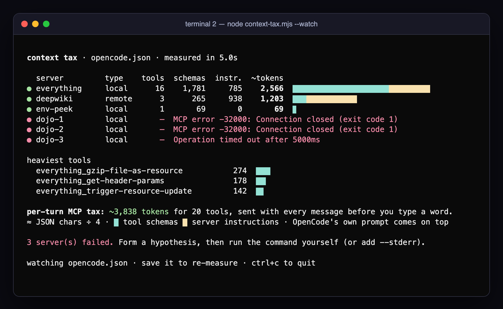

Fix the config or the file, save, watch the board. When all three dots are green, `opencode mcp list` should agree: **connected** across the board.

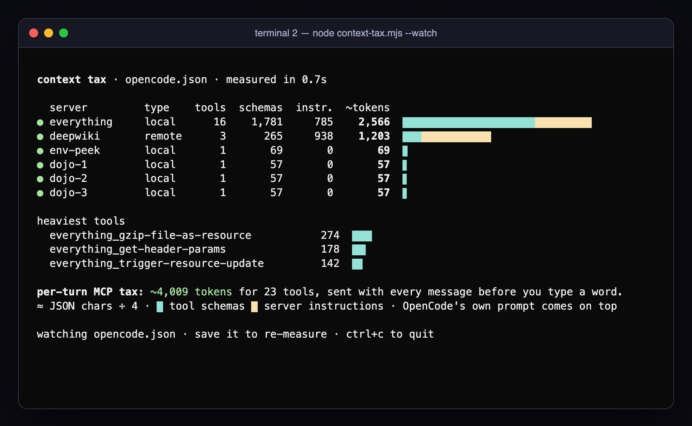

Hints, if you need them after Step 2:

<details><summary>dojo-1 · "Connection closed"</summary>

Read the command very carefully. The process never started because the file does not exist. (`node` printed the real error to stderr, which `opencode mcp list` does not show; running the command yourself does.)
</details>

<details><summary>dojo-2 · "Connection closed"</summary>

Same symptom, different cause: the server refuses to start without `DOJO_API_KEY` and exits with code 1. Add an `environment` block with that key (any value works for the dojo). Servers that fail fast on missing credentials are *good* servers; this one just needed its config.
</details>

<details><summary>dojo-3 · "Operation timed out after 5000ms"</summary>

The server pretends to warm up for 20 seconds; the entry's `timeout` is 5 000 ms. Either raise the timeout (60 000) or make the server faster (`DOJO_SLOW_MS`). Real-world versions of this: `npx` downloading a package, a Python venv being created, a server waiting on a database connection.
</details>

<details><summary>Still stuck? Let the board show you stderr</summary>

`node context-tax.mjs --all --stderr` prints the last meaningful stderr lines of every failing server. Use it to check your hypotheses, not to replace them: in production you will have `opencode mcp list` and your own terminal, not this script.
</details>

> 🔬 **Under the hood: why two different bugs print the same error.** For a stdio server, OpenCode sees exactly two pipes: it writes to stdin and reads stdout. When the process dies (missing file, missing key, crash) stdout closes, and all the client can report is `Connection closed`. The *reason* went to stderr, which OpenCode does not show in `opencode mcp list`. A timeout is the opposite: the process is alive but silent, and the client gives up waiting for the `initialize` reply. So there are two symptoms and many causes, and the fastest debugger is the one you used in Step 2: run the exact command yourself and read stderr.

### 🧪 Exercise 2.E — Verify without OpenCode

The MCP Inspector is the protocol's reference debugging tool. Its CLI mode talks to any server directly:

```bash
npx -y @modelcontextprotocol/inspector --cli node env-peek.mjs --method tools/list
npx -y @modelcontextprotocol/inspector --cli node env-peek.mjs --method tools/call --tool-name peek_environment
npx -y @modelcontextprotocol/inspector --cli https://mcp.deepwiki.com/mcp --transport http --method tools/list
```

(Without `--cli` it opens a web UI on `localhost:6274` with the same capabilities and a form for every tool.) If the Inspector can list tools and OpenCode cannot, the problem is in your `opencode.json`; if neither can, the problem is in the server.

### 🧪 Exercise 2.F — The context tax, measured (4 minutes)

Every message you send carries the whole tool catalogue. Time to put a price on it.

> 🔮 **Predict.** With `everything` and `env-peek` enabled, how many extra tokens does MCP add to *every* turn, before the model does anything useful? 200? 2,000? 20,000? And which of the two servers costs more?

1. In the TUI, `/new` and ask *"Reply with the single word OK."* Note the token count in the footer.
2. Disable every server in `/mcps`, `/new`, ask again. The difference is the per-turn price of your MCP setup.
3. Now look at terminal 2 (or run `node context-tax.mjs` once). It prices each server separately: **tool schemas** in cyan, **server instructions** in yellow.

<details><summary>Our run (OpenCode 1.18, gpt-5.4-mini)</summary>

| Setup | Input tokens for "OK" | MCP share |
|---|---|---|
| no MCP servers | 9,640 | — |
| `everything` + `env-peek` (starter) | 11,756 | **+2,116** |
| `deepwiki` alone | 10,881 | **+1,241** |

`context-tax.mjs` estimated 2,635 and 1,203 for the same setups. It counts characters ÷ 4, so it lands within about a quarter of the real number; the footer is the ground truth, the board tells you *which server* to blame.
</details>

> [!IMPORTANT]
> 🤯 **DeepWiki's three tools cost about 265 tokens. DeepWiki costs you about 1,200.** The rest is the `instructions` string the server returns from `initialize`: 3,700 characters, including descriptions of `devin_*` tools you do not even have. OpenCode puts server instructions into the model's context on every turn. We confirmed it with a test server whose instructions contained a codeword: the model recited the codeword without calling a single tool. So a server writes into your system prompt the moment it connects, before any tool is called and before any permission rule applies. Keep that in mind for Module 4.

Now you know what "enable only what you need" costs in numbers, and where to look when a session feels slow or expensive.

### 🏅 Mission complete

- **Remote in one line.** You plugged a hosted MCP server into your agent with a URL and nothing else.
- **Saw through the layers.** You found a config entry where you didn't put it, and know `opencode debug config` will find the next one.
- **Debugged like an operator.** Three failures diagnosed from symptoms, confirmed from stderr, fixed and verified, and a board that proved it in real time.
- **Priced your setup.** You can say, in tokens, what each server adds to every turn, and you know servers can write into the prompt itself.
- **Know what the errors mean.** `Connection closed` means the process died, a timeout means it went silent, and remote errors say `SSE` even when SSE is not the problem.

### ✅ Check yourself

<details><summary>1. You wrote <code>"command": "npx -y @modelcontextprotocol/server-everything"</code>. What happens, and why?</summary>

`command` must be an array (`["npx", "-y", "@modelcontextprotocol/server-everything@2.0.0"]`). There is no shell parsing; each argument is passed verbatim. Worse, OpenCode 1.18 does not complain about a string: it quietly drops the entry, so the server is simply missing from `opencode mcp list` (Challenge 2B). Keep `"$schema"` at the top of the file so your editor flags it as you type.
</details>

<details><summary>2. You removed a server from the project <code>opencode.json</code> but it still connects. Where is it?</summary>

In another config layer: global (`~/.config/opencode/opencode.json`), `OPENCODE_CONFIG`, an organisation default, or managed config. `opencode debug config` shows the merged result.
</details>

<details><summary>3. A local server needs an API key. Name two ways to provide it without writing the key into <code>opencode.json</code>.</summary>

`"environment": { "API_KEY": "{env:MY_API_KEY}" }` (read from your shell) or `"{file:~/.secrets/my-api-key}"` (read from a file). Both keep the committed file secret-free.
</details>

<details><summary>4. What does a remote server receive that a local one does not, and vice versa?</summary>

A remote server receives your tool arguments over the network and runs with *its* credentials and infrastructure; it never sees your environment or files. A local server sees your whole environment and filesystem but nothing leaves your machine unless its code sends it.
</details>

<details><summary>5. You add a server with two small tools, and your per-turn token count jumps by over a thousand. What is the likely cause, and how would you confirm it?</summary>

The server returns a long `instructions` string from `initialize`, which OpenCode adds to the context on every turn. `node context-tax.mjs` shows it in the `instr.` column; the Inspector or the Lab 1 wiretap shows the raw `initialize` response.
</details>

### 🏆 Challenge 2A — Scope a server to one agent (10 minutes, optional)

Create a `docs` agent that is the **only** agent allowed to use the `deepwiki` and `mslearn` tools; the default `build` agent must be refused when it tries. Do it with Markdown agent files under `.opencode/agents/` plus a `permission` block, verify by switching agents with `Tab` and asking the same question twice, and write down which permission rule did the work. Bonus: make the `docs` agent unable to edit files or run shell commands.

### 🏆 Challenge 2B — Black-belt dojo (15 minutes, harder)

The first dojo's failures announced themselves. These three are the ones that eat an afternoon: one works in your shell and not in OpenCode, one has an error message that points the wrong way, and one gives you no error at all. Add them under `mcp` in the lab's `opencode.json`:

```jsonc
"dojo-4": { "type": "local", "command": ["node", "dojo-server.mjs"], "enabled": true,
            "environment": { "DOJO_API_KEY": "{env:DOJO_KEY}" } },
"dojo-5": { "type": "remote", "url": "https://mcp.deepwiki.com/mpc", "enabled": true },
"dojo-6": { "type": "local", "command": "node dojo-server.mjs", "enabled": true,
            "environment": { "DOJO_API_KEY": "dojo-123" } }
```

Now set the key the way a hurried person would, in the **same shell** you will start OpenCode from, and check:

```bash
DOJO_KEY=dojo-123
opencode mcp list
```

> 🔮 **Predict** for each server: connected or failed, and with what message? One of the three will surprise you by not appearing at all.

Rules: the hypothesis table first, as in 2.D, then one fix per server, and each fix must be the **smallest correct change**. Done when all three say **connected** in `opencode mcp list`. Then answer:

1. `dojo-4`: `echo $DOJO_KEY` prints the key. Why does the server not get it? Where exactly is `{env:…}` resolved, and when?
2. `dojo-5`: the message says `SSE error`. Is SSE the problem? What is?
3. `dojo-6`: which command shows you what OpenCode actually did with this entry?

<details><summary>Nudges (open one at a time)</summary>

- `dojo-4`: a shell variable and an *exported* environment variable are not the same thing. Child processes only inherit the second kind.
- `dojo-5`: read the URL letter by letter. Then reread the 🔬 box in 2.4 about the fallback transport.
- `dojo-6`: `opencode debug config | grep -A4 dojo-6`.
</details>

📼 **Next episode.** So far every server has been someone else's code, configured by you. Next you write one: a few dozen lines of TypeScript that turn *"should I bring an umbrella?"* into a live API call the model chose to make on its own.

[Module 3 · Building a custom MCP server →](03-building-a-custom-mcp-server.md)
