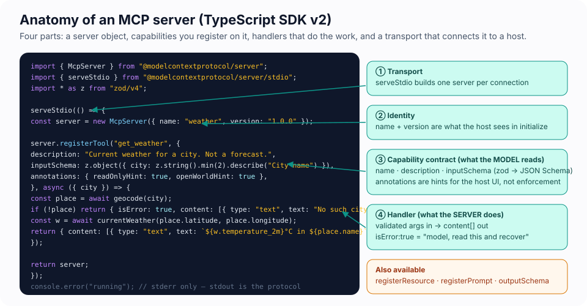
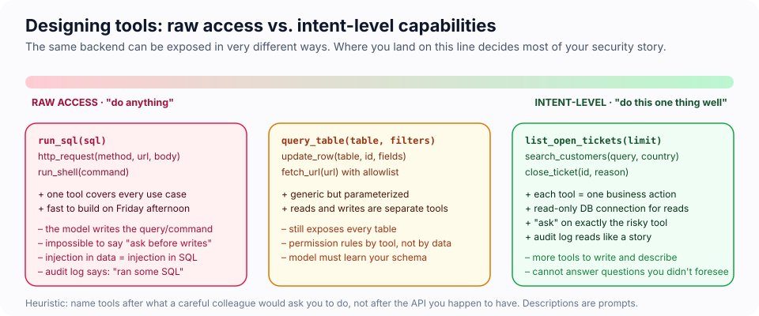
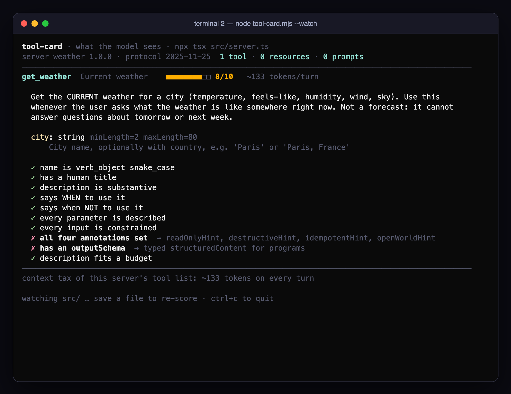
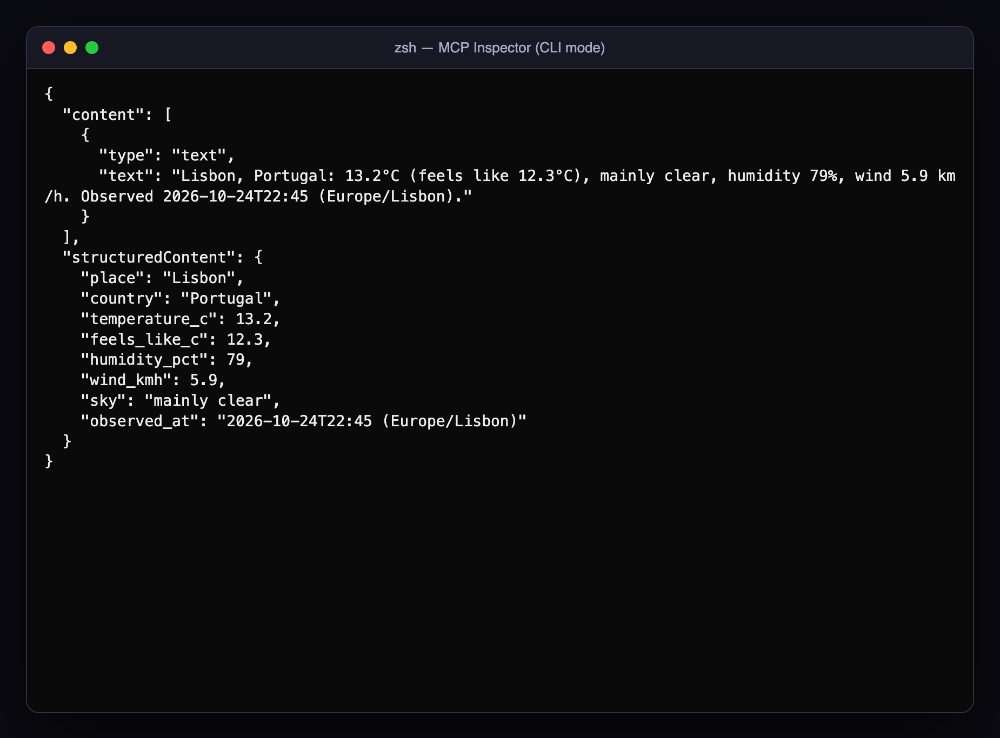
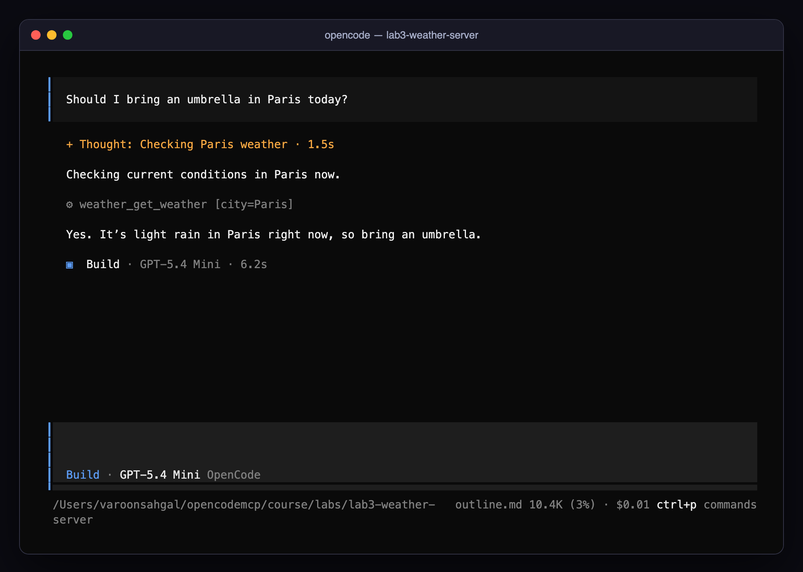
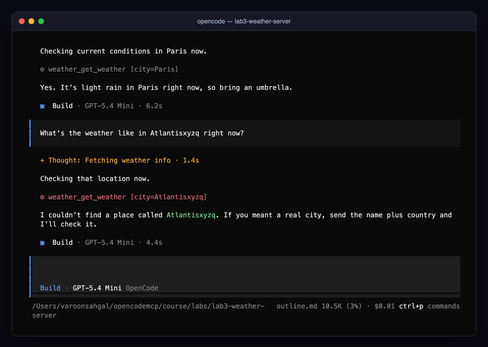
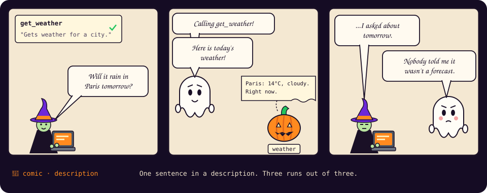
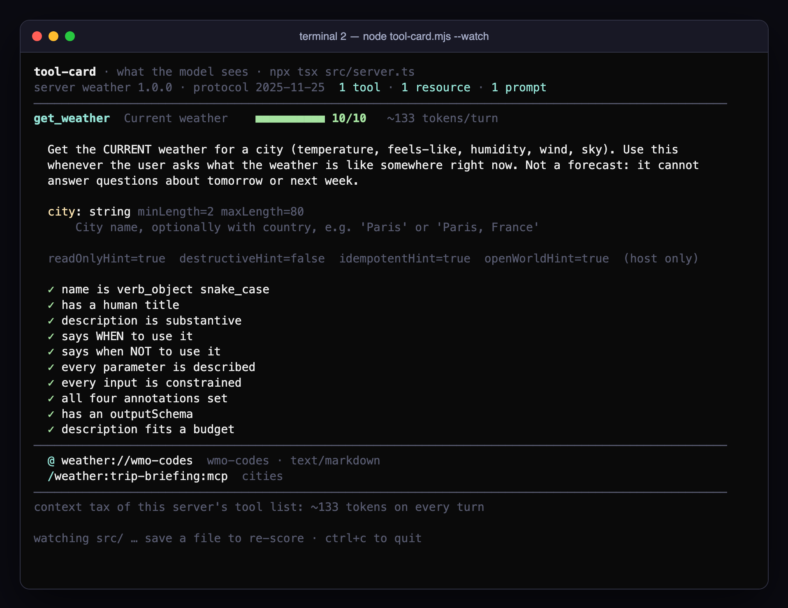

# Module 3 · Building a Custom MCP Server

| | |
|---|---|
| **Time** | 55 minutes (15 concepts · 40 lab) |
| **Lab folder** | `course/labs/lab3-weather-server` |
| **You will** | build a TypeScript MCP server that wraps a real public API (Open-Meteo, no key needed), test it with the Inspector, register it in OpenCode, and invoke it in plain English |
| **You'll pull off** | a model you have never met finds your tool, from a question that never names it, and calls it with the right arguments. Then you change one sentence and watch it behave differently, 3 runs out of 3. |

> 🎬 **Cold open.** In about forty minutes someone will type *"Should I bring an umbrella in Paris today?"* into OpenCode. The model will look through every tool it has, pick a function you wrote, invent the right argument, call it, and read your reply. It will never see your code. It sees a name, a paragraph of prose and a JSON Schema, and it makes its decision on those alone. Your TypeScript decides what the tool *does*. Your words decide *whether it ever gets called*. This module is about writing both.

## 3.1 Anatomy of a server



With the TypeScript SDK v2 (`@modelcontextprotocol/server`), a server is four things:

1. **A transport.** `serveStdio(factory)` runs your factory once per connection and wires the result to stdin/stdout. (Remote servers use `createMcpHandler` behind an HTTP framework instead; same `McpServer` object.)
2. **An identity.** `new McpServer({ name, version })`, reported during `initialize`.
3. **Capabilities.** `registerTool`, `registerResource`, `registerPrompt`. Each has a name, metadata the *model* (or user) reads, and a schema.
4. **Handlers.** Async functions that receive validated arguments and return `{ content: [...] }`.

Schemas are **zod v4** objects; the SDK converts them to JSON Schema for the wire and validates incoming arguments *before* your handler runs. Logging goes to `console.error`, never `console.log`.

> 🍬 **Treat: the cast, so the imports make sense.** Three packages do the work. `@modelcontextprotocol/server` is the MCP TypeScript SDK, version 2 (version 1 lived in a single package called `@modelcontextprotocol/sdk`, which is what most blog posts still show). `zod` is a schema library: describe a shape once and you get both a TypeScript type and runtime validation. `tsx` runs TypeScript directly with no build step, which is why the command in `opencode.json` is `npx tsx src/server.ts`. One more thing that looks odd: `serveStdio` takes a *factory* even though a stdio server only ever has one client. That is on purpose. Module 6 hands the same factory to an HTTP server, which runs it once per connection.

## 3.2 Designing capabilities worth exposing



The model chooses tools by reading their names, descriptions and schemas. Design them the way you would brief a careful colleague. In the lab, `tool-card.mjs` scores your tool against exactly these rules, live, every time you save.

- **Expose intent, not plumbing.** `get_weather(city)` rather than `http_get(url)`. Raw-access tools (`run_sql`, `run_shell`, `fetch_any_url`) push every decision onto the model and make permissions meaningless. Module 4 shows the blast radius.
- **Name for the verb.** `snake_case`, a verb plus an object, under 64 characters: `list_open_tickets`, `acknowledge_incident`. The spec's naming guidance (SEP-986) recommends exactly this.
- **Write descriptions as instructions.** Say what the tool does, *when to use it*, and *when not to*: "Current weather for a city. Not a forecast: cannot answer questions about tomorrow." Describe each parameter with `.describe()`. Mention units and formats.
- **Constrain inputs.** `z.enum([...])`, `.min()`, `.max()`, `.regex()`. Every constraint is one less way for a confused model (or a confused *deputy*, Module 4) to do harm.
- **Separate reads from writes.** One tool per business action. A read-only tool can be auto-approved; a write tool can be gated. A tool that does both can only be gated as a whole.
- **Annotate.** `annotations: { readOnlyHint, destructiveHint, idempotentHint, openWorldHint }` tell hosts how to present the tool. They are hints; hosts must treat them as untrusted. Set them honestly anyway.

> 🍬 **Treat: `name` is for machines, `title` is for people.** The model calls the `name`, permission rules match it, and the host prefixes it with the server's name. The optional `title` is what a UI may show a human instead: *Current weather* where the transcript says `weather_get_weather`. Write both, and never let the title carry a fact the description does not, because the model may never see it.

## 3.3 Inputs and outputs

A tool result is `{ content: ContentPart[], structuredContent?, isError? }`:

| Part | Shape | Notes |
|---|---|---|
| text | `{ type: "text", text }` | what the model reads; keep it short and information-dense |
| image / audio | `{ type: "image", data: <base64>, mimeType }` | OpenCode can show images from tools |
| resource_link | `{ type: "resource_link", uri, name }` | point to a resource instead of inlining it |
| embedded resource | `{ type: "resource", resource: { uri, text\|blob } }` | inline a resource's contents |

`outputSchema` + `structuredContent` give *programs* a typed result alongside the prose the model reads. The SDK validates `structuredContent` against the schema. OpenCode shows the text part in the transcript; if there is no output schema and the text looks like JSON, it parses it so it can render it nicely.

> [!TIP]
> 💡 **Insight: your tool's output is somebody's prompt.** Everything you return is pasted into the model's context, where it costs tokens and can *steer* the model. Return the fields that answer the question, not the whole upstream JSON. A 40 KB API response is both a waste and an attack surface.

> 🍬 **Treat: why say the same thing twice?** `content` and `structuredContent` carry the same facts because they have different readers. The model only ever reads `content`, and clients that predate `outputSchema` read nothing else. `structuredContent` is for code: the host, a test harness, or another tool that wants to chain on the result without parsing prose. The spec asks a server that declares an `outputSchema` to always send the structured copy, and the SDK checks that it matches.

## 3.4 Errors the model can recover from

Two error channels, chosen by audience:

- **Tool execution error** → `return { isError: true, content: [{ type: "text", text: "No place called 'Atlantis'. Try adding the country." }] }`. A successful JSON-RPC result that the *model* reads. It will retry, ask the user, or explain. Put the recovery hint in the text; it is the only thing the model has to work with. Thrown exceptions inside a tool handler are converted to this form automatically.
- **Protocol error** → thrown `ProtocolError` from resource/prompt callbacks, or produced by the SDK for malformed requests. A JSON-RPC error the model never sees; it is addressed to the client's code.

Invalid arguments never reach your handler: the SDK answers with an `isError` result describing the schema violation, which is exactly what lets the model self-correct.

> 🔬 **Under the hood: the two channels on the wire.** You sent both kinds by hand in Exercise 1.E. Side by side:
>
> ```jsonc
> // protocol error: a JSON-RPC "error". The client's code handles it; the model may never see it.
> {"jsonrpc":"2.0","id":6,"error":{"code":-32602,"message":"Tool get_weather not found"}}
> // tool error: a successful "result" that says it failed. Goes into the model's context, word for word.
> {"jsonrpc":"2.0","id":4,"result":{"isError":true,"content":[{"type":"text","text":"Unknown timezone 'Mars/Olympus_Mons'. Use an IANA name like 'Europe/Paris'."}]}}
> ```
>
> The rule of thumb: if a smarter *model* could fix it (wrong city, missing country, try again later), return `isError` with a hint. If only a *programmer* could fix it (no such method, malformed JSON), it is a protocol error, and the SDK produces those for you.

## 3.5 Talking to the outside world

`fetch` with `AbortSignal.timeout(8000)`, check `res.ok`, map the response to a compact shape, and never put credentials into the result text. Rate limits and transient failures are part of normal life: fail with an `isError` message that says *what to do next* ("try again in a minute"), not a stack trace.

> 🍬 **Treat: the API behind the lab.** Open-Meteo aggregates national weather services and needs no key for non-commercial use, which is why the lab can call it with no secrets at all. Its geocoding endpoint turns *Paris* into coordinates (the starter's `geocode()` helper wraps it), and its forecast endpoint takes those coordinates and a list of variables. Real APIs usually want a key: that is Module 2's `{env:…}` pattern, and Module 5 shows a server failing closed when the key is missing.

## 3.6 Register, discover, test, iterate

1. Add the server to `opencode.json` (`"command": ["npx", "tsx", "src/server.ts"]`).
2. `opencode mcp list` → **connected**.
3. Discovery: `npx -y @modelcontextprotocol/inspector --cli npx tsx src/server.ts --method tools/list` shows exactly what the model will see. (`node tool-card.mjs` shows the same thing as a scored card.)
4. Execution through the protocol: Inspector `tools/call`.
5. Execution through *language*: in OpenCode, ask the question a user would ask, without naming the tool. If the model does not pick the tool, your description is the bug.
6. After every code change, restart OpenCode (it spawns the server at startup). Toggling the server off and on in `/mcps` also respawns it.

> [!WARNING]
> ⚠️ **Six ways a first server goes wrong**, in the order people usually hit them:
> 1. **`console.log` for logging** (Module 1.4). Symptom: `Connection closed`, or `✗ not JSON on the protocol channel` in the wiretap.
> 2. **Not restarting OpenCode** after a change. Symptom: the model keeps seeing yesterday's description, and you blame the model.
> 3. **A vague description.** Symptom: the model answers from memory, or calls the tool for a question it cannot answer (Exercise 3.B).
> 4. **Returning the whole upstream payload.** Symptom: tokens, and a model steered by fields it should never have seen (3.3).
> 5. **Swallowing errors**: `catch { return { content: [{ type: "text", text: "" }] } }`. Symptom: the model reads an empty result as *no data* and carries on confidently. Fail closed with `isError` (Module 5 makes this a rule).
> 6. **No timeout on `fetch`.** Symptom: one slow upstream call pins the whole turn until OpenCode's `timeout` gives up.

---

## Lab 3 · The weather server (40 minutes)

### 🎯 Mission

- [ ] Ship `get_weather`, a tool that wraps a real API, and see it in the Inspector
- [ ] Get it called from a question that never mentions it
- [ ] Watch the model recover from your error message instead of inventing a forecast
- [ ] Break your description on purpose and measure what changes
- [ ] Take your tool card from 0 tools to **10/10**
- [ ] Add a resource and a prompt, so your server offers all three primitives

### 🖥️ Split screen

Open two terminals in the lab folder. Terminal 2 watches your server the way the model will see it, and redraws every time you save.

| Terminal 1 · you | Terminal 2 · the model's-eye view |
|---|---|
| your editor, `opencode`, the Inspector | `node tool-card.mjs --watch` |

```bash
cd course/labs/lab3-weather-server
cat src/server.ts             # helpers are done; the server has TODOs
opencode mcp list             # "weather" connects already — with zero tools
node tool-card.mjs --watch    # in terminal 2: leave it running
```

The starter compiles and connects, which is the point: a server with no capabilities is still a valid server. Terminal 2 agrees:

```
tool-card · what the model sees · npx tsx src/server.ts
server weather 0.1.0 · protocol 2025-11-25  0 tools · 0 resources · 0 prompts

0 tools. A valid server with nothing to offer: the model sees nothing here.
Register a tool (TODO 1) and save; this card fills in.
```

`tool-card.mjs` is about 150 lines with no dependencies: it starts your server, sends `initialize` and `tools/list` as raw JSON-RPC, and scores each tool against the rules in 3.2. Read it if you are curious; it is the client half of what you are about to build. The Inspector gives you the same discovery view without the score:

```bash
npx -y @modelcontextprotocol/inspector --cli npx tsx src/server.ts --method tools/list
```

### 🧪 Exercise 3.A — TODO 1: your first tool (12 minutes)

Inside `serveStdio(() => { … })`, after `const server = …`, register `get_weather`:

```ts
server.registerTool(
  "get_weather",
  {
    title: "Current weather",
    description:
      "Get the CURRENT weather for a city (temperature, feels-like, humidity, wind, sky). " +
      "Use this whenever the user asks what the weather is like somewhere right now. " +
      "Not a forecast: it cannot answer questions about tomorrow or next week.",
    inputSchema: z.object({
      city: z.string().min(2).max(80).describe("City name, optionally with country, e.g. 'Paris' or 'Paris, France'"),
    }),
  },
  async ({ city }) => {
    const place = await geocode(city);
    if (!place) {
      return {
        isError: true,
        content: [{ type: "text", text: `No place called '${city}' was found. Try adding the country, e.g. 'Springfield, US'.` }],
      };
    }
    const w = await currentWeather(place.latitude, place.longitude);
    const sky = WMO[w.weather_code] ?? `weather code ${w.weather_code}`;
    const text =
      `${place.name}, ${place.country}: ${w.temperature_2m}°C (feels like ${w.apparent_temperature}°C), ${sky}, ` +
      `humidity ${w.relative_humidity_2m}%, wind ${w.wind_speed_10m} km/h. Observed ${w.time} (${place.timezone}).`;
    return { content: [{ type: "text", text }] };
  },
);
```

> 🔬 **Under the hood: the model never sees zod.** The SDK turns your schema into JSON Schema (draft 2020-12), and that is what `tools/list` sends. Your `city` line becomes:
>
> ```json
> "city": { "type": "string", "minLength": 2, "maxLength": 80,
>           "description": "City name, optionally with country, e.g. 'Paris' or 'Paris, France'" }
> ```
>
> plus `"required": ["city"]` on the object. `.describe()` becomes `description` (prose the model reads); `.min()`/`.max()` become `minLength`/`maxLength`, constraints the model *usually* honours and the SDK *always* enforces. Add `.default(3)` to a field and it drops out of `required` and carries `"default": 3`. The Inspector's `tools/list` shows you the real thing; check it whenever a model "ignores" a constraint.

> 🔮 **Predict.** Before you save: out of 10, what will terminal 2 score this tool? Which checks will fail? Write your guess down, then save.

<details><summary>Our run</summary>

**8/10.** Everything about the *words* passes. What fails is the metadata you have not written yet: annotations and an output schema, which are exactly TODO 2. Note the cost too: about 133 tokens, paid on every turn of every conversation that has this server enabled.


</details>

Test it through the protocol first, no model involved:

```bash
npx -y @modelcontextprotocol/inspector --cli npx tsx src/server.ts --method tools/list
npx -y @modelcontextprotocol/inspector --cli npx tsx src/server.ts --method tools/call --tool-name get_weather --tool-arg city=Paris
npx -y @modelcontextprotocol/inspector --cli npx tsx src/server.ts --method tools/call --tool-name get_weather --tool-arg city=Atlantisxyzq   # look for "isError": true
```



Now the real test. Start `opencode` and ask, without naming the tool: **Should I bring an umbrella in Paris today?**



> [!IMPORTANT]
> 🤯 **Nobody told it to.** You never said "weather", "tool" or `get_weather`. The model read about 133 tokens of your name, prose and schema, matched "umbrella" to "what the weather is like somewhere right now", picked `city=Paris` out of the sentence, and called a function on your laptop that called a live API. Every MCP integration you will ever use works like this, and the description you just wrote is what made it happen.

Then: **What's the weather like in Atlantisxyzq right now?** Watch the model read your `isError` text and respond sensibly instead of hallucinating a forecast.



### 🧪 Exercise 3.B — Sabotage your description (5 minutes)

Your description is a routing rule written in English. Time to prove it. In OpenCode, `/new`, then ask: **What will the weather be in Paris tomorrow afternoon?**

Now quit OpenCode and sabotage the tool. Replace the whole `description:` value with `"Gets weather for a city."` and delete the `.describe(…)` on `city`. Save, glance at terminal 2, restart `opencode` and ask the same question.

> 🔮 **Predict.** For each version: does the model call `weather_get_weather`? And what score does terminal 2 give the sabotaged tool?

<details><summary>Our runs (gpt-5.4-mini, 3 runs per version, repeated on two different days with the same result)</summary>

| Version | tool-card | Tokens per turn | Called `get_weather`? | What the user got |
|---|---|---|---|---|
| Your description from 3.A | 8/10 | ~133 | **0 of 3** | "I can't forecast tomorrow's weather. I can only get the current weather right now for Paris." |
| `"Gets weather for a city."` | 4/10 | ~60 | **3 of 3** | a wasted call for *today's* weather, then a web search for the forecast |
</details>

> [!IMPORTANT]
> 🤯 **One sentence changed the model's behaviour, 3 times out of 3.** No code changed, and the handler is identical. "Not a forecast" was enough to stop a pointless call, and deleting it made the model use the tool for a question it cannot answer. The cheaper description saved 73 tokens a turn and bought a wrong call every time. The flip side is just as telling: with the good description, the model told the user it could not forecast instead of looking elsewhere. Descriptions steer hard, in both directions. Test them like code.



Put the original description and `.describe()` back (undo in your editor) and confirm terminal 2 shows **8/10** again.

### 🧪 Exercise 3.C — TODO 2: annotations and structured output (8 minutes)

Add to the tool's config object:

```ts
outputSchema: z.object({
  place: z.string(), country: z.string(), temperature_c: z.number(), feels_like_c: z.number(),
  humidity_pct: z.number(), wind_kmh: z.number(), sky: z.string(), observed_at: z.string(),
}),
annotations: { readOnlyHint: true, destructiveHint: false, idempotentHint: true, openWorldHint: true },
```

and return `structuredContent` next to `content`:

```ts
const structured = { place: place.name, country: place.country, temperature_c: w.temperature_2m, feels_like_c: w.apparent_temperature,
  humidity_pct: w.relative_humidity_2m, wind_kmh: w.wind_speed_10m, sky, observed_at: `${w.time} (${place.timezone})` };
return { content: [{ type: "text", text }], structuredContent: structured };
```

Save and watch terminal 2 fill the bar:



The token count did **not** go up. Annotations and the output schema are for the host and for programs; only the name, description and input schema are pasted into the model's context.

Re-run the Inspector `tools/call`: the result now carries both the prose and the typed object. Deliberately break the schema (return `temperature_c: "warm" as any`) and call it again. The SDK refuses to send your own output: the result becomes `isError: true` with *"Output validation error: Invalid structured content for tool get_weather: temperature_c: Invalid input: expected number, received string"*. Validation protects consumers from you, too. Fix it back.

### 🧪 Exercise 3.D — TODO 3: a resource and a prompt (10 minutes)

A resource for the lookup table (user attaches it with `@`), and a prompt that encodes a workflow (user runs it with `/`):

```ts
server.registerResource(
  "wmo-codes", "weather://wmo-codes",
  { title: "WMO weather codes", description: "Lookup table of WMO weather interpretation codes used by Open-Meteo.", mimeType: "text/markdown" },
  async (uri) => ({
    contents: [{ uri: uri.href, mimeType: "text/markdown",
      text: "| code | meaning |\n|---|---|\n" + Object.entries(WMO).map(([c, m]) => `| ${c} | ${m} |`).join("\n") }],
  }),
);

server.registerPrompt(
  "trip-briefing",
  { title: "Trip briefing", description: "Compare current weather across the cities of a trip and give packing advice.",
    argsSchema: z.object({ cities: z.string().describe("Comma-separated list of cities, e.g. 'Oslo, Cairo, Sydney'") }) },
  ({ cities }) => ({
    messages: [{ role: "user" as const, content: { type: "text" as const,
      text: `I am travelling to: ${cities}. For each city call get_weather, then produce a one-line summary per city, ` +
            `rank them warmest to coldest, and finish with three concrete packing tips.` } }],
  }),
);
```

Terminal 2 now lists `@ weather://wmo-codes` and `/weather:trip-briefing:mcp` under your tool card: one server, all three primitives. (The `:mcp` suffix is how the TUI labels a server prompt. If you script it with `opencode run --command`, the name is `weather:trip-briefing`.) Check with the Inspector too (`--method resources/list`, `--method resources/read --uri weather://wmo-codes`, `--method prompts/list`), restart OpenCode, then type `@wmo` to attach the table and `/weather:trip-briefing:mcp` to run the prompt with `Oslo, Cairo, Sydney, Reykjavik`. Watch the model make four tool calls, in parallel.

### 🎲 Fun — Weather roulette (5 minutes)

- Ask: *"Which is warmer right now, the hottest city in Scandinavia you can think of or the coldest city in Africa?"* Count the tool calls and judge the model's planning.
- Ask for the weather in a city that exists twice (*"Springfield"*, *"Paris, Texas"*). Does your description help the model disambiguate, or do you need a `country` parameter? Add one if you like, and keep terminal 2 at 10/10 while you do.
- **Description golf.** What is the shortest description that still scores 10/10 *and* still makes the model decline the forecast question in 3.B? Compare token counts with your neighbours.

### 🏅 Mission complete

- **You built a tool a model picks on its own**, from a question that never named it.
- **You measured what one sentence of prose is worth**: the difference between a correct refusal and a wrong call, three runs out of three.
- **You went from 0 tools to a 10/10 tool card** and a server that offers all three primitives.
- **You know which error goes to whom**: `isError` for the model, protocol errors for the client's code, and output validation that catches your own bugs.

### ✅ Check yourself

<details><summary>1. The model keeps answering weather questions from memory instead of calling your tool. Where is the bug?</summary>

Almost always in the description: make it say *when* to use the tool ("whenever the user asks what the weather is like somewhere right now"). Also confirm the server is connected (`/status`) and that no permission rule denies `weather_*`.
</details>

<details><summary>2. Why return <code>isError: true</code> instead of throwing for an unknown city?</summary>

Both end up as a tool error the model can read, but the explicit form lets you write the recovery hint ("add the country"). A thrown error gives the model only the exception message.
</details>

<details><summary>3. Your tool returns the full 30 KB Open-Meteo JSON "so the model has everything". What are the two costs?</summary>

Tokens on every turn that carries the result (money and context budget), and attack surface: everything in that JSON becomes part of the prompt and can steer the model. Return what answers the question.
</details>

<details><summary>4. What does <code>readOnlyHint: true</code> enforce?</summary>

Nothing. It is a hint for hosts (icons, default approval policies). Enforcement is your code: no write path exists in a read-only tool, and the host's permission rules decide what is auto-approved.
</details>

<details><summary>5. In 3.B the shorter description saved 73 tokens a turn. Why was it still the more expensive choice?</summary>

It bought a tool call that could not answer the question (a round trip to Open-Meteo plus the result in context), and then a web search on top. Per-turn tokens are only part of the cost; wrong calls cost more. The words that tell the model when *not* to use a tool are the cheapest tokens you will ever spend.
</details>

### 🏆 Challenges (optional)

Score your challenge servers with `node tool-card.mjs -- npx tsx <path-to-server.ts>` before you show them to anyone.

**3A · Dad jokes as a service (easy, 10 min).** Build a second server, `jokes`, with one tool `get_dad_joke(topic?)` backed by `https://icanhazdadjoke.com/` (send `Accept: application/json`; the search endpoint is `/search?term=…`). Add an `outputSchema`, honest annotations, and an `isError` for "no jokes about that". Register it next to `weather` and ask OpenCode for a joke about computers.

**3B · A system utility with a fence (medium, 15 min).** Build `sysinfo` with `get_system_info()` (OS, CPUs, memory, uptime; no environment variables) and `largest_files(dir, limit)` that lists the biggest files under a directory. The catch: `dir` must be relative to the project and the tool must refuse anything that escapes it (`../../`), with an `isError` that says so. Prove it with the Inspector before you prove it with OpenCode.

**3C · Two tools, one topic (harder, 20 min).** Exercise 3.B proved one sentence can keep a model *away* from a tool. Now make it choose *between* two. Add `get_forecast(city, days)` to your weather server: Open-Meteo's `/v1/forecast` with `daily=weather_code,temperature_2m_max,temperature_2m_min,precipitation_probability_max` and `forecast_days`; `days` an integer 1–7 with `.default(3)`; an `outputSchema` with one row per day. Then edit the one line of `get_weather` that says "Not a forecast" so it points to the new tool instead of refusing. Both tools must stay at 10/10 on terminal 2. They share an API, an argument name and a topic; only your words separate them. Route these correctly, in a fresh session each:

| Prompt | Should call |
|---|---|
| *Should I bring an umbrella in Paris today?* | `get_weather` |
| *What will the weather be in Paris tomorrow afternoon?* | `get_forecast` |
| *Is it colder in Oslo or Helsinki right now?* | `get_weather` (twice) |
| *I'm hiking near Zermatt this weekend. Pack shorts or a down jacket?* | `get_forecast` |

Then try to break it: find a prompt that sits on the line between the two tools (*"this evening"*? *"tonight"*?) and decide which tool *should* win. Then make your descriptions say so.

**3D · Unit tests for words (hard, 25 min).** Checking 3C by hand does not scale, and descriptions regress like code. Write `route-eval.mjs`: it reads `cases.json` (`[{ "prompt": "…", "expect": "get_forecast" }, { "prompt": "…", "expect": "none" }]`), runs each prompt N times with `opencode run "<prompt>"` in the lab folder (stdin closed, or it hangs), pulls the tool names out of the `⚙ server_tool …` lines, scores the **first MCP tool** of each run against `expect`, prints a table and an accuracy figure, and **exits non-zero** if anything misses. Run 2–3 prompts in parallel; each run is a real model call (about a cent).

```
prompt                                                     expect         result
Should I bring an umbrella in Paris today?                 get_weather    3/3 ✓
What will the weather be in Paris tomorrow afternoon?      none           0/3 ✗ got get_weather

routing accuracy: 3/6 (50%)
```

That table is the 3.B sabotage, caught automatically. Prove your harness the same way: it must **fail** against the `"Gets weather for a city."` version and **pass** against yours. Add two `expect: "none"` cases (a question no weather tool should touch) so you also catch descriptions that are too eager. Wire the exit code into `npm test` and you have CI for prose.

📼 **Next episode.** You just watched a model decide, on its own, to call a function you wrote. In Module 4 a support ticket makes that decision for it, and the function is `DELETE`. [Module 4 · Securing MCP integrations →](04-securing-mcp-integrations.md)
