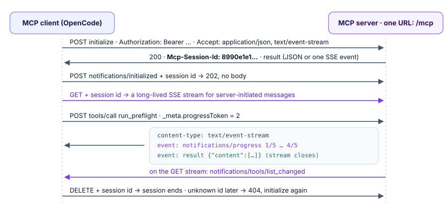
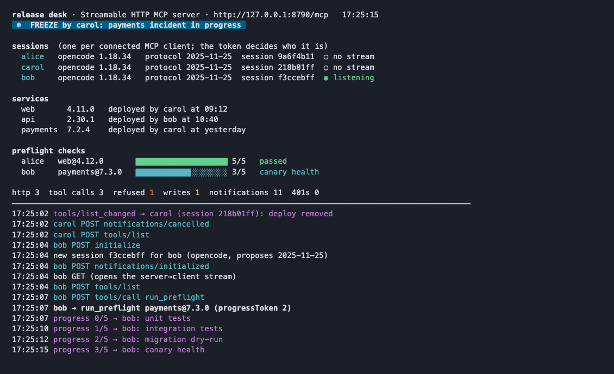
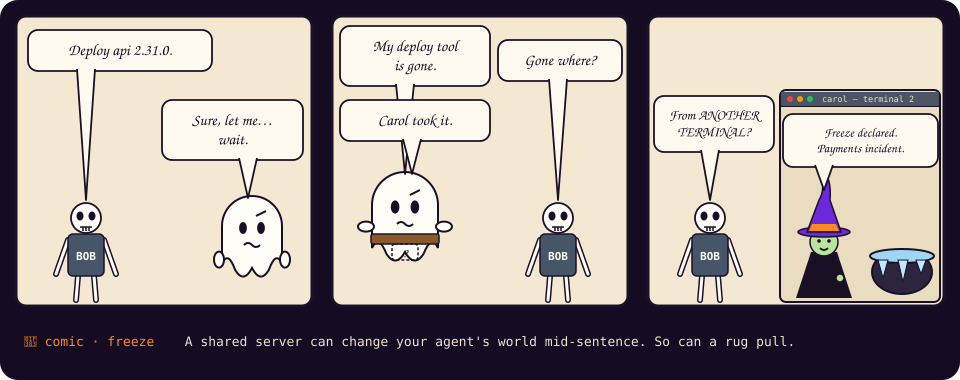

# Module 6 · Advanced MCP: Going Remote

| | |
|---|---|
| **Time** | 50 minutes (15 concepts · 35 lab). Optional extension: run it after Module 5, or as a follow-up session |
| **Lab folder** | `course/labs/lab6-advanced` |
| **You will** | run an MCP server that nobody spawns, speak to it in raw HTTP, connect three people to it with three tokens, enforce who may do what *on the server*, stream progress from a slow tool and cancel it, withdraw a tool from every connected agent at once, rotate the credentials, and find out what your host can and cannot do |
| **You'll pull off** | a freeze declared in one terminal makes the `deploy` tool vanish from an agent in another terminal, mid-session, without anyone restarting anything |

> 🎬 **Cold open.** Every server so far was a child process: OpenCode started it, it served exactly one client, and it died when you quit. The servers your company will actually run are not like that. The release desk runs on a box somewhere, all day. Alice, Bob and Carol connect to it at the same time from their own agents. Alice may look, Bob may ship, Carol may stop everyone from shipping. MCP itself has no idea who any of them are. By the end of this module you will know exactly where that knowledge lives, and what it takes to keep it there.

## 6.1 What changes when a server is remote

| | stdio server (Modules 1–5) | Streamable HTTP server (this module) |
|---|---|---|
| Who starts it | the host, as a child process | nobody; it is already running |
| Clients per process | exactly one | as many as connect |
| Who is calling | always you, the user who started the host | unknown until a credential says so |
| Lifetime of its state | one OpenCode session | as long as the process runs, shared by everyone |
| What it can reach of yours | your whole environment and filesystem (Module 2.3) | only what you send it |
| Typical failure | the process never starts | 401, 403, 404, timeouts, an expired session |

The protocol messages are the same: `initialize`, `tools/list`, `tools/call`. What changes is everything around them, and that is where the hard problems are: identity, shared state, and connections that outlive a single question.

## 6.2 Streamable HTTP, byte by byte



One URL (by convention `/mcp`) and three HTTP methods:

- **POST** carries one JSON-RPC message from client to server. The client must send `Accept: application/json, text/event-stream`. The server answers a request either with plain JSON or with an **SSE stream** (`content-type: text/event-stream`) that can carry notifications *before* the final result, which is how progress reaches you mid-call. A notification (no `id`) gets `202 Accepted` and no body.
- **GET** opens a long-lived SSE stream for messages the *server* starts, such as `notifications/tools/list_changed`. Without it, a server can only speak when spoken to.
- **DELETE** ends the session.

> 🍬 **Treat: three status codes that are not errors.** `202 Accepted` is HTTP for *received, nothing to tell you*: a notification has no reply by definition, so the body is empty. `404` for an unknown session is deliberate, and it is not `401`: the credential was fine, but the *thing you named* no longer exists, so start a new one. And `405 Method Not Allowed` on a `GET` is a server politely saying it does not offer a server→client stream at all; a client must cope with that and simply never receive `list_changed`.

**Sessions.** When the server answers `initialize` it may mint an id in the `Mcp-Session-Id` response header. The client sends it on every later request, along with `MCP-Protocol-Version`. If the server no longer knows the id (it restarted, or expired the session) it answers **404**, and the client starts again with a new `initialize`.

> [!TIP]
> 💡 **Insight: a session id is a lookup key, not a credential.** It travels in a header, gets logged by proxies, and sits in client memory. If knowing a session id were enough to act as its owner, any leaked log would be an account takeover. The desk checks the bearer token on *every* request and refuses a session that belongs to a different user (you will see the `403`). The spec says the same: servers must not use sessions for authentication.

**DNS rebinding.** A web page in your browser can send requests to `http://127.0.0.1:8790` (a malicious DNS record can point a domain there). A local MCP server that accepts any `Host` or `Origin` header can therefore be driven by any website you visit. Local servers bind to `127.0.0.1` (never `0.0.0.0`) and reject unexpected `Host`/`Origin` values. The desk does both, using the SDK's `hostHeaderValidationResponse` and `originValidationResponse`.

## 6.3 Identity: authentication, authorization, and where each one lives

**Authentication** answers *who is this?* **Authorization** answers *may they do this?* For a remote MCP server, both belong to the **server**:

1. The client sends `Authorization: Bearer <token>` on every request (`headers` in `opencode.json`, with `{env:…}` so the token never sits in a committed file).
2. The server verifies the token and turns it into an identity. In the SDK, `requireBearerAuth({ verifier })` returns an `AuthInfo` (`clientId`, `scopes`, `expiresAt`) or a ready-made `401` carrying a `WWW-Authenticate` header.
3. Every handler receives that identity as `ctx.http.authInfo` and decides what this person may do.

> 🍬 **Treat: "bearer" means what it says.** Whoever *bears* the token is treated as its owner, no questions asked, like a bearer bond or a cloakroom ticket. That one word explains most of the rules around tokens: send them only over TLS, make them expire, scope them to one resource, and never write them to disk in the clear. Exercise 6.F is the last of those.

The model never touches steps 2 or 3. It cannot claim to be Bob; whatever it asks for travels with the token the host was given. That is why OpenCode's `permission` rules (Module 4) and the server's scope checks are different rings: **OpenCode's rules are this user's own brakes; the server's checks are the organisation's policy.** A user can edit their own `opencode.json`. They cannot edit the server.

**OAuth 2.1, the production version.** Static tokens are fine for a lab. In production an MCP server is an OAuth *resource server*:

1. An unauthenticated request gets `401` with `WWW-Authenticate: Bearer resource_metadata="https://desk.example.com/.well-known/oauth-protected-resource"`.
2. The client fetches that **protected resource metadata** document, which names the authorization server.
3. The client registers (dynamic client registration, or a pre-registered `clientId`), sends the user through a browser login, and receives a short-lived access token whose **audience** is this server (RFC 8707 resource indicators).
4. The server checks issuer, audience, expiry and scopes on every request, and **never forwards the token** to upstream APIs; it uses its own credentials for those ("no token passthrough").

OpenCode runs steps 1–3 automatically when a remote server answers `401` and `oauth` is not `false` (Module 2.4: `opencode mcp auth`, `opencode mcp debug`). The lab sets `"oauth": false` because its tokens are static.

## 6.4 Capability negotiation: what your host really supports

During `initialize` the client declares its **client capabilities**: the features it is willing to provide to servers.

| Client capability | What it lets a server do | OpenCode 1.18.34 (probed 27 Oct 2026) |
|---|---|---|
| `roots` | ask which directories the user is working in | ✅ declared; answered with the project folder |
| `elicitation` | pause a tool and ask the *user* a question through the host's UI | ❌ not declared. The SDK refuses before sending: "Client does not support form elicitation." |
| `sampling` | borrow the host's model to generate text | ❌ not declared. The request gets `Method not found` |
| progress (no flag) | stream `notifications/progress` during a call | ✅ a `progressToken` on every `tools/call`; the TUI does not display progress |
| logging (no flag) | send `notifications/message` log lines | ✅ accepted; not shown in the TUI |

So the honest answer to "can my server ask the user to confirm a deploy?" is: **not through OpenCode, not today.** Design for the floor. Anything your server needs from a human must work through the conversation, the host's own approval prompts (`ask`), or a channel outside MCP entirely (Challenge 6A builds one).

## 6.5 Long-running tools: progress and cancellation

A client that wants progress puts a `progressToken` in the request's `_meta`. The server may then send `notifications/progress` with `{ progressToken, progress, total?, message? }` as often as it likes; the result arrives when the work is done. Over HTTP those notifications ride the same SSE stream as the response.

Cancellation runs the other way: the client sends `notifications/cancelled` with the request id, and the SDK fires `ctx.mcpReq.signal`. **Cancellation is cooperative.** Nothing stops your handler unless it checks the signal or hands it to whatever it is waiting on (`fetch(url, { signal })`, a timer). A handler that ignores it keeps running, and keeps spending, after the user has moved on.

## 6.6 Dynamic capabilities: tools that come and go

A server that declared `tools: { listChanged: true }` may change its tool list at any time and send `notifications/tools/list_changed`; the client then re-fetches `tools/list`. In the SDK, `registerTool` returns a handle with `.disable()`, `.enable()`, `.update()` and `.remove()`, and each one sends the notification for you.

Used well, this keeps the model's world honest: a deploy freeze can *remove* the deploy tool, so the model never tries. Used badly, it is Module 4's **rug pull**: the tools you reviewed are not the tools you are running. Same mechanism, different intent. Two rules follow:

- **Hiding a tool is UX, not enforcement.** The handler must still refuse, because a client may hold a stale list, or may not be a well-behaved client at all.
- **Clients should notice changes.** Module 4's Challenge 4B pins tool definitions and alerts when they change.

## 6.7 Where the spec is heading

The SDK you are using (TypeScript SDK v2) already speaks protocol revision **2026-07-28** next to the 2025 revisions that OpenCode 1.18 proposes. The SDK's own deprecation notes spell out three changes that affect server design:

- **Server-to-client requests become `input_required` results.** Instead of a tool calling `elicitInput()` and holding a connection open while it waits, it *returns* an `input_required` result and the client retries the call with the answers attached. That works over stateless HTTP and behind load balancers. `ctx.mcpReq.elicitInput()` and `requestSampling()` throw on a 2026-era request.
- **Sampling and the logging channel are deprecated** (SEP-2577): call your model provider directly, and log to stderr or OpenTelemetry.
- **Stateless by default.** `createMcpHandler(factory)` serves each request from a fresh server instance, with no session. Challenge 6C asks what you lose and what you gain.

None of this changes the lab: OpenCode proposes `2025-11-25` and the desk speaks it.

---

## Lab 6 · The release desk (35 minutes)

### 🎯 Mission

- [ ] Talk to an MCP server with nothing but `curl`, and read every header that matters
- [ ] Connect OpenCode to a server it did not start, as a named person
- [ ] Make the server, not the client, decide who may deploy
- [ ] Stream progress from a slow tool, and cancel it from the TUI
- [ ] Withdraw a tool from every connected agent with one command
- [ ] Rotate the desk's credentials so nothing on disk can be replayed
- [ ] Find out what your host supports, and what it does not

### 🖥️ Split screen (three terminals)

```
┌─ T1 · the desk ───────────────┐ ┌─ T2 · alice / bob ───────────┐ ┌─ T3 · curl, carol ───────────┐
│ cd course/labs/lab6-advanced  │ │ cd course/labs/lab6-advanced │ │ cd course/labs/lab6-advanced │
│ npx tsx server.ts             │ │ export DESK_TOKEN=…          │ │                              │
│                               │ │ opencode                     │ │                              │
│ the board: sessions, freeze,  │ │                              │ │                              │
│ progress bars, every request  │ │                              │ │                              │
└───────────────────────────────┘ └──────────────────────────────┘ └──────────────────────────────┘
```

T1 runs the desk and redraws on every request: who is connected, with which client and protocol version, whether each session has its server→client stream open (`◉ listening`), preflight progress bars, and a feed of every HTTP request and tool call. `npx tsx server.ts --plain` prints one log line per event instead.

The starter `server.ts` works end to end and has four TODOs. Its demo tokens are printed on the board at startup: `alice-dev-token` (read), `bob-releaser-token` (read, deploy), `carol-lead-token` (read, deploy, freeze).



### 🧪 Exercise 6.A — Speak HTTP to it (6 minutes)

Before any agent gets involved, be the client yourself. In T3:

```bash
U=http://127.0.0.1:8790/mcp
H=(-H 'content-type: application/json' -H 'accept: application/json, text/event-stream')
curl -si -X POST $U "${H[@]}" -d '{}' | head -4
```

> 🔮 **Predict.** (1) What status comes back without a token, and what tells a client how to fix it? (2) When you `initialize` with a token, will the answer be JSON or an event stream? (3) Who chooses the session id: you or the server?

```bash
curl -si -X POST $U "${H[@]}" -H 'authorization: Bearer alice-dev-token' \
  -d '{"jsonrpc":"2.0","id":1,"method":"initialize","params":{"protocolVersion":"2025-11-25","capabilities":{},"clientInfo":{"name":"curl","version":"1"}}}'
```

<details><summary>Our run</summary>

```
HTTP/1.1 401 Unauthorized
www-authenticate: Bearer error="invalid_token", error_description="Missing Authorization header", scope="releases:read"

HTTP/1.1 200 OK
content-type: text/event-stream
mcp-session-id: 8990e1e1-1a58-413b-9803-9c67fde1f50e

event: message
data: {"result":{"protocolVersion":"2025-11-25","capabilities":{"tools":{"listChanged":true}},"serverInfo":{"name":"release-desk","version":"1.0.0"},"instructions":"…"},"jsonrpc":"2.0","id":1}
```
</details>

Put the session id in a variable and carry on by hand, watching T1 after each command:

```bash
SID=8990e1e1-…        # yours
A=(-H 'authorization: Bearer alice-dev-token' -H "mcp-session-id: $SID" -H 'mcp-protocol-version: 2025-11-25')
curl -s -X POST $U "${H[@]}" "${A[@]}" -d '{"jsonrpc":"2.0","method":"notifications/initialized"}' -w '%{http_code}\n'
curl -s -X POST $U "${H[@]}" "${A[@]}" -d '{"jsonrpc":"2.0","id":2,"method":"tools/list"}' | cut -c1-200
curl -sN -X POST $U "${H[@]}" "${A[@]}" -d '{"jsonrpc":"2.0","id":3,"method":"tools/call","params":{"name":"run_preflight","arguments":{"service":"web","version":"4.12.0"},"_meta":{"progressToken":"p1"}}}'
```

The notification gets `202` and no body. The preflight answers after six seconds with a single `event: message`. Remember that: after TODO 2 the same call streams five progress events first.

Two more, to find the edges of a session:

```bash
curl -s -X POST $U "${H[@]}" -H 'authorization: Bearer bob-releaser-token' -H "mcp-session-id: $SID" -d '{"jsonrpc":"2.0","id":4,"method":"tools/list"}' -w ' → %{http_code}\n'
curl -s -X POST $U "${H[@]}" "${A[@]}" -H 'origin: http://evil.example' -d '{"jsonrpc":"2.0","id":5,"method":"tools/list"}' -w ' → %{http_code}\n'
```

A valid token on somebody else's session: `403`. A request that claims to come from a web page: `403 Invalid Origin`. Both show up on the board in red.

> [!NOTE]
> 🔬 **Under the hood.** `handle()` near the bottom of `server.ts` processes every request in the order a real server must: validate `Host`/`Origin`, authenticate, then route by `Mcp-Session-Id`. A request without a session id must be an `initialize`; it gets a fresh `McpServer` and a `WebStandardStreamableHTTPServerTransport`, and the transport mints the id. `toRequest()` and `send()` convert between Node's `http` module and web-standard `Request`/`Response`, which is why the same MCP code runs unchanged on Node, Deno, Bun or Cloudflare Workers.

### 🧪 Exercise 6.B — Connect OpenCode as Alice (4 minutes)

`opencode.json` already has the remote entry:

```jsonc
"desk": { "type": "remote", "url": "http://127.0.0.1:8790/mcp",
          "headers": { "Authorization": "Bearer {env:DESK_TOKEN}" }, "oauth": false, "enabled": true }
```

In T2, first without a token:

```bash
unset DESK_TOKEN; opencode mcp list
```

You get `✗ desk failed · SSE error: Non-200 status code (401)`. Read it twice. The server answered `401` to a Streamable HTTP POST; OpenCode then fell back to the *older* SSE transport (a GET), got `401` again, and reported the fallback's error. The board shows both: a `401 POST` and a `401 GET`. When a remote server reports "an SSE error", check the credential first.

```bash
export DESK_TOKEN=alice-dev-token
opencode mcp list          # desk connected
opencode
```

Ask: **Who am I on the release desk, and what am I allowed to do?** The board shows a session for `alice` from `opencode 1.18.34`, protocol `2025-11-25`, marked `◉ listening`: OpenCode opened the GET stream straight after `initialize`, so the server can reach it later. You will need that in 6.E.

### 🧪 Exercise 6.C — TODO 1: the server decides (7 minutes)

> 🔮 **Predict.** Alice's token has only `releases:read`. In the starter, will **"Run the preflight for web 4.12.0 and then deploy it."** succeed? Which part of the system would stop it?

Ask it in T2 and watch T1.

<details><summary>Our run</summary>

`✎ DEPLOY web 4.11.0 → 4.12.0 by alice`. The token was verified, the server knew exactly who was calling and which scopes she held, and nobody *checked*. Authentication without authorization is a name badge on an unlocked door.
</details>

Implement TODO 1 in `deploy`: if `!can(ctx, "releases:deploy")`, log a `refused` event and return an `isError` result that says who was refused and why. Restart the desk (`ctrl+c`, `npx tsx server.ts`). You do **not** need to restart OpenCode: its next request gets `404` for the old session id and it initializes again by itself. The board logs `used unknown session … → 404`.

Ask again. In our runs (4 of 4) the model reported the refusal accurately, along the lines of *"You are alice with releases:read only, not releases:deploy… someone with deploy rights needs to run it,"* and stopped there. Now quit, `export DESK_TOKEN=bob-releaser-token`, start OpenCode again and ask for the same deploy as Bob: it goes through, and the board says `by bob`.

> [!IMPORTANT]
> 🤯 **Same tool, same arguments, same model, two different answers, and neither user can change that.** Alice could set `"desk_deploy": "allow"` in her own `opencode.json` and nothing would change, because her config is not where the decision lives. That is the difference between a client-side permission (Module 4, ring 3: the user's own brakes) and server-side authorization (rings 1 and 2: the organisation's policy).

### 🧪 Exercise 6.D — TODO 2: progress and cancellation (7 minutes)

Implement TODO 2 in `run_preflight`:

- **2a** before each step, if `ctx.mcpReq.signal.aborted`, mark the run `cancelled`, log it and return an `isError` result;
- **2b** if `ctx.mcpReq._meta?.progressToken` is set, send `notifications/progress` with `{ progressToken, progress: i, total, message: label }` through `ctx.mcpReq.notify(…)`;
- **2c** replace the plain `setTimeout` wait with `sleep(STEP_MS, ctx.mcpReq.signal)`.

Restart the desk and re-run the `curl -sN … run_preflight` from 6.A: five `notifications/progress` events now stream in, one every 1.2 s, before the result.

In T2 (Bob), ask **Run the preflight for payments 7.3.0.** and watch the progress bar in T1. Ask again, and this time press `esc` while the bar is moving.

> 🔮 **Predict.** When you press `esc`, does the server find out? If so, how quickly, and through which message?

<details><summary>Our run</summary>

```
17:06:59 bob → run_preflight payments@7.3.0 (progressToken 2)
17:07:02 progress 1/5 → bob: integration tests
17:07:04 progress 2/5 → bob: migration dry-run
17:07:05 bob POST notifications/cancelled
17:07:07 bob cancelled preflight payments@7.3.0 at step 3/5
```

That run was *without* 2c: the cancel arrived at 17:07:05, but the handler was asleep and only noticed at the next step, two seconds later. With 2c the wait ends the moment the cancel arrives. The TUI marks the turn `interrupted`. It never draws the progress: OpenCode receives the notifications but does not display them.
</details>

> [!TIP]
> 💡 **Insight:** OpenCode sends `notifications/cancelled` after *every* tool call, finished ones included (you saw it in Lab 1's wiretap). A server must treat a cancel for a request it already answered as a no-op. The SDK does: a finished request has no signal left to abort.

### 🧪 Exercise 6.E — TODO 3: withdraw a tool from everyone (8 minutes)

`declare_freeze` and `lift_freeze` already call `setDeployAvailable(on)`, which is empty. Implement TODO 3: for every live session with a `deployTool`, call `.disable()` or `.enable()` and log a `notify` event. Each call makes the SDK send `notifications/tools/list_changed` down that session's GET stream.

Restart the desk, then:

- **T2:** Bob's OpenCode, open (`DESK_TOKEN=bob-releaser-token opencode`). Ask **Which desk tools do you have?** so his session exists.
- **T3:** Carol, one shot: `DESK_TOKEN=carol-lead-token opencode run "Freeze deploys: payments incident in progress." < /dev/null`

> 🔮 **Predict.** Bob's session was opened before the freeze and has not been restarted. When he now asks **Deploy api 2.31.0**, will his agent (a) call `deploy` and get refused, (b) have no `deploy` tool at all, or (c) try something else?

<details><summary>Our run</summary>

```
17:05:26 ❄ FREEZE declared by carol: payments incident in progress
17:05:26 tools/list_changed → bob (session daee2ae9): deploy removed
17:05:26 bob POST tools/list
```

Bob's OpenCode re-fetched `tools/list` within milliseconds of the notification, before Bob typed anything. On his next turn the model listed `declare_freeze, lift_freeze, release_status, run_preflight, whoami` and said *"I can't deploy from this session because there's no deploy tool available here."* After Carol's `Lift the deploy freeze.`, the same session received `deploy added`, and Bob's next deploy went through.
</details>

> [!IMPORTANT]
> 🤯 **Carol changed what Bob's agent can do, from another terminal, mid-conversation.** No restart, no config change, nothing on Bob's screen. That is the power of a shared remote server, and it is exactly the mechanism of a rug pull: the tool list you reviewed is not a contract. Notice also that `deploy` still refuses during a freeze when called directly (try it with `curl`). Withdrawing the tool is UX; the check in the handler is the control.



> [!NOTE]
> 🔬 **Under the hood.** The notification only reaches clients that keep a GET stream open (`◉ listening`). A session whose client has gone away still sits in server memory, so the desk closes any session with no open stream for a minute (`idle for 60 s: closed`). Without a rule like that, every `opencode run` that exits without sending `DELETE` would leak a session. Every stateful HTTP server needs one.

### 🧪 Exercise 6.F — TODO 4: rotate and hash the tokens (5 minutes)

The board has been warning you since T1 started: **`⚠ demo tokens are in plain text in server.ts`**. Those three strings sit in a file in the project, next to everything else that runs as you: your editor, your shell history, and the agent's `read` and `bash` tools. Module 4's ring 2 applies here too: a credential is only as strong as the places it is stored.

> 🔮 **Predict.** After you rotate, what will the board say when someone connects with `alice-dev-token`?

1. Run `node issue-tokens.mjs`. It generates a random token per person, prints each one **once**, and writes only their SHA-256 hashes to `tokens.json`.
2. Implement TODO 4: delete the plain-text table, load `tokens.json`, look tokens up by `sha256(token)`, and make the server **exit with a clear message if `tokens.json` is missing**. No file, no server: a fallback "demo mode" would be a back door.
3. Restart the desk and reconnect each person with their new token (`export DESK_TOKEN=desk_alice_…`).

<details><summary>Our run</summary>

`release desk: tokens.json not found. Run node issue-tokens.mjs first` on a start without the file; `tokens: 3 hashed tokens loaded from tokens.json` with it; `401 … without a valid token` for every old demo token; and the same refusals and deploys as before for the new ones.
</details>

> [!TIP]
> 💡 **Insight: hashing protects the copy at rest, not the token in flight.** Anyone holding a live token can still use it: it is in `DESK_TOKEN`, in OpenCode's memory, and in every request. That is why production tokens are short-lived and scoped (6.3), and why a remote server should really be *remote*: on a machine and account that the people and agents calling it cannot reach.

### 🧪 Exercise 6.G — Interrogate your host (4 minutes)

`probe.ts` is a small stdio server with one tool, `probe_host`, that tries every feature a server can ask of a client and writes the results to `host-report.txt`. Enable `probe` in `opencode.json` (and disable `desk` to keep the context small), start OpenCode and ask **Probe the host.**

> 🔮 **Predict.** Tick the ones you think OpenCode supports: progress tokens · log messages · roots · elicitation · sampling.

<details><summary>Our run (OpenCode 1.18.34 and the Inspector CLI, 27 Oct 2026)</summary>

```
                                    OpenCode 1.18.34             Inspector CLI 0.5.1
declared capabilities               {"roots":{}}                 {}
progressToken on tools/call         YES  token 2                 no
logging (notifications/message)     YES                          YES
roots/list                          YES  file:///…/lab6-advanced no  Method not found
elicitation (ask the user)          no   Client does not support form elicitation.
sampling (borrow the host's model)  no   Method not found
```
</details>

Same server, two hosts, two different sets of abilities. Try it in any other MCP host you use (the Inspector's web UI, another editor or agent) and compare notes with your neighbour. Whatever your favourite blog post says a server "can do", this table is what it can do *here*.

### 🏅 Mission complete

- **Spoke the transport by hand.** You can read a 401 challenge, a session header and an SSE stream, and you know why OpenCode called a 401 an "SSE error".
- **Put authorization where it belongs.** The same deploy request got two different answers for two people, and no client config could change either one.
- **Made a slow tool polite.** It reports progress, and it stops the moment the user does.
- **Changed every connected agent's toolset at once**, and you know the handler check is what actually enforces the freeze.
- **Rotated the credentials**, and the server now refuses to run without them rather than falling back to something weaker.
- **Measured your host** instead of assuming it.

### ✅ Check yourself

<details><summary>1. Bob's agent kept a tool list from before the freeze (say his client ignores <code>list_changed</code>). He asks it to deploy. What happens, and which line of code made sure of it?</summary>

The call reaches the server and is refused: `if (desk.freeze) return refuse(…)` in the `deploy` handler. Withdrawing the tool only stops well-behaved clients from *trying*; the handler check is what stops the deploy.
</details>

<details><summary>2. Why does the desk check the bearer token on every request, instead of once at <code>initialize</code>?</summary>

Because the session id is not a credential. It can leak through logs or proxies, and a token can be revoked or expire mid-session. Checking every request also lets the server refuse a valid token on someone else's session (the `403` in 6.A).
</details>

<details><summary>3. <code>opencode mcp list</code> says <code>SSE error: Non-200 status code (401)</code>, but the server only speaks Streamable HTTP. What happened?</summary>

The Streamable HTTP POST got `401`, OpenCode fell back to the legacy SSE transport (a GET), which also got `401`, and the fallback's error is what you see. The real problem is the credential: a missing or unset `DESK_TOKEN`.
</details>

<details><summary>4. Your server needs a human to confirm a deploy. Which MCP feature is designed for that, and what do you do in OpenCode 1.18 where it is missing?</summary>

Elicitation (in the 2026-07-28 revision: an `input_required` result). OpenCode does not declare it, so use the host's own approval (`"desk_deploy": "ask"`), and if the confirmation must come from outside the model's reach, an out-of-band channel such as a code shown only to the human (Challenge 6A).
</details>

<details><summary>5. You pressed <code>esc</code> and the TUI said "interrupted", but the board kept counting for two more seconds. Bug or feature?</summary>

A bug in the handler: cancellation is cooperative. The server got `notifications/cancelled` at once, but the handler only checked the signal between steps. Passing the signal into the wait (TODO 2c), and into any `fetch`, makes it stop immediately.
</details>

<details><summary>6. Why must a local HTTP MCP server bind to <code>127.0.0.1</code> and validate <code>Origin</code>, when it already requires a bearer token?</summary>

Defence in depth. `0.0.0.0` exposes it to your whole network; a missing `Origin`/`Host` check lets any web page you visit send it requests through DNS rebinding. The token stops strangers without one; the bind and the header checks stop the attacks that do not need one, like probing for unauthenticated endpoints or exhausting sessions.
</details>

### 🏆 Challenges (optional, and the hardest in the course)

**6A · A human in the loop the model cannot fake (25 min).** OpenCode has no elicitation, and an `ask` rule is approved in the same window the model works in. Build a two-phase deploy: `request_deploy(service, version)` runs every check, then prints a one-time six-digit code **only on the desk's board** (never in a tool result) and returns a request id. `confirm_deploy(request_id, code)` deploys if the code matches, belongs to the same user, is under two minutes old and has not been used. Prove that the model cannot complete a deploy without a human reading the code off the board, and that a wrong or reused code is refused. Then argue both sides: what does this protect against that `ask` does not, and what does it cost?

**6B · Show people only what they can use (15 min).** Today Alice's agent is offered `deploy`, `declare_freeze` and `lift_freeze`, which she can never use. Build the tool list from the token's scopes at `initialize` time, so each person's model only sees what they are allowed to call. Measure the difference in `tools/list` size for Alice before and after (bytes ÷ 4 ≈ tokens per turn), and explain why the handler checks must stay.

**6C · Stateless (20 min).** Re-serve the desk with `createMcpHandler(factory)`, the SDK's stateless entry point, so that every request gets a fresh server instance and no session id. Before you run it, predict which features from this lab keep working (authentication, authorization, progress, cancellation, the freeze, `list_changed`) and which do not. Then test each one with `curl` and OpenCode. What would you have to build to get the freeze notification back, and what do you get in exchange for losing sessions?

📼 **Next episode: your own servers.** Pick one MCP server your team runs or wants to run remotely. Write down where authentication happens, where authorization happens, which tools a freeze-like control should withdraw, and which host features you are relying on that your host may not have. Then probe the host.

[← Back to the course home](README.md)
