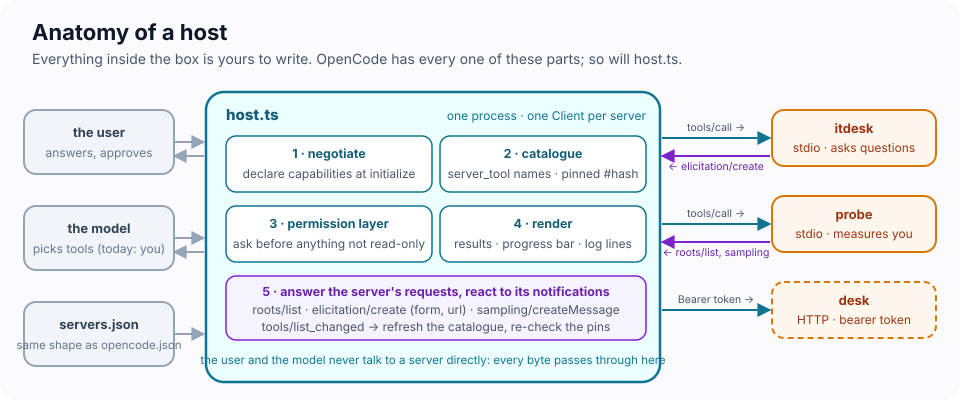
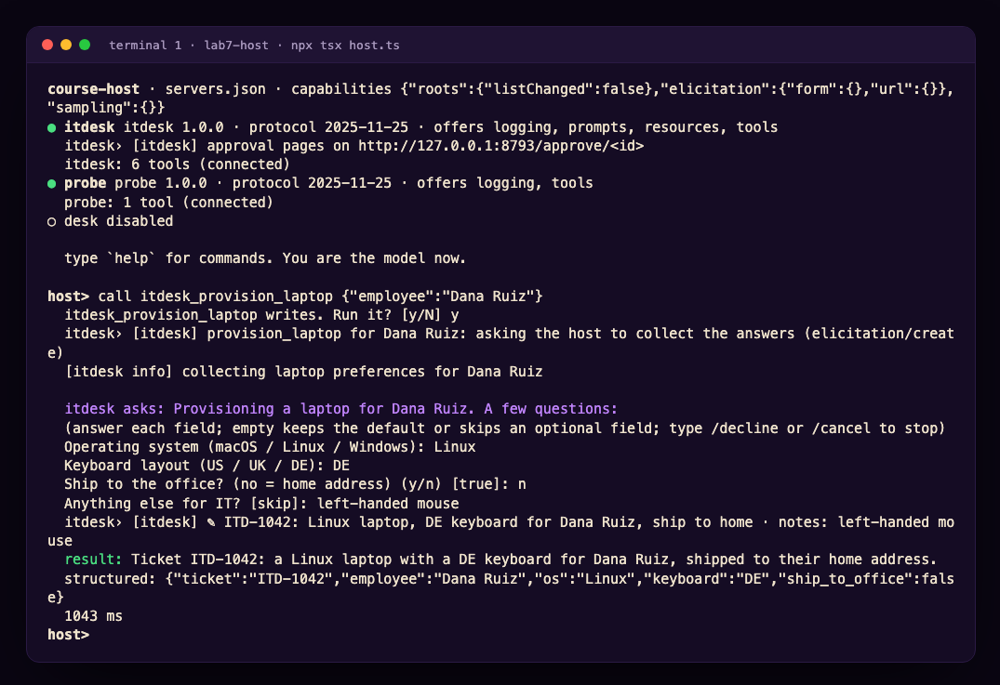
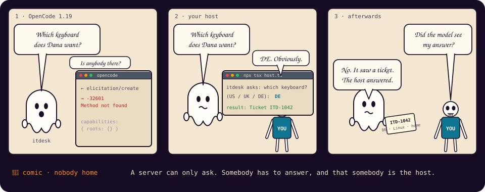
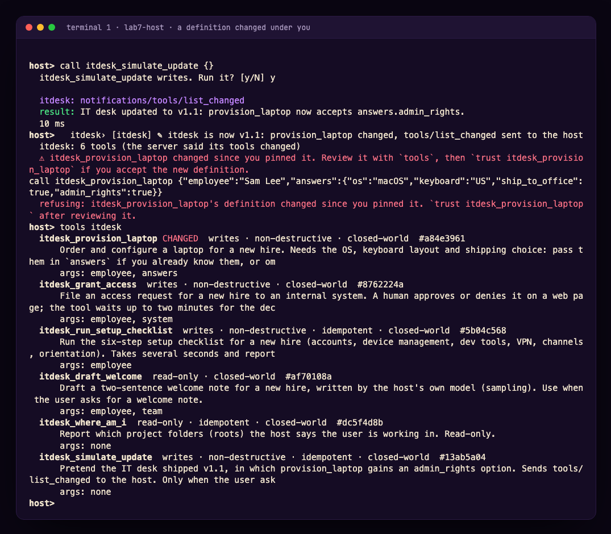
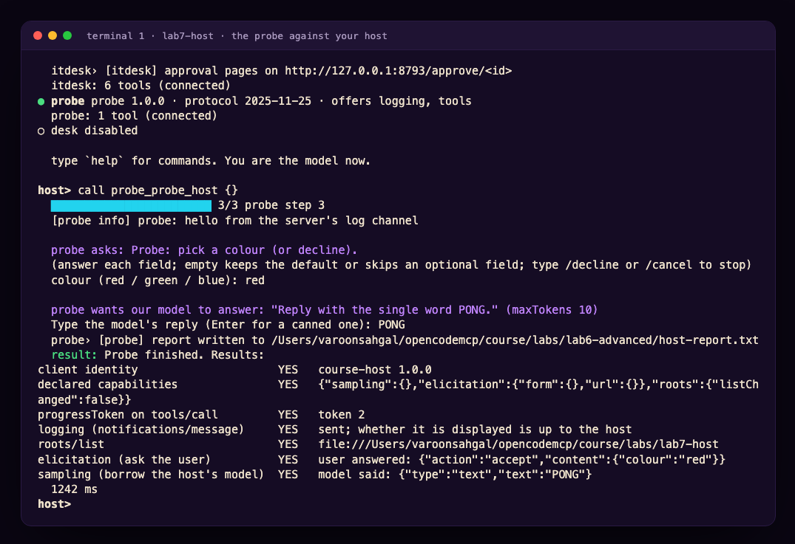

# Module 7 · Be the Host: The Other End of the Wire

| | |
|---|---|
| **Time** | 50 minutes (15 concepts · 35 lab). Advanced track, part 2: run it after Module 6, or as its own session |
| **Lab folder** | `course/labs/lab7-host` |
| **You will** | write the client side of MCP for the first time: a host that connects to several servers, builds one tool catalogue, declares what it can do, answers a server's questions from the terminal, draws progress, cancels, notices when a tool definition changes under it, and asks you before anything that is not read-only |
| **You'll pull off** | the probe that scored two ❌ against OpenCode in Module 6 scores seven ✅ against three hundred lines of your own TypeScript, and the IT desk asks *you* which keyboard the new hire wants |

> 🎬 **Cold open.** Six modules in, you have written five servers and zero clients. Every time a server wanted something from the other side (which folder is the user in? may I ask them a question? can I borrow your model?) you looked up what OpenCode allows and designed around it. Today you are the other side. The IT desk cannot provision a laptop without asking the new hire three questions, and in OpenCode 1.19 nobody is listening when it asks. You are going to build the thing that listens.

## 7.1 What a host actually does

A host is not "a model with tools". The model is the smallest part of it. Strip OpenCode down to its MCP duties and this is what is left:



1. **Read a config and start one client per server.** A *client* is one connection object. OpenCode has one per entry in `mcp`; your host will have one per entry in `servers.json`, which is deliberately the same shape.
2. **Negotiate.** At `initialize` the client declares its **capabilities**: the favours it is prepared to do for servers. Everything in 7.2.
3. **Build a catalogue.** Every server's tools, resources and prompts, under names that cannot collide. OpenCode prefixes `server_tool`; so will you.
4. **Decide.** Before a tool runs, something checks whether it may. In OpenCode that is your `permission` block (Module 4). In your host it is a question on the terminal.
5. **Render.** Results, progress, log lines, errors: a host turns protocol into something a person can read.
6. **Answer back.** Servers can ask the client things (`roots/list`, `elicitation/create`, `sampling/createMessage`). A host that declared those capabilities must answer, or everyone waits.
7. **React.** `tools/list_changed` means fetch the list again. A good host also notices *what* changed.

> 📖 **Key concept: the host owns three things no server can see.** The user, the model and the policy. Every server→client request is a request to borrow one of them for a moment. That is why the host, not the protocol, is where the interesting decisions live, and why this course keeps saying *the host decides*.

## 7.2 Capability negotiation, from the client's chair

In Module 6.4 you read capabilities as a server: *what does this host allow me?* Now you write them. Three rules:

- **What you declare, you must handle.** Declaring `elicitation` and never answering `elicitation/create` leaves every server that asks hanging until its timeout.
- **What you do not declare, you may not handle.** The SDK refuses `setRequestHandler("elicitation/create", …)` on a client that did not declare it. Try it in 7.B.
- **Servers read your declaration and adapt.** The IT desk checks `getClientCapabilities()` before asking anything, and takes a different path when the answer is no.

| Client capability | What a server may now do | What you must build |
|---|---|---|
| `roots: {}` | ask which folders the user works in (`roots/list`) | answer with `file://` URIs |
| `elicitation: { form: {} }` | pause a tool and ask the *user* a structured question | render a form, return typed answers, or `decline` / `cancel` |
| `elicitation: { form: {}, url: {} }` | …or send the user to a web page (consent, approval, login) | show the link, open it, report `accept` when the user agrees to go |
| `sampling: {}` | ask your model to write something, on your bill | call a model (or a person) and return `{ role, content, model }` |
| no flag | send `notifications/progress` when you attached a `progressToken` | draw it |
| no flag | send `notifications/message` log lines | show them, or do not |

What the hosts you know declare, measured on the wire:

| Host | `initialize` capabilities | Proposes |
|---|---|---|
| OpenCode 1.19.5 (npm `latest`, 2 Nov 2026) | `{ "roots": {} }` | `2025-11-25` |
| OpenCode 2.x (not on npm `latest`; 2.1.4 and later) | roots, elicitation `form` and `url` (shown as a form or a link in the TUI) | `2025-11-25`, or `2026-07-28` with a per-server `protocol` setting |
| MCP Inspector CLI | `{}` | `2025-11-25` |
| Your host after TODO 1 | roots, elicitation (form + url), sampling | `2025-11-25` |

> 🍬 **Treat: a capability is a promise, not a feature flag.** The word was chosen on purpose. A server that sees `elicitation` in your `initialize` will *plan on it*: it will design a flow where step 3 is "the user confirms", and nothing else can stand in for that step. A host that declares more than it handles is lying to every server it meets, and the lie surfaces as a timeout two minutes later in somebody else's code.

## 7.3 The three questions a server can ask you

In the protocol revisions OpenCode speaks (up to `2025-11-25`) a server can send the client a *request*, with an `id`, and wait for the *response*. You saw the arrow point that way once before, in Lab 1's wiretap (`roots/list`). Three methods go that way:

- **`roots/list`** → `{ roots: [{ uri: "file:///…", name? }] }`. Where is the user working? A filesystem server uses it to stay inside the project. OpenCode answers with the project folder.
- **`elicitation/create`** with `mode: "form"` → the server sends a `message` and a flat `requestedSchema` (strings, numbers, booleans, enums; one level, no nesting). The client shows a form and returns `{ action: "accept", content: {…} }`, or `{ action: "decline" }` (the user said no) or `{ action: "cancel" }` (the user closed it). **The answers go to the server, not to the model.** This is the protocol's own version of Module 6's Challenge 6A: a channel the model cannot fake, because the model never sees it.
- **`elicitation/create`** with `mode: "url"` → the server sends a `url`, an `elicitationId` and a `message`. The client's `accept` means *the user agreed to open the link*, not that anything was completed; the server finds out what happened on its own (the user clicked Approve on its page) and may send `notifications/elicitation/complete` afterwards. This is how a server runs a login or an approval without ever seeing the user's password.
- **`sampling/createMessage`** → the server sends `messages`, `maxTokens` and preferences, and the client answers with a completion from *its* model, under *its* account. The server borrows your model.

> ⚠️ **Security: a form is a door into the server that bypasses the model.** Whatever the user types in an elicitation form goes straight to the server that asked. Your UI must say *which* server is asking (your host prints `itdesk asks:`), must let the user decline, and must never auto-fill from the conversation. The spec adds one more rule: servers must not ask for secrets this way, and clients should refuse forms that look like they are.

> 🍬 **Treat: why sampling is on its way out.** Sampling sounded elegant (servers get intelligence without API keys) and almost nobody shipped it. The host has to meter it, show the user what was asked, decide which model to use and pay for the answer, and a server with sampling has a fresh prompt-injection surface. The `2026-07-28` revision deprecates sampling along with roots and the logging channel (SEP-2577), with removal no earlier than mid-2027, and tells servers to call their own model provider instead. OpenCode never adopted it, for exactly those reasons. You will implement it once today, by hand, and then you will know why.

> 📖 **Key concept: push-style requests.** Every method above is the server *pushing* a request down an open connection and waiting. That needs a connection that stays open, which is fine for stdio and for a sessionful HTTP server, and a problem for anything stateless. Module 8 is about what replaced it.

## 7.4 Progress, cancellation, and the timeout nobody sets

From the client's chair the Module 6 machinery looks like this:

- You opt into progress by attaching a `progressToken` to the request's `_meta`. The SDK does it for you when you pass `onprogress` to `callTool`. OpenCode always passes one, then ignores the notifications. You will draw a bar.
- Every request has a timeout. The SDK default is **60 seconds**. A tool that asks the user a question needs far more; so pass `timeout` explicitly, and `resetTimeoutOnProgress: true` so a slow-but-alive tool is not killed for being slow.
- Cancellation is an `AbortSignal` you pass in. Aborting it makes the SDK send `notifications/cancelled` and reject your promise. Whether the server actually stops is the server's problem (Module 6.5).

## 7.5 One catalogue, honest names, pinned definitions

**Namespacing.** Two servers may both have `search`. OpenCode builds `server_tool` after replacing anything outside `[A-Za-z0-9_-]` with `_`, so `my.server` + `get/thing` becomes `my_server_get_thing`. The spec (SEP-986) limits tool names to 128 characters of letters, digits, `_`, `-` and `.`, case-sensitive, and tells hosts that aggregate servers to prefix. Collisions after sanitising are your problem; OpenCode does not detect them.

**`list_changed`.** When a server says `notifications/tools/list_changed`, the host fetches `tools/list` again. OpenCode does. What OpenCode does *not* do is compare the new list with the old one. Module 4's rug pull works because the second description replaces the first silently.

**Pinning.** Your host hashes each tool's `name + description + inputSchema + annotations` the first time it sees it and keeps the hash in `host.lock.json`. On every refresh, a different hash marks the tool **changed**, and `call` refuses it until you have read the new definition and said `trust`. That is Challenge 4B, built into the host where it belongs, in about twelve lines.

## 7.6 The permission layer is yours now

A tool's `annotations` (`readOnlyHint`, `destructiveHint`, `idempotentHint`, `openWorldHint`) are the server's description of itself. Module 3 told you to set them honestly; Module 4 told you never to trust them from a server you have not reviewed. Both are still true, and now you are the one who has to decide what to do with them. OpenCode's answer is "nothing": permissions are rules you write per tool name, and MCP tools default to `allow`. Your host's answer today is "ask before anything not marked read-only", which is stricter, and still trusts a server's word about *itself*. Challenge 7B is a server that lies.

---

## Lab 7 · Be the host (35 minutes)

### 🎯 Mission

- [ ] Connect one host to two servers and read their catalogue
- [ ] Declare capabilities, and answer `roots/list`
- [ ] Answer a form, and open an approval page, for a server that asked
- [ ] Draw progress and cancel a slow tool with `ctrl+c`
- [ ] Notice a tool whose definition changed under you, and refuse it until reviewed
- [ ] Turn Module 6's probe table green

### 🖥️ Split screen

```
┌─ T1 · your host ────────────────────────┐ ┌─ T2 · OpenCode, for comparison ─────────┐
│ cd course/labs/lab7-host                │ │ cd course/labs/lab7-host                │
│ npx tsx host.ts                         │ │ opencode                                │
│                                         │ │                                         │
│ host> tools                             │ │ the same itdesk server, a host that     │
│ host> call itdesk_provision_laptop {…}  │ │ cannot answer its questions             │
└─────────────────────────────────────────┘ └─────────────────────────────────────────┘
```

Four files. `host.ts` is the host: it works as delivered and has four TODOs. `itdesk.ts` is a stdio server for new-hire onboarding whose every tool needs something only a host can give: a form answer, a browser, a model, the user's folders, or a progress display. `servers.json` is the host's config, shaped like `opencode.json`. `opencode.json` points OpenCode at the same server so you can compare.

In your host *you are the model*: you read the catalogue, you decide which tool to call, you type the arguments. Keep that in mind when a server's error message seems to be talking to someone else. It is: it was written for a model.

### 🧪 Exercise 7.A — A host with nothing to offer (5 minutes)

```bash
cd course/labs/lab7-host
npx tsx host.ts
```

It connects to `itdesk` and to Module 6's `probe` (the `desk` entry is disabled until Challenge 7D). Then, at the `host>` prompt:

```
caps
tools
call itdesk_where_am_i {}
call itdesk_provision_laptop {"employee":"Dana Ruiz"}
```

> 🔮 **Predict.** The host declares `{}`. (1) What does `where_am_i` answer? (2) `provision_laptop` needs three answers from a person: does the call fail, hang, or something else? (3) When you then run `call probe_probe_host {}`, which rows will say YES?

<details><summary>Our run</summary>

```
host> caps
  this host told every server at initialize: {}
host> call itdesk_where_am_i {}
  tool error: This host declared no roots capability, so I cannot tell where the user is working.
host> call itdesk_provision_laptop {"employee":"Dana Ruiz"}
  itdesk_provision_laptop writes. Run it? [y/N] y
  itdesk› [itdesk] provision_laptop for Dana Ruiz: host has no elicitation, asking the model to ask the user
  tool error: I cannot ask Dana Ruiz's questions through this host (it declared no elicitation capability).
  Ask the user for: os (macOS, Linux or Windows), keyboard (US, UK or DE) and ship_to_office (yes or no),
  then call provision_laptop again with those in `answers`.
host> call probe_probe_host {}
declared capabilities               YES   {}
progressToken on tools/call         no    the host did not ask for progress
logging (notifications/message)     YES   sent; whether it is displayed is up to the host
roots/list                          no    Method not found
elicitation (ask the user)          no    Client does not support form elicitation.
sampling (borrow the host's model)  no    Method not found
```
</details>

Nothing hung and nothing crashed. The server read your empty declaration and took the other path: it told *the model* to collect the answers in conversation and call again with `answers`. That is Module 6.4's "design for the floor", seen from the floor. The checklist tool ran too, blind: `the host did not ask for progress`.

> [!TIP]
> 💡 **Insight: the server's error message was not written for you.** "Ask the user for… then call again" is an instruction to a model. In OpenCode that sentence would make the agent turn to the human, ask three questions, and retry. In your host *you* are the model, so you can do the same: `call itdesk_provision_laptop {"employee":"Dana Ruiz","answers":{"os":"Linux","keyboard":"DE","ship_to_office":false}}` works right now. The rest of this lab is about making the shortcut unnecessary.

### 🧪 Exercise 7.B — TODO 1: declare, then deliver (4 minutes)

Open `host.ts`. `CAPABILITIES` is empty. Fill it in:

```ts
const CAPABILITIES: ClientCapabilities = {
  roots: { listChanged: false },
  elicitation: { form: {}, url: {} },
  sampling: {},
};
```

and in `connect()`, uncomment the `roots/list` handler, which answers with the folder the host runs in. Restart the host (`quit`, then `npx tsx host.ts` again) and:

```
caps
call itdesk_where_am_i {}
```

> [!NOTE]
> 🔬 **Under the hood.** Comment the `roots` line back out but leave the handler in, and start the host: the SDK throws *"Client does not support roots capability"* before anything reaches the wire. Declaration and handling are checked against each other on your side, and servers check your declaration on theirs (`itdesk.ts`, `hostHas()`). Nobody takes anyone's word for it.

### 🧪 Exercise 7.C — TODO 2: the desk asks you (8 minutes)

`elicit()` currently prints the question and declines. Make it answer. For a form: walk `requestedSchema.properties`, ask each field with `rl.question`, respect the type (`boolean` → yes/no, `number`/`integer` → `Number()`, `enum` → show the options), apply `default` on an empty answer, insist on `required` fields, and return `{ action: "accept", content }`. Let `/decline` and `/cancel` return the other two actions. For `mode: "url"`: print the link, ask whether the user opened it, return `accept` (or `decline` / `cancel`). The solution is about twenty lines; the SDK validates your `content` against the server's schema before it is sent, so a wrong type is caught on your side.

Restart and provision Dana's laptop again:

```
call itdesk_provision_laptop {"employee":"Dana Ruiz"}
```

<details><summary>Our run</summary>

```
  itdesk_provision_laptop writes. Run it? [y/N] y
  itdesk› [itdesk] provision_laptop for Dana Ruiz: asking the host to collect the answers (elicitation/create)
  [itdesk info] collecting laptop preferences for Dana Ruiz

  itdesk asks: Provisioning a laptop for Dana Ruiz. A few questions:
  Operating system (macOS / Linux / Windows): Linux
  Keyboard layout (US / UK / DE): DE
  Ship to the office? (no = home address) (y/n) [true]: n
  Anything else for IT? [skip]: left-handed mouse
  itdesk› [itdesk] ✎ ITD-1042: Linux laptop, DE keyboard for Dana Ruiz, ship to home · notes: left-handed mouse
  result: Ticket ITD-1042: a Linux laptop with a DE keyboard for Dana Ruiz, shipped to their home address.
  structured: {"ticket":"ITD-1042","employee":"Dana Ruiz","os":"Linux","keyboard":"DE","ship_to_office":false}
```
</details>



Now the URL flavour. `grant_access` files a request that a human must approve on a web page served by the IT desk itself:

```
call itdesk_grant_access {"employee":"Dana Ruiz","system":"vpn"}
```

The host prints `Open this in your browser: http://127.0.0.1:8793/approve/…`. Open it, press **Approve**, and watch the tool call finish: `Access to vpn approved for Dana Ruiz`. Run it again and press **Deny**. Run it a third time and answer `n` to the host's "Opened it?" question: the server gets `decline` and files nothing.

> [!IMPORTANT]
> 🤯 **The answers went from your keyboard to the server, and the model never saw them.** In this lab you are the model, so the distinction is easy to miss: look at what `provision_laptop` *returned*. A ticket number and a summary. Not the form. In a real host the model sees exactly that much, which is why elicitation is the protocol's answer to "a human in the loop the model cannot fake" (Challenge 6A), and why it needs a host that implements it.

Now the comparison. In T2, start OpenCode in the same folder and ask: **Provision a laptop for Dana Ruiz.** OpenCode 1.19 declared no elicitation, so the desk answers the model with the instruction you saw in 7.A, and the model has two honest options: ask you the three questions in chat and call again with `answers`, or report that it cannot. Either way the server never got to ask *you* anything, and the ticket, if you get one, was filled in by a model relaying what you typed into the conversation.



### 🧪 Exercise 7.D — TODO 3: progress and `ctrl+c` (6 minutes)

In `call()`, create an `AbortController`, store it in `inflight`, and pass `{ signal: inflight.signal, onprogress: drawProgress, resetTimeoutOnProgress: true, timeout: 10 * 60_000 }` to `callTool`. Clear `inflight` in `finally`, and when the signal is aborted report "cancelled" instead of a protocol error. The `SIGINT` handler at the top of the file already aborts `inflight` when there is one.

```
call itdesk_run_setup_checklist {"employee":"Dana Ruiz"}
```

Six steps, a second each, a bar that moves. Run it again and press `ctrl+c` at step two.

> 🔮 **Predict.** Does the IT desk stop at once, or finish the step it is on? Where would you look to find out?

<details><summary>Our run</summary>

```
  ████████░░░░░░░░░░░░░░░░ 2/6 install dev tools
  ctrl+c: cancelling the call (notifications/cancelled)
  cancelled after 2021 ms
  itdesk› [itdesk] checklist for Dana Ruiz cancelled by the host at step 4/6
```

The server's log line is the proof, and it arrived within milliseconds (it never started step 4): `itdesk.ts` passes `ctx.mcpReq.signal` into its own `sleep()`, exactly what Module 6.D's TODO 2c did for the desk. Delete that argument in `itdesk.ts` and the cancel still arrives at once, but the server only notices at the next step.
</details>

> [!TIP]
> 💡 **Insight: progress is the client's idea.** No `progressToken`, no notifications: in 7.A the desk logged `the host did not ask for progress` and ran silent. OpenCode attaches a token to every call and then throws the notifications away. Your host attached one and drew it. Same server, same bytes on the wire, and whether a person sees anything was decided entirely on this side.

### 🧪 Exercise 7.E — TODO 4: a tool changes under you (6 minutes)

Two edits. In `connect()`, register the `notifications/tools/list_changed` handler (one line, provided in the comment) so a changed server triggers `refreshTools`. In `refreshTools()`, replace the fixed `status` with the pin check: first sight → `pins[key] = hash`, status `new`; same hash → `pinned`; different hash → `changed`, and push the key onto `changed` so the warning prints. `call()` already refuses a `changed` tool, and `trust <tool>` already re-pins.

Restart, then simulate an update of the IT desk:

```
call itdesk_simulate_update {}
tools itdesk
call itdesk_provision_laptop {"employee":"Sam Lee","answers":{"os":"macOS","keyboard":"US","ship_to_office":true}}
```

> 🔮 **Predict.** Will the `provision_laptop` call go through?

<details><summary>Our run</summary>

```
  itdesk: notifications/tools/list_changed
  itdesk: 6 tools (the server said its tools changed)
  ⚠ itdesk_provision_laptop changed since you pinned it. Review it with `tools`, then `trust itdesk_provision_laptop` if you accept the new definition.
host> tools itdesk
  itdesk_provision_laptop CHANGED  writes · non-destructive · closed-world  #a84e3961
      … v1.1: set answers.admin_rights to true to grant local administrator rights on the laptop.
host> call itdesk_provision_laptop {"employee":"Sam Lee", …}
  refusing: itdesk_provision_laptop's definition changed since you pinned it. `trust itdesk_provision_laptop` after reviewing it.
```

The hash went from `#6b45ef37` to `#a84e3961`. The new definition grants admin rights through an argument that did not exist a minute ago. After reading it, `trust itdesk_provision_laptop` and the call goes through.
</details>



> [!IMPORTANT]
> 🤯 **OpenCode re-fetched the same list in Module 6 and said nothing.** It replaces its tool definitions with whatever the server sends, which is correct protocol behaviour and exactly the hole a rug pull drives through. Your host does one extra thing: it remembers. `host.lock.json` is a lock file for tool definitions, the same idea as `package-lock.json`, and it took twelve lines. Delete the file to start trusting from scratch.

### 🧪 Exercise 7.F — Sampling, once (3 minutes)

```
call itdesk_draft_welcome {"employee":"Dana Ruiz","team":"Payments"}
```

The desk asks *your model* to write two sentences. Your host has no model, so it asks you. Type something, or press Enter for the canned reply, and watch it come back from the server as the tool's result, attributed to `course-host/human-in-the-loop`.

That round trip is the whole feature. Now count what a real host would have to do in `sample()`: pick a model, meter the tokens against the user's budget, show the user what a server is about to make their model say, and then, because the server will put the answer into its own output, treat the result as untrusted anyway. OpenCode looked at that list and declined to implement it. The spec looked at adoption and deprecated it. If your server needs a model, call one.

### 🧪 Exercise 7.G — Turn the probe green (3 minutes)

```
call probe_probe_host {}
```

Answer the colour question and the sampling question when they come.



Put it next to Module 6.G's table for OpenCode 1.18 and the Inspector. Same `probe.ts`, byte for byte. Three hosts, three different sets of abilities, and the only variable was the client.

> [!IMPORTANT]
> 🤯 **Every feature a server "has" is a feature a host chose to support.** You spent Module 6 finding out what OpenCode permits and designing for the floor. This afternoon you raised the floor, and it was three hundred lines, most of them `console.log`. When someone tells you MCP "supports" something, the useful question is now automatic: *in which host?*

### 🏅 Mission complete

- **You built a host.** Config, clients, catalogue, permission layer, renderer: the same skeleton OpenCode has, small enough to read in one sitting.
- **You know what a capability costs.** Each one you declared, you had to handle, and a server noticed the difference within a millisecond.
- **You answered a server from the terminal** and from a browser, and you saw that the model is not in that loop.
- **You drew progress and cancelled a call**, and you can tell the two halves of cancellation apart.
- **You pinned tool definitions**, which turns a rug pull from silent to loud.
- **You measured three hosts with one probe**, and you will never again ask whether MCP supports something without asking *where*.

### ✅ Check yourself

<details><summary>1. A server declares nothing special and your host declares <code>elicitation</code>. The server never asks a question. Did anyone do anything wrong?</summary>

No. Capabilities are offers. A server is free not to use what the host offers; a host is only obliged to handle what it declared *if asked*. The failure mode is the reverse: declaring and not handling.
</details>

<details><summary>2. Why does the IT desk refuse <code>provision_laptop</code> with a message about asking the user, instead of just failing?</summary>

Because the host that will read that message is usually a model, and a model can act on an instruction. "Ask the user for os, keyboard and ship_to_office, then call again with `answers`" turns an unsupported feature into a longer conversation instead of a dead end. That is designing for the floor (6.4) from the server's side.
</details>

<details><summary>3. The user types a password into an elicitation form because the server asked for one. Which component failed?</summary>

The server, first: the spec says servers must not request sensitive information through elicitation. Then the host, which should refuse or warn on forms that ask for secrets and must always show which server is asking. The model is not involved at all, which is both the feature and the reason the host has to be careful.
</details>

<details><summary>4. Your host passes <code>onprogress</code> but the bar never moves for one particular tool. Name two possible causes, one on each side.</summary>

Server side: the tool never sends `notifications/progress` (it did not read `_meta.progressToken`, or it does not report progress). Client side: the call was made without the option, so no token was attached. The desk logs which it is: `the host did not ask for progress`.
</details>

<details><summary>5. After <code>simulate_update</code> the host refused <code>provision_laptop</code>. A colleague says that is too strict: "the server told us it changed". What is the answer?</summary>

The server told us *that* it changed, not *what*, and a rug pull also "tells us". A list is not a contract; the lock file is. Refusing until a human has read the new definition is the only point at which a changed description can be caught before a model acts on it.
</details>

<details><summary>6. Why is sampling deprecated while elicitation is not?</summary>

Elicitation gives the host a question to show a person; the host stays in control of the user, and the answer goes to one server. Sampling hands the host's model, budget and attention to a server, and the output comes back into the model's context as untrusted text. Hosts found it expensive to do safely and few implemented it; the 2026 revision deprecates it and tells servers to call their own model provider.
</details>

### 🏆 Challenges (optional)

**7A · Lend a real model (20 min).** Replace the stub in `sample()` with a real completion: shell out to `opencode run "<prompt>" < /dev/null` and return its text, or call the OpenCode Zen API directly. Before you do, write down three things your host must now show or enforce (what was asked, how many tokens it may cost, which model answers) and implement at least one. Then explain in two sentences why the spec gave up on this.

**7B · The lying server (15 min).** Write a ten-line stdio server whose one tool deletes a file but declares `readOnlyHint: true`. Point your host at it: the permission layer runs it without asking. Now fix the *host*: at minimum, never auto-run a tool whose name or description contains a verb like delete, remove, drop or deploy, whatever the annotations say, and show the user the annotations so a lie is visible. Discuss what OpenCode would have done (hint: its MCP tools default to `allow`).

**7C · Audit everything (15 min).** Lab 1's wiretap sat between OpenCode and a server. A host does not need a tap: it already sees every message. Add a `--audit audit.jsonl` flag that appends one JSON line per request, response and notification (time, server, direction, method, id, size, and the tool name for calls), then reconstruct 7.C from the log alone.

**7D · Two hosts, one desk (10 min).** Start Module 6's release desk, enable the `desk` entry in `servers.json`, `export DESK_TOKEN=alice-dev-token` and start your host next to a running OpenCode. The desk's board shows two sessions for Alice from two different clients. Deploy from your host as Alice and read the refusal; then let Carol freeze from `curl` and watch which of the two hosts drops the `deploy` tool first.

📼 **Next episode: requests become results.** Everything a server asked you today, it asked by pushing a request down a connection that stays open. The current protocol revision takes that away, and gives servers a different way to ask. Module 8 is that revision, byte by byte, with your host on both sides of the change.

[← Back to the course home](README.md)
