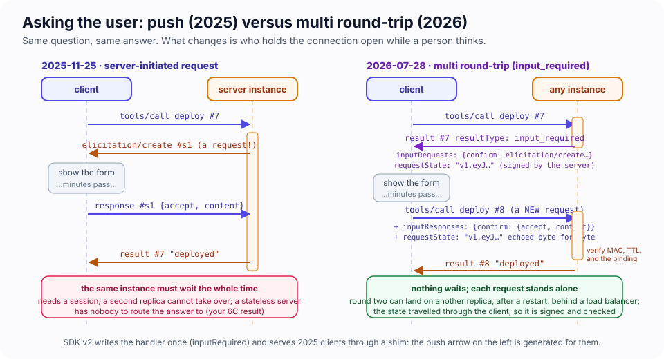
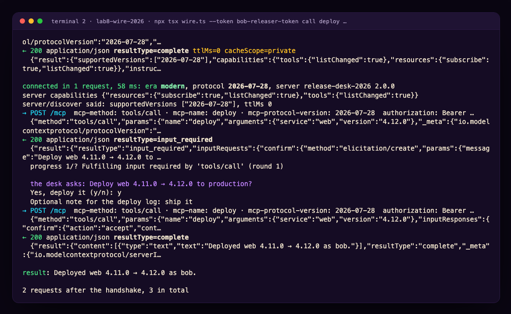
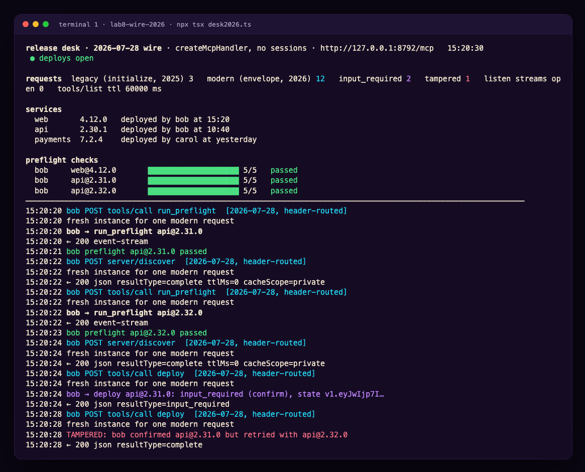
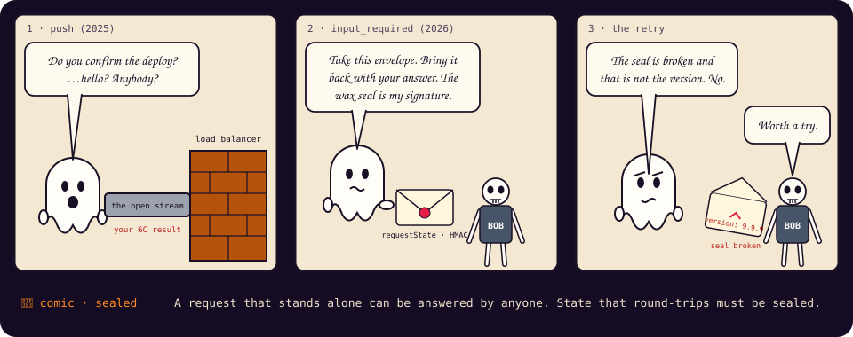
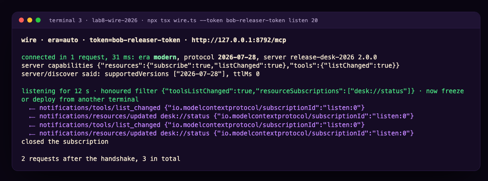

# Module 8 · The 2026 Wire: Requests That Stand Alone

| | |
|---|---|
| **Time** | 50 minutes (18 concepts · 32 lab). Advanced track, part 2: after Module 7 |
| **Lab folder** | `course/labs/lab8-wire-2026` |
| **You will** | serve the release desk on the current protocol revision, `2026-07-28`, and watch both eras on the wire with a client you control: `server/discover` instead of `initialize`, a `_meta` envelope on every request, headers that mirror the body, no sessions, a tool that asks the person for confirmation by *answering* with `input_required`, a signed `requestState` that defeats a tampered retry, a `subscriptions/listen` stream that brings the freeze notification back to a stateless server, and a cache hint that stops a client re-fetching your catalogue every turn |
| **You'll pull off** | the same `deploy` call, made twice: the first answer is a question, the second is a deploy; then you tamper with the retry in flight and the server rejects it before your handler even runs |

> 🎬 **Cold open.** Challenge 6C ended on a question. Served statelessly, the desk lost two things: cancellation (the cancel arrived at a different instance) and the freeze notification (there was no session to push it down). "What would you have to build to get the freeze notification back?" The protocol's own answer shipped on 28 July 2026, and it did not add sessions back. It removed the reasons you needed them.

## 8.1 What changed, and why it is not an increment

The `2026-07-28` revision is a redesign of the core, not a feature release. The spec's own changelog calls it a breaking change. Its one organising idea: **every request carries everything the server needs to process it**, so no server has to remember anything between two requests.

| | up to `2025-11-25` ("legacy") | `2026-07-28` ("modern") |
|---|---|---|
| Handshake | `initialize` → `notifications/initialized` | none; a client *may* ask `server/discover` first |
| Who the client is | said once at `initialize` | in every request's `_meta` envelope |
| Sessions | `Mcp-Session-Id`, `GET` stream, `DELETE` | none; `GET` and `DELETE` answer `405` |
| Server asks the user | pushes `elicitation/create` down the connection | returns an `input_required` result; the client retries |
| Server pushes changes | `list_changed` on the GET stream | the client opens `subscriptions/listen` and says what it wants |
| Progress, logging | `notifications/progress`, `notifications/message` | progress unchanged; logging per request (`_meta.logLevel`), deprecated |
| Roots, sampling | client capabilities | deprecated (SEP-2577); pass paths as arguments, call your own model |
| HTTP headers | `MCP-Protocol-Version` | plus `Mcp-Method`, `Mcp-Name`, `Mcp-Param-*` mirroring the body |
| Results | just `result` | every result has a `resultType`: `complete`, `input_required`, or an extension's |
| Caching | none | `ttlMs` + `cacheScope` on list results and `server/discover` |
| Errors | `-32000…` | reserved `-32020` header mismatch, `-32021` missing client capability, `-32022` unsupported version |

The SDK you have been using all course (v2) implements both. It calls them **eras**: a server built with `createMcpHandler` or `serveStdio` serves both from one factory; a client picks with `versionNegotiation` (the default is legacy, which is what OpenCode 1.x speaks). The next revision is scheduled for 30 March 2027, and the spec now promises at least twelve months between deprecating a feature and removing it.

> 🍬 **Treat: why the handshake had to go.** `initialize` was a conversation: "I speak 2025-11-25 and I can do elicitation", "I speak 2025-11-25 and I have tools". That only works if the thing that heard you is the thing that answers your next request. Put two replicas behind a load balancer, or restart one, and the second request lands on a server that never heard the first. Sessions were the patch: an id that routes you back to the instance that remembers. The 2026 revision does the arithmetic the other way round: if remembering is the problem, stop needing to remember. Say who you are every time.

## 8.2 The envelope and the headers

A modern request is a normal JSON-RPC request whose `params._meta` carries three reserved keys:

```json
{ "jsonrpc": "2.0", "id": 7, "method": "tools/call",
  "params": { "name": "deploy", "arguments": { "service": "web", "version": "4.12.0" },
    "_meta": { "io.modelcontextprotocol/protocolVersion": "2026-07-28",
               "io.modelcontextprotocol/clientInfo": { "name": "wire", "version": "1.0.0" },
               "io.modelcontextprotocol/clientCapabilities": { "elicitation": { "form": {}, "url": {} } } } } }
```

`protocolVersion` and `clientCapabilities` are required; `clientInfo` should be there. Miss one and the server answers `-32602` with the key named. The SDK lifts them out of `_meta` before your handler runs and hands them to you as `ctx.mcpReq.envelope`; your tool arguments never see them.

Over Streamable HTTP the same request carries three headers that **mirror the body**: `MCP-Protocol-Version: 2026-07-28`, `Mcp-Method: tools/call` and `Mcp-Name: deploy` (the tool, resource or prompt name). A tool argument can be mirrored too, as `Mcp-Param-<Name>`, if its schema says `x-mcp-header`. If a header and the body disagree, the server refuses with `-32020` and never parses further. The point is the thing in the middle: a proxy, a gateway or a rate limiter can now route, authorise and meter *without reading JSON bodies*. Module 10 builds one.

**`server/discover`** replaces the handshake for clients that want to know what they are talking to before they talk. It returns `supportedVersions`, `capabilities`, `instructions` and a `ttlMs`, and a client may cache it. A client that already knows may skip it and send `tools/call` cold; a bare request to an unknown server is legal. The SDK client's `auto` mode sends `server/discover` first and falls back to `initialize` if the answer does not look modern, which is how one client talks to both eras.

## 8.3 Asking by answering: multi round-trip requests



In Module 7 the IT desk *pushed* `elicitation/create` at your host and waited, holding the connection. A stateless server cannot do that: when the answer comes back as a new HTTP request, it may land on a different instance, and the one that asked is gone. The 2026 revision turns the question into a **result**:

```json
{ "result": { "resultType": "input_required",
    "inputRequests": { "confirm": { "method": "elicitation/create", "params": { "mode": "form", "message": "Deploy web 4.11.0 → 4.12.0 to production?", "requestedSchema": { … } } } },
    "requestState": "v1.eyJwIjp7InVzZXIiOiJib2Ii…" } }
```

The client shows the form, then **retries the same call** with a new request id, the original arguments, `inputResponses: { confirm: { action: "accept", content: { confirm: true } } }`, and `requestState` echoed **byte for byte**. The server sees a normal `tools/call` whose handler can now read the answers. Only `tools/call`, `resources/read` and `prompts/get` may answer this way. Elicitation (form and URL), sampling and roots all ride it; the server→client request channel is gone.

> 📖 **Key concept: `requestState` is the server's memory, carried by the client.** The server has nothing between the two rounds except what it put in that string, so the string holds what was asked, for whom, about what. And since it travels through the client, it comes back as **attacker-controlled input**. The spec is blunt: servers MUST integrity-protect it (HMAC or AEAD) and SHOULD bind it to the principal, a TTL and a digest of the original request. The SDK gives you `createRequestStateCodec` (HMAC-SHA256, signed not encrypted) and verifies it before your handler runs. You still have to check that the retry is about the same thing.

> 🍬 **Treat: write once, serve both.** An SDK v2 handler that returns `inputRequired(…)` works for a 2025 client too: the SDK's *legacy shim* turns the result into a push-style `elicitation/create` on the open connection, waits, and re-enters your handler with the answers filled in. That is why Module 7's IT desk could have been written the 2026 way. The shim needs a connection that stays open, though, which a stateless server does not have. You will meet that edge in 8.C.

## 8.4 Listening instead of being pushed to

Without a GET stream, how does a client learn that tools changed? It asks for exactly the notifications it wants: `subscriptions/listen` with a filter (`toolsListChanged`, `promptsListChanged`, `resourcesListChanged`, `resourceSubscriptions: [uri, …]`). The server answers with an SSE stream that stays open: first `notifications/subscriptions/acknowledged` with the filter it honours and a `subscriptionId`, then each notification tagged with that id. Closing the stream ends the subscription. `notifications/progress` and `notifications/message` never travel on it; they belong to the request that caused them.

Behind `createMcpHandler` the handler object has a publish side: `mcp.notify.toolsChanged()`, `mcp.notify.resourceUpdated(uri)`. Every open listen stream that opted in gets the event. Replace the in-process bus with your pub/sub backend and every replica's listeners hear every replica's changes. That is 6C's missing piece.

## 8.5 Cache hints

Module 2 measured the context tax of a tool catalogue; OpenCode pays it once per session because it keeps the list. A client that re-fetches `tools/list` on every turn pays a request, too. The 2026 revision puts `ttlMs` and `cacheScope` (`private` to this client, or `public`) on every cacheable result: `tools/list`, the other lists, `resources/read` and `server/discover`. The SDK's default is the honest one, `ttlMs: 0`; `cacheHints` in the server options sets the rest. The SDK client keeps a cache and invalidates it on `list_changed`, which is why TODO 3 matters for TODO 4.

## 8.6 What is deprecated, and what to do instead

SEP-2577 deprecates three things at once, with removal no earlier than mid-2027: **roots** (pass paths as tool arguments, resource URIs or configuration), **sampling** (call your model provider; Module 7.F showed why), and the **logging channel** (log to stderr for stdio servers, or OpenTelemetry; `logging/setLevel` is gone, and a per-request `_meta.logLevel` is the only way a modern client receives `notifications/message` at all). `ping` is gone. Resumability (`Last-Event-ID`) is gone: a broken response stream loses the in-flight request and the client re-sends it, which is only safe because requests now stand alone.

---

## Lab 8 · The desk, reborn (32 minutes)

### 🎯 Mission

- [ ] See both handshakes on the wire and count the requests
- [ ] Make a server refuse a hand-written request four different ways
- [ ] Turn `deploy` into a question the person answers, then a deploy
- [ ] Tamper with the retry and watch the server reject it before the handler runs
- [ ] Bring the freeze notification back to a stateless server
- [ ] Stop a client re-fetching your catalogue every turn

### 🖥️ Split screen

```
┌─ T1 · the desk ───────────────────────┐ ┌─ T2 · the wire ──────────────────────────┐
│ cd course/labs/lab8-wire-2026         │ │ cd course/labs/lab8-wire-2026            │
│ npx tsx desk2026.ts                   │ │ npx tsx wire.ts --era auto handshake     │
│                                       │ │ npx tsx wire.ts --era legacy handshake   │
│ every request: era, mirrored headers, │ │                                          │
│ resultType, input_required, listeners │ │ T3: curl, and a listener                 │
└───────────────────────────────────────┘ └──────────────────────────────────────────┘
```

`desk2026.ts` is Module 6's release desk served by `createMcpHandler`: the same tools and demo tokens (`alice-dev-token` read, `bob-releaser-token` deploy, `carol-lead-token` freeze), no sessions, both eras. It works end to end and has four TODOs. `wire.ts` is the client for this lab: it prints every HTTP exchange, answers elicitation from the terminal, and takes `--era legacy|auto|2026`. `opencode.json` points OpenCode (a 2025 client) at the same desk.

### 🧪 Exercise 8.A — Two handshakes (5 minutes)

T1: `npx tsx desk2026.ts`. T2:

```bash
npx tsx wire.ts --era auto handshake
npx tsx wire.ts --era legacy handshake
```

> 🔮 **Predict.** How many HTTP requests does each take to be ready to call a tool? What does the legacy client do that gets a `405`?

<details><summary>Our run</summary>

```
→ POST /mcp  mcp-method: server/discover · mcp-protocol-version: 2026-07-28
  {"jsonrpc":"2.0","id":"server-discover-probe-1","method":"server/discover","params":{"_meta":{"io.modelcontextprotocol/protocolVersion":"2026-07-28",…
← 200 application/json resultType=complete ttlMs=0 cacheScope=private
connected in 1 request, 78 ms: era modern, protocol 2026-07-28

→ POST /mcp  {"method":"initialize","params":{"protocolVersion":"2025-11-25",…
← 200 text/event-stream
→ POST /mcp  {"jsonrpc":"2.0","method":"notifications/initialized"}
← 202 (no body)
→ GET /mcp  mcp-protocol-version: 2025-11-25
connected in 3 requests, 62 ms: era legacy, protocol 2025-11-25
```

One request against three. The legacy client's `GET` is it opening the server→client stream it expects; the desk answers `405 Method not allowed`, because there is no session to stream to, and the client carries on without one. The board in T1 shows `fresh instance for one modern request` and `fresh instance for one legacy request`: the same factory, called once per request, for both.
</details>

Now `npx tsx wire.ts call whoami '{}'` in both eras. The modern answer names the client, the revision and the envelope keys that arrived; the legacy answer says *"speaking legacy from a 2025 client. Your host declares: {}"*. It is not that the legacy client declared nothing: it declared plenty, at `initialize`, to an instance that was thrown away. A stateless server serving 2025 traffic knows nothing about who is calling except the bearer token.

### 🧪 Exercise 8.B — Refuse me four ways (5 minutes)

Be the client with `curl` in T3. First a modern `tools/list` by hand, so you have a working baseline:

```bash
U=http://127.0.0.1:8792/mcp
H=(-H 'content-type: application/json' -H 'accept: application/json, text/event-stream' -H 'authorization: Bearer alice-dev-token')
ENV='"_meta":{"io.modelcontextprotocol/protocolVersion":"2026-07-28","io.modelcontextprotocol/clientInfo":{"name":"curl","version":"1"},"io.modelcontextprotocol/clientCapabilities":{}}'
curl -s -X POST $U "${H[@]}" -H 'mcp-protocol-version: 2026-07-28' -H 'mcp-method: tools/list' \
  -d "{\"jsonrpc\":\"2.0\",\"id\":1,\"method\":\"tools/list\",\"params\":{$ENV}}" | cut -c1-200
```

Then break it, one thing at a time, and read each refusal:

```bash
# b) forget the Mcp-Method header
curl -s -X POST $U "${H[@]}" -H 'mcp-protocol-version: 2026-07-28' -d "{\"jsonrpc\":\"2.0\",\"id\":2,\"method\":\"tools/list\",\"params\":{$ENV}}" -w ' → %{http_code}\n'
# c) claim a revision the server does not speak (change it in the header AND the envelope)
curl -s -X POST $U "${H[@]}" -H 'mcp-protocol-version: 2027-03-30' -H 'mcp-method: tools/list' -d '{"jsonrpc":"2.0","id":3,"method":"tools/list","params":{"_meta":{"io.modelcontextprotocol/protocolVersion":"2027-03-30","io.modelcontextprotocol/clientInfo":{"name":"curl","version":"1"},"io.modelcontextprotocol/clientCapabilities":{}}}}' -w ' → %{http_code}\n'
# d) leave clientCapabilities out of the envelope
curl -s -X POST $U "${H[@]}" -H 'mcp-protocol-version: 2026-07-28' -H 'mcp-method: tools/list' -d '{"jsonrpc":"2.0","id":4,"method":"tools/list","params":{"_meta":{"io.modelcontextprotocol/protocolVersion":"2026-07-28"}}}' -w ' → %{http_code}\n'
# e) open a 2025 stream
curl -s -X GET $U "${H[@]}" -H 'mcp-protocol-version: 2025-11-25' -w ' → %{http_code}\n'
# f) a bare 2025 tools/list with no initialize at all
curl -s -X POST $U "${H[@]}" -H 'mcp-protocol-version: 2025-11-25' -d '{"jsonrpc":"2.0","id":5,"method":"tools/list"}' -w ' → %{http_code}\n' | head -3
```

<details><summary>Our run</summary>

```
b) {"error":{"code":-32020,"message":"Bad Request: the request headers and body disagree: the body names method tools/list but the required Mcp-Method header is absent",…}} → 400
c) {"error":{"code":-32022,"message":"Unsupported protocol version: 2027-03-30","data":{"supported":["2026-07-28"],"requested":"2027-03-30"}}} → 400
d) {"error":{"code":-32602,"message":"Invalid _meta envelope for protocol revision 2026-07-28: io.modelcontextprotocol/clientCapabilities: missing",…}} → 400
e) {"error":{"code":-32000,"message":"Method not allowed."}} → 405
f) event: message
   data: {"result":{"tools":[{"name":"whoami",…        → 200
```
</details>

Read (f) twice. A 2025-shaped request with **no handshake at all** was served. In stateless legacy mode there is nothing to initialise; the handshake was always ceremony for the client's benefit. And read (c)'s `data.supported`: a client that gets `-32022` is told what to send instead, which is how the spec expects version negotiation to work from now on, with no round trip reserved for it.

> [!NOTE]
> 🔬 **Under the hood.** The order of checks in `desk2026.ts`'s `handle()` is the one every modern server runs: `Host`/`Origin` first (DNS rebinding, Module 6.2), then the bearer token, then the handler, which validates headers against the body before it even looks at the JSON-RPC method. A request fails as early and as cheaply as possible, and a proxy that only reads headers reaches the same conclusions as the server.

### 🧪 Exercise 8.C — TODO 1: ask by answering (8 minutes)

As delivered, `deploy` deploys. Bob with a passing preflight gets `Deployed web 4.11.0 → 4.12.0` and nobody was asked. Make the desk ask the person, through the protocol, before anything changes. In the `deploy` handler, after the scope, freeze and preflight checks, add the first round:

```ts
const view = inputResponse(ctx.mcpReq.inputResponses, "confirm");
if (view.kind === "missing") {                                   // round one: nobody has answered yet
  if (era(ctx) === "legacy") return refuse(`Deploying needs the person's confirmation, and this desk can only ask through the 2026-07-28 protocol. Your host spoke the 2025 revision.`);
  if (!clientCaps(ctx).elicitation) return refuse(`Deploying needs the person's confirmation, and your host declared no elicitation capability.`);
  const state = JSON.stringify({ user, service, version });      // naive, for now: TODO 2 signs it
  return inputRequired({
    inputRequests: { confirm: inputRequired.elicit({ message: `Deploy ${service} ${desk.services[service].version} → ${version} to production?`, requestedSchema: Confirm }) },
    requestState: state,
  });
}
if (view.kind === "elicit" && view.action !== "accept") return refuse(`${user} ${view.action}d the confirmation. Nothing deployed.`);
const answer = acceptedContent(ctx.mcpReq.inputResponses, "confirm", Confirm);
if (answer?.confirm !== true) return refuse("The confirmation was not a yes. Nothing deployed.");
```

Restart the desk. In T2, as Bob:

```bash
npx tsx wire.ts --token bob-releaser-token call run_preflight '{"service":"web","version":"4.12.0"}'
npx tsx wire.ts --token bob-releaser-token call deploy '{"service":"web","version":"4.12.0"}'
```

> 🔮 **Predict.** How many `tools/call` requests will the deploy take, and will they have the same `id`?



Two requests, different ids, and the second carries `inputResponses` and your `requestState`. The desk's board counts it under `input_required`. Now the same deploy from a 2025 client: `npx tsx wire.ts --era legacy --token bob-releaser-token call deploy '{"service":"web","version":"4.12.0"}'`, and from OpenCode (`export DESK_TOKEN=bob-releaser-token; opencode`, then *Deploy web 4.12.0*): both get the polite refusal. OpenCode 1.19 is a 2025 client; it connects (`opencode mcp list` says so), reads, runs preflights, and cannot be asked.

> [!IMPORTANT]
> 🤯 **The server asked a question without holding a connection open.** Between the two requests the desk kept nothing about the conversation: no session, no pending promise, no instance. The second request is complete on its own, so any replica could have answered it, as long as the facts it checks (here, the passed preflight) live in a store every replica shares rather than in one process's memory. Challenge 6A built a human-in-the-loop out of a six-digit code because the host could not be asked; this is the protocol doing the same job, with the question in the result and the memory in the client's pocket.

> ⚠️ **Security: the refusal for legacy hosts is a feature-detect, not a bug.** The SDK's shim could push `elicitation/create` at a 2025 client, but on a stateless server the answer would arrive at a different instance (6C). Detecting the era and saying so is the honest behaviour. Challenge 8A routes legacy traffic to a sessionful desk instead.

### 🧪 Exercise 8.D — TODO 2: seal the state (7 minutes)

Your `requestState` is plain JSON, and the retry is a brand-new request that *anything* between client and server can edit: a proxy, a buggy host, or a model that confirmed one thing and called with another. `wire.ts --tamper` plays that part: on the retry it changes `arguments.version` to another version, after you have confirmed the real one. Give it a version that has also passed preflight, so nothing else stands in the way:

```bash
npx tsx wire.ts --token bob-releaser-token --quiet call run_preflight '{"service":"api","version":"2.31.0"}'
npx tsx wire.ts --token bob-releaser-token --quiet call run_preflight '{"service":"api","version":"2.32.0"}'
npx tsx wire.ts --token bob-releaser-token --tamper --tamper-to 2.32.0 call deploy '{"service":"api","version":"2.31.0"}'
```

> 🔮 **Predict.** With TODO 1 as written, what gets deployed?

<details><summary>Our run (naive TODO 1)</summary>

```
the desk asks: Deploy api 2.30.1 → 2.31.0 to production?
Yes, deploy it (y/n): y
✂ tampered the retry: arguments.version → 2.32.0 (the person confirmed 2.31.0)
result: Deployed api 2.30.1 → 2.32.0 as bob.
```

Bob confirmed 2.31.0; 2.32.0 is in production. The confirmation and the thing confirmed were never tied together. (Without the second preflight the desk would have refused `2.32.0` for a different reason, which is luck, not a control.)
</details>

Now seal it. The codec is already constructed at the top of the file (`createRequestStateCodec`, a random 32-byte key per process, 120-second TTL). Three edits:

1. In the server options, `requestState: { verify: codec.verify }`, so the SDK verifies the signature and the TTL before any handler runs.
2. In round one, `const state = await codec.mint({ user, service, version, nonce: randomUUID() }, ctx);` instead of the JSON string.
3. In round two, after the yes, read it back and compare it with the request:

```ts
const pending = ctx.mcpReq.requestState<Pending>();
if (!pending) return refuse("The confirmation came back without its state. Start the deploy again.");
if (pending.user !== user || pending.service !== service || pending.version !== version)
  return refuse(`Confirmation mismatch: what was confirmed (${pending.service}@${pending.version}) is not what you asked to deploy (${service}@${version}). Nothing deployed.`);
```

Restart and run the tampered deploy again, then once more with `--tamper-state --tamper-to 2.32.0`, which also flips two characters of the echoed state.

<details><summary>Our run</summary>

```
✂ tampered the retry: arguments.version → 2.32.0 (the person confirmed 2.31.0)
tool error: Confirmation mismatch: what was confirmed (api@2.31.0) is not what you asked to deploy (api@2.32.0). Nothing deployed.

✂ tampered the retry: arguments.version → 2.32.0 (the person confirmed 2.31.0)
✂ tampered the requestState too: flipped its last two characters
← 200 application/json error -32602: Invalid or expired requestState
ProtocolError: Invalid or expired requestState
```

The first attack reaches your handler and dies on the comparison. The second never reaches it: `-32602 Invalid or expired requestState` comes from the SDK, and the board logs `TAMPERED` only for the first.
</details>





> [!TIP]
> 💡 **Insight: two checks, two different attackers.** The signature proves the state is one *this server* minted and nobody edited. The comparison proves the state is about *this request*. A valid, unedited state can still be replayed against different arguments, which is why `requestState` should carry (or digest) the original request and why the handler compares. Signed is not the same as bound; you need both.

### 🧪 Exercise 8.E — TODO 3: the freeze, heard again (6 minutes)

In T3, open a listener as Bob:

```bash
npx tsx wire.ts --token bob-releaser-token listen 60
```

It sends `subscriptions/listen` with `toolsListChanged: true` and `resourceSubscriptions: ["desk://status"]`; the board shows `listen streams open 1`. In T2, Carol freezes: `npx tsx wire.ts --token carol-lead-token call declare_freeze '{"reason":"payments incident"}'`.

> 🔮 **Predict.** Does the listener hear anything? What did the desk do in Module 6 at this point, and why can it not do that now?

Nothing arrives, because `declare_freeze` and `lift_freeze` publish nothing yet, and there is no session list to walk (Module 6's `setDeployAvailable` looped over `sessions`; there are none). Implement TODO 3: in both freeze tools, `mcp.notify.toolsChanged(); mcp.notify.resourceUpdated("desk://status");` and in `deploy`, after the write, `mcp.notify.resourceUpdated("desk://status")`. Restart, listen again, freeze and lift again:



Both notifications carry `io.modelcontextprotocol/subscriptionId: "listen:0"`, the id of the listen request they belong to. Try `--era legacy listen`: the client tells you `subscriptions/listen` does not exist in `2025-11-25`, tries `resources/subscribe` instead, and gets `Method not found`.

> [!IMPORTANT]
> 🤯 **6C's missing feature came back without sessions.** The listener is just another request, one that the server answers slowly. Any replica can serve it, and `mcp.bus` is where you plug in Redis or NATS so every replica's `notify` reaches every replica's listeners. Nothing about the desk remembers Bob; Bob remembers the desk.

### 🧪 Exercise 8.F — TODO 4: stop re-fetching the catalogue (4 minutes)

```bash
npx tsx wire.ts --quiet tools
```

Two `tools/list` calls; both went out, because every list result says `ttlMs=0`. Add to the server options: `cacheHints: { "tools/list": { ttlMs: TOOLS_LIST_TTL_MS, cacheScope: "private" } }`, restart, run it again.

<details><summary>Our run</summary>

```
tools/list #1: whoami, release_status, run_preflight, deploy, declare_freeze, lift_freeze  (1 request)
tools/list #2: whoami, release_status, run_preflight, deploy, declare_freeze, lift_freeze  (served from the client's cache: no request went out)
```

The board shows the result went out with `ttlMs=60000 cacheScope=private`.
</details>

Now the interplay: with a listener open and a freeze declared, the client's cached list is invalidated by `tools/list_changed`, so the next `tools/list` goes to the server and comes back without `deploy`. Comment out TODO 3 again and the cache serves a `deploy` tool that the server would refuse, for up to a minute. A cache hint without a change feed is a stale catalogue with a timer on it.

### 🏅 Mission complete

- **You read two handshakes** and know why one of them is one request.
- **You refused yourself four ways** and can decode `-32020`, `-32022`, `-32602` and a `405` on sight.
- **You asked a question by answering**, and your server kept nothing between the rounds.
- **You sealed the state** and watched a tampered retry die before your code ran.
- **You brought the freeze back** to a stateless server, through a stream the client asked for.
- **You set a cache hint** and saw why it needs the change feed next to it.

### ✅ Check yourself

<details><summary>1. A modern request arrives with no <code>Mcp-Method</code> header. What happens, and why does the spec insist on it?</summary>

`400` with `-32020 HeaderMismatch`, before the body's method is acted on. The headers exist so that intermediaries (proxies, gateways, rate limiters, WAFs) can route and authorise a request without parsing JSON. If the header could be omitted, every intermediary would have to parse the body anyway, and the headers would be worthless.
</details>

<details><summary>2. Why does the desk refuse to ask a 2025 client for confirmation, when the SDK has a shim that could?</summary>

The shim pushes `elicitation/create` down the open connection and waits for the response on the same instance. Served statelessly, the response arrives as a fresh HTTP request at an instance that never asked. On a sessionful server the shim works; `desk2026.ts` is not one, so it says so instead of hanging.
</details>

<details><summary>3. Your <code>requestState</code> is signed and the SDK verifies it. A reviewer says the comparison in round two is redundant. Is it?</summary>

No. The signature proves the server minted the state and it was not edited; it says nothing about whether the retry's arguments match it. A client can send an untouched state with different arguments, which is exactly `--tamper`. Binding (compare, or digest the original request into the state) catches that; the signature cannot.
</details>

<details><summary>4. What happens to an open <code>subscriptions/listen</code> stream when the desk restarts, and what does the client do?</summary>

The stream breaks. The client sees a remote close and must re-issue `subscriptions/listen` (the SDK's subscription reports `closed: 'remote'`). Nothing is replayed: there is no `Last-Event-ID` in 2026, so a client that cares re-fetches `tools/list` after reconnecting. Requests stand alone; so do subscriptions.
</details>

<details><summary>5. The legacy curl (f) worked with no <code>initialize</code>. Is the desk broken?</summary>

No. In stateless legacy mode there is nothing for `initialize` to set up, so the handler serves the request from a fresh instance. The capability declaration the client would have made is lost, which is why `whoami` reports `Your host declares: {}` for legacy callers, and why the desk cannot ask them anything.
</details>

<details><summary>6. Which of Module 6's features survive on this desk for a 2026 client, and which for a 2025 client?</summary>

2026 client: authentication, authorization, progress, cancellation (the cancel is the client closing the stream), confirmation, `list_changed` and resource updates via `listen`, cache hints. 2025 client: authentication, authorization, progress; no cancellation routing, no notifications, no confirmation. Same server, same factory. The era decides.
</details>

### 🏆 Challenges (optional)

**8A · Two desks, one URL (20 min).** Route by era: `isLegacyRequest(request)` in front, Module 6's sessionful desk (with its GET stream and the shim-powered confirmation) for 2025 traffic, `createMcpHandler(..., { legacy: "reject" })` for 2026 traffic. Both share the `desk` object. Prove that OpenCode now gets asked to confirm (through the shim) and that `wire.ts --era auto` still gets `input_required`.

**8B · Route on a header (15 min).** Add `x-mcp-header: true` to `deploy`'s `service` argument so it is mirrored as `Mcp-Param-Service`. Put a twenty-line reverse proxy in front of the desk that refuses any `Mcp-Param-Service: payments` request from a token that is not Carol's, *without parsing the body*. Discuss what a mirrored header can and cannot be trusted for (hint: `-32020`).

**8C · Signed, bound, and digested (15 min).** Replace the three-field comparison with a SHA-256 digest of the original request (`method`, `name`, canonical `arguments`) stored in the state, as the spec suggests. Then try to defeat it: change an argument the digest does not cover. Which arguments should it cover, and what is the cost of covering all of them?

**8D · The long task (30 min, hard).** The 2026 tasks extension (`io.modelcontextprotocol/tasks`, beta) lets `tools/call` answer `resultType: "task"` with a `taskId`, after which the client polls `tasks/get`. The SDK has no server-side helper yet. Using `server.server.setRequestHandler("tasks/get", { params, result }, …)`, make `run_preflight` return a task when the client declares the extension, keep running in the background, and answer polls until `completed`. What has to be true about where the task runs before this works behind a load balancer?

📼 **Next episode: a real login.** The desk still trusts three strings from a table. Module 9 replaces them with an authorization server, a login page, PKCE, scopes that step up, tokens that expire, and OpenCode doing the whole dance by itself.

[← Back to the course home](README.md)
