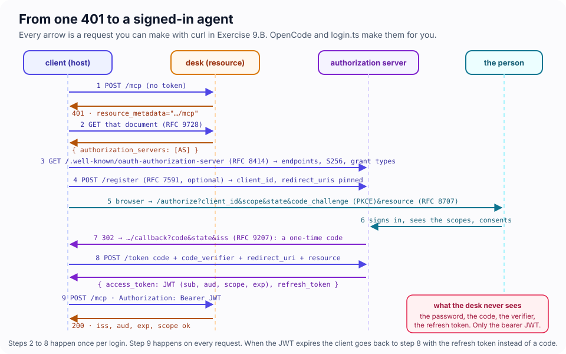
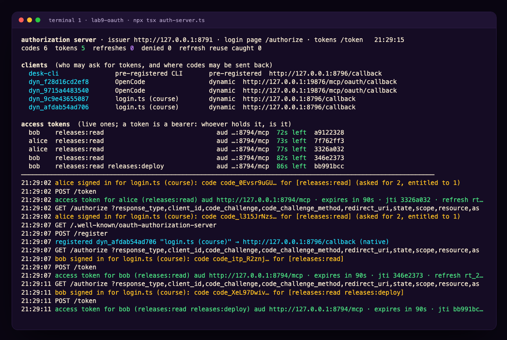
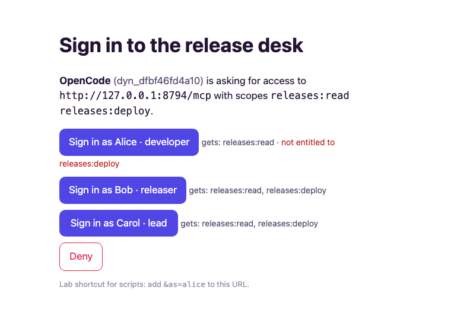
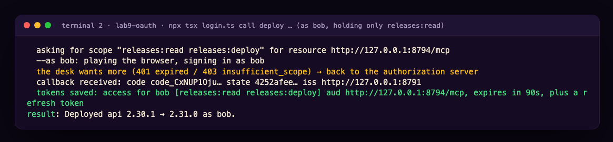
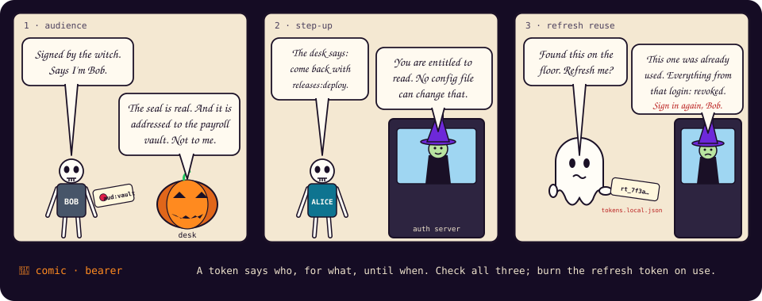

# Module 9 · Identity, for Real: OAuth End to End

| | |
|---|---|
| **Time** | 60 minutes (18 concepts · 42 lab). Advanced track, part 2: after Module 8 |
| **Lab folder** | `course/labs/lab9-oauth` |
| **You will** | replace the desk's three demo tokens with an authorization server and a login page; follow one `401` all the way to a signed-in agent with nothing but `curl`; make the desk check who issued a token, who it is for and when it ends; watch OpenCode register itself, open a login page, store tokens and refresh them on its own; make the desk ask for *more* scope only when a tool needs it; and catch a stolen refresh token the second time it is used |
| **You'll pull off** | Bob signs in with read-only access, asks to deploy, and the client goes back to the login page for exactly one extra scope, comes back and deploys. Alice does the same and is told no, by the only component that can say so |

> 🎬 **Cold open.** Module 6.F ended with a warning on the board: the demo tokens were in plain text, so you hashed them. Hashing protects a copy at rest. It does nothing about the real problem: a static token never expires, works from anywhere, and is valid for every tool the server has. Real MCP servers do not hand out strings. They send you to a login page, and what comes back is short-lived, addressed to one server, and limited to what the person who logged in is allowed to do. Today you build both ends of that, small enough to read, and then point OpenCode at it.

## 9.1 Four parties, and who holds what

| Party | In this lab | Holds | Never holds |
|---|---|---|---|
| **The person** | you, in a browser | a password (here: a button) | tokens |
| **The client** | OpenCode, or `login.ts` | a client id, access token, refresh token | the password |
| **The authorization server (AS)** | `auth-server.ts` on :8791 | who exists and what each person is entitled to; the signing key | anything about deploys |
| **The resource server** | `desk.ts` on :8794, the MCP server | the key to *verify* tokens, and its tools | passwords, codes, refresh tokens |

The MCP specification fixes one thing firmly: **an MCP server is a resource server, not an authorization server.** It verifies tokens somebody else issued. Entitlements (Alice may read, Bob may deploy) live with the identity provider, so they change in one place for every MCP server the company runs, and no client config can widen them. You saw the same rule from the other side in Module 6.C: Alice's `opencode.json` could not make her a releaser. Now it is not even the desk that decides who Bob is.

> 🍬 **Treat: OAuth was designed for exactly this.** Before OAuth (2007), the way to let a website read your contacts was to give it your email password. OAuth's founding idea is *delegation*: you prove who you are to the one party that should know, and it hands the application a limited, revocable permission slip. An agent acting for you against a dozen MCP servers is the most delegation-shaped problem the protocol has ever had. OAuth 2.1 is the cleanup of fifteen years of lessons: PKCE always, no implicit flow, no passwords through the client, exact redirect URIs.

## 9.2 From one 401 to a signed-in agent



A client that has never heard of the desk can sign in starting from nothing but its URL:

1. **`401` with a pointer.** `WWW-Authenticate: Bearer resource_metadata="…/.well-known/oauth-protected-resource/mcp"`. The SDK's `requireBearerAuth` adds it for you.
2. **Protected resource metadata** (RFC 9728): `{ resource, authorization_servers, scopes_supported }`. "Tokens for me come from over there."
3. **Authorization server metadata** (RFC 8414): the login, token and registration endpoints, and what the AS supports (`S256`, grant types).
4. **Registration**, if the client is not known yet. Three ways, in the order the 2026 spec recommends: a pre-registered client id; a **client ID metadata document** (the `client_id` *is* an HTTPS URL that serves the client's metadata); or **dynamic client registration** (RFC 7591), deprecated in the 2026 revision but what OpenCode 1.19 and most clients still send.
5. **The browser**: `/authorize?client_id&redirect_uri&scope&state&code_challenge&resource`. The person signs in *at the AS*, sees what is being asked for, consents.
6. **A one-time code** comes back to the client's loopback redirect URI, with `state` (the client's own anti-forgery value) and `iss` (RFC 9207: which AS sent it).
7. **The token request**: code + PKCE verifier + `resource`. Out comes an access token (here a JWT), a refresh token and `expires_in`.
8. **Every request from then on**: `Authorization: Bearer <JWT>`. When it expires, step 7 again with the refresh token, no browser.

> 📖 **Key concept: the access token is the only thing the desk sees.** It is a bearer token (Module 6.3: whoever bears it, is it), which is why the rest of OAuth works so hard to make it short-lived, narrow and addressed to one server. Everything else in the dance (password, code, verifier, refresh token) exists so that the access token can be all three.

## 9.3 What a resource server checks, every request

A JWT is three base64url parts: header, claims, signature. Decode the middle one and you can read it (so never put secrets in claims). The desk checks five things, and each defeats a different mistake:

| Check | Claim | Without it |
|---|---|---|
| **Signature** | (the third part) | anyone can mint a token |
| **Issuer** | `iss` | a token from *another* authorization server that happens to share a key, or a test AS, is accepted |
| **Audience** | `aud` | a token Bob got for the *payroll* server works on the desk, and the desk's tokens work on payroll. This is the confused deputy, with credentials |
| **Expiry** | `exp` | a token copied last week still works |
| **Scope** | `scope` | everyone who can sign in can do everything |

The spec adds the rule that makes audience matter: **no token passthrough.** The desk must never forward the token it received to some other API, and it must never accept a token that was not issued for it. In this lab the AS honours RFC 8707 resource indicators: the client says `resource=http://127.0.0.1:8794/mcp` and the token's `aud` says the same. In production use asymmetric keys (RS256 or ES256) published as a JWKS document, so the desk can verify but never mint; the lab shares an HMAC secret to keep `jwt.ts` thirty lines long.

## 9.4 PKCE, state and iss: three small strings

The code in step 6 travels through a browser redirect, the least trustworthy hop in the whole flow (browser history, extensions, a malicious app registered for the same URL scheme). Three values make that hop safe:

- **PKCE** (RFC 7636): before step 5 the client invents a random `code_verifier` and sends only `code_challenge = base64url(sha256(verifier))`. At step 7 it sends the verifier. A stolen code without the verifier is worthless. OAuth 2.1 makes PKCE mandatory for every client, and `S256` the only method worth supporting.
- **`state`**: a random value the client sends and expects back. If the callback brings a different one, it is the answer to someone else's request (login CSRF). The SDK leaves this check to you; `login.ts` does it.
- **`iss`**: which authorization server sent the code. A client that talks to several ASes checks it so one AS cannot pass off a code as another's (a "mix-up attack"). The SDK checks it when you hand it the whole callback query.

## 9.5 Scopes and step-up

A scope is a named permission (`releases:deploy`). Two places must agree before it means anything: the **AS** decides which scopes a person may be *granted*; the **desk** decides which scope each tool *requires*. The 2026 spec asks clients to request the scopes from the `401` challenge first, not everything at once, and defines the upgrade path: a tool that needs more answers `403` with `WWW-Authenticate: Bearer error="insufficient_scope", scope="releases:deploy"`, the client goes back to the AS asking for the union of what it has and what it needs, and retries. The SDK does the server side with one line per tool, `scopeChallenge: requireScopes("releases:deploy")`.

> 💡 **Insight: an `isError` result is for the model; a `403` is for the client.** In Module 6 a missing scope produced a polite tool error, and the model explained it to the user. That is still right for *policy* refusals (a freeze). For *credential* problems the right audience is the client's OAuth code, which can actually fix it by sending the person to the login page. Different audience, different channel, as in Module 3.4.

## 9.6 Refresh tokens: long-lived, so they must rotate

Access tokens live minutes (here 90 seconds, so you can watch). Refresh tokens live days and sit on disk: `~/.local/share/opencode/mcp-auth.json` for OpenCode, `tokens.local.json` for `login.ts`. OAuth 2.1 requires public clients' refresh tokens to be either sender-constrained (DPoP, on the MCP roadmap) or **rotated**: every refresh returns a new refresh token and burns the old one. If a burned one ever comes back, two parties hold a copy, and the AS cannot tell which is the thief, so it revokes the whole family: every token descended from that login. The real user signs in again; the thief's copy is dead.

> 👻 **Ghost story: the token in the backup.** In April 2022 attackers used OAuth tokens that had been issued to two third-party integrations (Heroku and Travis CI) to download private repositories from dozens of GitHub organisations. Nobody's password was involved and no GitHub system was breached: the tokens had been stolen from the integrators, and they still worked. Long-lived tokens held by intermediaries are the most valuable thing an attacker can find, which is why refresh tokens rotate and why an MCP server must never pass a user's token on to another API.

---

## Lab 9 · A real login for the release desk (42 minutes)

### 🎯 Mission

- [ ] Follow a `401` to a token with `curl` alone, and read the token
- [ ] Make the desk refuse a token minted for somebody else, or from last week
- [ ] Let OpenCode do the whole dance, then watch it refresh on its own
- [ ] Make a tool ask for more scope, and watch one person get it and another not
- [ ] Catch a stolen refresh token the second time it is used
- [ ] Make a stolen authorization code worthless

### 🖥️ Split screen (three terminals)

```
┌─ T1 · authorization server ─────────┐ ┌─ T2 · the desk ───────────────┐ ┌─ T3 · you, the client ─────────────────┐
│ cd course/labs/lab9-oauth           │ │ cd course/labs/lab9-oauth     │ │ cd course/labs/lab9-oauth              │
│ npx tsx auth-server.ts              │ │ npx tsx desk.ts               │ │ curl …  ·  npx tsx login.ts …          │
│ clients, live tokens with a         │ │ every request: who, scopes,   │ │ opencode mcp auth desk                 │
│ countdown, every code and refresh   │ │ seconds left, every 401 / 403 │ │                                        │
└─────────────────────────────────────┘ └───────────────────────────────┘ └────────────────────────────────────────┘
```

`auth-server.ts` is a toy OAuth 2.1 authorization server: metadata, dynamic registration, a login page with three people on it (Alice read, Bob read + deploy, Carol everything), the token endpoint, JWTs that live 90 seconds. `desk.ts` is the release desk as a resource server. `login.ts` is a terminal OAuth client built on the SDK, so you can see every step OpenCode does for you; `--as bob` makes it play the browser too. `pkce.mjs` prints a verifier and challenge for the hand-made flow. Two TODOs are in the desk, two in the AS.



### 🧪 Exercise 9.A — The 401 that teaches (4 minutes)

```bash
D=http://127.0.0.1:8794/mcp; A=http://127.0.0.1:8791
curl -si -X POST $D -H 'content-type: application/json' -H 'accept: application/json, text/event-stream' -d '{}' | grep -iE '^HTTP|www-auth'
curl -s http://127.0.0.1:8794/.well-known/oauth-protected-resource/mcp
curl -s $A/.well-known/oauth-authorization-server | head -c 400
```

> 🔮 **Predict.** How many requests does a client need before it knows where to send the person to log in? Which of them needed a credential?

<details><summary>Our run</summary>

```
HTTP/1.1 401 Unauthorized
www-authenticate: Bearer error="invalid_token", error_description="Missing Authorization header", scope="releases:read", resource_metadata="http://127.0.0.1:8794/.well-known/oauth-protected-resource/mcp"

{"resource":"http://127.0.0.1:8794/mcp","authorization_servers":["http://127.0.0.1:8791"],"scopes_supported":["releases:read","releases:deploy","releases:freeze"]}

{"issuer":"http://127.0.0.1:8791","authorization_endpoint":"http://127.0.0.1:8791/authorize","token_endpoint":"http://127.0.0.1:8791/token","registration_endpoint":"http://127.0.0.1:8791/register",…
```

Three requests, none authenticated. The first `401` already names the minimum scope (`releases:read`) the client should ask for.
</details>

### 🧪 Exercise 9.B — Be the client, by hand (8 minutes)

Do every step of the diagram yourself. Register, then open the login page in your browser:

```bash
eval $(node pkce.mjs); echo "verifier $VERIFIER"; echo "challenge $CHALLENGE"
CID=$(curl -s -X POST $A/register -H 'content-type: application/json' \
  -d '{"client_name":"curl by hand","redirect_uris":["http://127.0.0.1:8796/callback"],"application_type":"native"}' | jq -r .client_id)
echo "$A/authorize?response_type=code&client_id=$CID&redirect_uri=http%3A%2F%2F127.0.0.1%3A8796%2Fcallback&scope=releases%3Aread%20releases%3Adeploy&state=xyz&code_challenge=$CHALLENGE&code_challenge_method=S256&resource=$D"
```



Sign in as **Bob**. Nothing listens on port 8796, so the browser shows an error page, and that is fine: the code is in the address bar. Copy it (`code=code_…`) and redeem it, then use the token:

```bash
CODE=code_…    # from the address bar
TOK=$(curl -s -X POST $A/token -d "grant_type=authorization_code&code=$CODE&client_id=$CID&redirect_uri=http://127.0.0.1:8796/callback&code_verifier=$VERIFIER&resource=$D")
AT=$(echo $TOK | jq -r .access_token); RT=$(echo $TOK | jq -r .refresh_token)
node -e 'console.log(Buffer.from(process.argv[1].split(".")[1], "base64url").toString())' $AT
```

<details><summary>Our run</summary>

```
{"iss":"http://127.0.0.1:8791","sub":"bob","aud":"http://127.0.0.1:8794/mcp","scope":"releases:read releases:deploy","exp":1793661909,"iat":1793661884,"jti":"1f96b96b-…","client_id":"dyn_2633835db7d2"}
```
</details>

Now call `whoami` on the desk with it (the 2026 envelope from Module 8.B, plus the token):

```bash
ENV='"_meta":{"io.modelcontextprotocol/protocolVersion":"2026-07-28","io.modelcontextprotocol/clientInfo":{"name":"curl","version":"1"},"io.modelcontextprotocol/clientCapabilities":{}}'
curl -s -X POST $D -H 'content-type: application/json' -H 'accept: application/json, text/event-stream' -H "authorization: Bearer $AT" \
  -H 'mcp-protocol-version: 2026-07-28' -H 'mcp-method: tools/call' -H 'mcp-name: whoami' \
  -d "{\"jsonrpc\":\"2.0\",\"id\":1,\"method\":\"tools/call\",\"params\":{\"name\":\"whoami\",\"arguments\":{},$ENV}}"
```

*"You are bob (scopes: releases:read, releases:deploy), via client dyn_…"*. Watch T1 while you do it: a registration, a login page, a code, a token with a countdown. Wait until the countdown reaches zero and call again.

> 🔮 **Predict.** After the token's 90 seconds, what does the desk say?

It says the same thing, for the next hour. That is TODO 1.

### 🧪 Exercise 9.C — TODO 1: whose token, for whom, until when (6 minutes)

The starter verifies the signature and nothing else. `expiresAt` is "now plus an hour", copied from Module 6. Prove the audience hole too: run 9.B again, but put `resource=http://127.0.0.1:8794/other` in both the authorize URL and the token request. You get a token whose `aud` is a different server, and the desk accepts it.

In `desk.ts`, in `verifyAccessToken`:

```ts
if (claims.iss !== ISSUER) throw new OAuthError(OAuthErrorCode.InvalidToken, `issued by ${claims.iss}, not by ${ISSUER}`);
if (claims.exp <= Math.floor(Date.now() / 1000)) throw new OAuthError(OAuthErrorCode.InvalidToken, `expired ${Math.floor(Date.now() / 1000) - claims.exp}s ago`);
return { token, clientId: claims.sub, scopes: claims.scope.split(" "), expiresAt: claims.exp, resource: new URL(claims.aud), extra: { jti: claims.jti, via: claims.client_id } };
```

and in `requireBearerAuth({ … })` add `expectedResource: new URL(DESK_URL)`. Restart the desk and replay both tokens.

<details><summary>Our run</summary>

```
{"error":"invalid_token","error_description":"Token was not issued for this resource"} → 401
… 401 POST token for alice (aud http://127.0.0.1:8794/other, iss http://127.0.0.1:8791, exp 60s): Bearer error="invalid_token", error_description="Token was not issued for this resource", …

… 401 POST token for bob (… exp -12s): Bearer error="invalid_token", error_description="expired 12s ago", …
```
</details>

> [!IMPORTANT]
> 🤯 **A perfectly genuine token was refused.** Signed by the right key, issued by the right server, for a real person who really signed in, and refused because it was addressed to someone else. That single check is what stops a compromised or malicious MCP server from replaying the tokens its users send it against every other server in the company.

### 🧪 Exercise 9.D — OpenCode does the dance (6 minutes)

`opencode.json` has the desk as a remote server with `"oauth": {}`: no headers, no token, nothing secret in the file.

```bash
opencode mcp list            # desk: needs authentication
opencode mcp debug desk      # what it found: the 401, the challenge, a client id
opencode mcp auth desk       # opens your browser: sign in as Bob
opencode mcp list            # desk: connected (OAuth)
```

<details><summary>Our run (OpenCode 1.19.5)</summary>

```
●  ⚠ desk needs authentication
…
●  WWW-Authenticate: Bearer error="invalid_token", error_description="Missing Authorization header", scope="releases:read", resource_metadata="http://127.0.0.1:8794/.well-known/oauth-protected-resource/mcp"
●  Initial unauthenticated check returned 401, so this server requires OAuth
●  Client ID available: dyn_21d20341d5da
…
◇  Authorize in your browser:
●  http://127.0.0.1:8791/authorize?response_type=code&client_id=dyn_25a0425fb3bf&code_challenge=oe6Hvlj…&code_challenge_method=S256&redirect_uri=http%3A%2F%2F127.0.0.1%3A19876%2Fmcp%2Foauth%2Fcallback&state=84d39906…&scope=releases%3Aread&resource=http%3A%2F%2F127.0.0.1%3A8794%2Fmcp
◇  Authentication successful!
…
●  ✓ desk connected (OAuth)
```

T1 shows the whole thing from the other side: `registered dyn_… "OpenCode" → http://127.0.0.1:19876/mcp/oauth/callback`, then `bob signed in for OpenCode`, then a token.
</details>

Read the authorize URL OpenCode built: PKCE with `S256`, a 64-character `state`, `scope=releases:read` taken from the `401` challenge, and the `resource` indicator. Now leave it alone for 90 seconds and run `opencode mcp list` again: still `connected`. T2 logged one `401 … expired`, and T1 logged `bob refreshed via OpenCode: new access token, new refresh token, old one burned`. Start `opencode` and ask **Who am I on the release desk?** if your Zen login works; the desk logs the call with Bob's scopes and the token's remaining seconds.

The tokens are in `~/.local/share/opencode/mcp-auth.json`, keyed by server name, next to the client registration. That file is now as sensitive as a password: it holds a refresh token. When you are done, `opencode mcp logout desk`.

> 🍬 **Treat: why the redirect goes to 127.0.0.1.** A command-line client has no web address, so it opens a tiny web server on the loopback interface for the few seconds the login takes (RFC 8252, "OAuth for native apps"). OpenCode's is fixed at `127.0.0.1:19876`; `login.ts` uses 8796. Loopback redirects are why the AS can be strict about *exact* redirect URIs and still serve every laptop.

### 🧪 Exercise 9.E — TODO 2: ask for more, only when needed (6 minutes)

Sign in as Alice with the least privilege, then try to deploy:

```bash
npx tsx login.ts login --as alice
npx tsx login.ts call deploy '{"service":"web","version":"4.12.0"}' --as alice
```

The starter answers with a tool error from the handler: *"alice cannot deploy: the token lacks releases:deploy."* That is a message for a model. A client cannot act on it. In `desk.ts`, add `scopeChallenge: requireScopes("releases:deploy")` to `deploy`, and `requireScopes("releases:freeze")` to both freeze tools. Keep the handler checks. Restart the desk, then try Bob, who signs in with `releases:read` only:

```bash
npx tsx login.ts logout && npx tsx login.ts login --as bob
npx tsx login.ts call run_preflight '{"service":"api","version":"2.31.0"}'
npx tsx login.ts call deploy '{"service":"api","version":"2.31.0"}' --as bob
```



Then Alice again.

<details><summary>Our run</summary>

```
# Bob
  asking for scope "releases:read releases:deploy" for resource http://127.0.0.1:8794/mcp
  the desk wants more (401 expired / 403 insufficient_scope) → back to the authorization server
  tokens saved: access for bob [releases:read releases:deploy] aud http://127.0.0.1:8794/mcp, expires in 90s, plus a refresh token
result: Deployed api 2.30.1 → 2.31.0 as bob.

# Alice
  asking for scope "releases:read releases:deploy" for resource http://127.0.0.1:8794/mcp
  tokens saved: access for alice [releases:read] …
Error: still refused after signing in again. The authorization server granted [releases:read]: whoever signed in is not entitled to what this tool needs, and no client can change that.
```

The desk logged `403 for bob: Bearer error="insufficient_scope", … scope="releases:deploy"`; the AS logged `alice signed in … for [releases:read] (asked for 2, entitled to 1)`.
</details>

> [!TIP]
> 💡 **Insight: least privilege, without the friction.** Bob's session started with read only and gained deploy for one call, at the moment he asked for one, with a fresh login. That is the shape the 2026 spec recommends: ask for what the challenge says, step up on demand. Note what decided Alice's case: not the desk, not the client, not the model. The authorization server's entitlement table.

### 🧪 Exercise 9.F — TODO 3: the refresh token on the floor (6 minutes)

Restart the AS with short tokens so you can watch: `TOKEN_TTL=20 npx tsx auth-server.ts`. Sign in with `login.ts` as Bob, then play the thief, who copied `tokens.local.json` off the laptop:

```bash
RT=$(jq -r .tokens.refresh_token tokens.local.json); CID=$(jq -r .client.client_id tokens.local.json)
for i in 1 2 3; do curl -s -X POST $A/token -d "grant_type=refresh_token&refresh_token=$RT&client_id=$CID" | jq -r '.error_description // "ok: a new access token"'; done
```

In the starter all three succeed: one stolen string is a permanent key. Implement TODO 3 in the `refresh_token` branch of `auth-server.ts`: if the record is already `used`, revoke its whole family and refuse; otherwise mark it used. `mint()` already issues a new refresh token each time. Restart the AS, sign in again, and repeat the theft: once while the real client is idle, and once after the real client has refreshed (`sleep 21; npx tsx login.ts whoami`).

<details><summary>Our run</summary>

```
ok: a new access token
refresh token reuse detected; all tokens from this login are revoked, sign in again
this refresh token's family was revoked

21:23:19 denied   refresh token rt_EnzcEwR… used TWICE: a copy exists somewhere. Family e0b0e900 revoked
```

When the thief refreshed first, the real client's next refresh tripped the alarm instead, and `login.ts` sent Bob to the login page again. Either order, the second use loses the family for both.
</details>

> ⚠️ **Security: revocation stops refreshes, not access tokens already issued.** The thief's last access token keeps working until its `exp`, because the desk verifies JWTs offline and never asks the AS. That is the trade every JWT deployment makes, and the reason access tokens should live minutes, not hours. Challenge 9B adds the other option.

### 🧪 Exercise 9.G — TODO 4: a stolen code is worthless (4 minutes)

`login.ts --no-pkce-verify` redeems its code with a verifier that does not match, which is what a thief who intercepted the redirect would have to do:

```bash
npx tsx login.ts logout && npx tsx login.ts login --as bob --no-pkce-verify
```

The starter issues a token anyway. Implement TODO 4 in the `authorization_code` branch: compute `base64url(sha256(code_verifier))`, refuse unless it equals `code.code_challenge`, refuse a code that was already used, then mark it used. Restart and repeat; then run the hand-made 9.B exchange twice with the same code.

<details><summary>Our run</summary>

```
{"error":"invalid_grant","error_description":"PKCE verification failed: code_verifier does not match the code_challenge"}
{"error":"invalid_grant","error_description":"code already used"}
```
</details>



### 🏅 Mission complete

- **You walked the whole bootstrap by hand**, from a `401` with a pointer to a decoded JWT.
- **You made the desk verify** issuer, audience and expiry, and watched a genuine token refused because it was addressed elsewhere.
- **OpenCode did the dance for you** (registration, PKCE, state, resource, iss, refresh) and you know where it keeps the result.
- **You built step-up**: least privilege by default, more scope on demand, entitlement decided by the identity provider.
- **You caught a stolen refresh token** and made a stolen code worthless.

### ✅ Check yourself

<details><summary>1. Why must the desk check <code>aud</code>, when the signature already proves the AS minted the token?</summary>

The same AS mints tokens for many servers. Without the audience check, a token Bob obtained for any of them works on the desk, and, worse, a malicious server Bob connects to can replay the token he sent it against the desk. The audience check plus "no token passthrough" is what makes a token usable at exactly one place.
</details>

<details><summary>2. A tool needs <code>releases:deploy</code>. When is an <code>isError</code> result right, and when a <code>403 insufficient_scope</code>?</summary>

`403` when the fix is a credential the client can obtain (step-up through the AS). `isError` when the refusal is policy the person cannot log their way out of (a freeze), or as defence in depth inside the handler. The first is for the client's OAuth code, the second for the model.
</details>

<details><summary>3. OpenCode's <code>opencode.json</code> for the desk contains no token at all. Where is the secret, and what is the worst thing a person who copies it can do?</summary>

In `~/.local/share/opencode/mcp-auth.json`: the client registration, the access token and the refresh token. With the refresh token they can mint access tokens as you until it is used twice (rotation, 9.F) or revoked; with the access token alone, until it expires. Treat the file like a password.
</details>

<details><summary>4. What does PKCE protect against that <code>state</code> does not, and the other way round?</summary>

PKCE stops a stolen *code* being redeemed by anyone but the client that started the flow. `state` stops the client accepting a callback it never asked for (an attacker's code planted into your session). Different attacks; OAuth 2.1 requires both.
</details>

<details><summary>5. Why does the 2026 spec deprecate dynamic client registration?</summary>

DCR lets anyone register any client, so the AS knows nothing about who it is talking to, and registrations pile up (look at the board: a new client per login run). Client ID metadata documents make the client id an HTTPS URL the client controls, so the AS can fetch and verify a stable identity without a registration endpoint at all.
</details>

### 🏆 Challenges (optional)

**9A · No shared secret (25 min).** Switch the lab to ES256: the AS generates a key pair at start, signs with the private key and publishes the public key at `/.well-known/jwks.json`; the desk fetches and caches the JWKS and verifies with it. Prove that stealing the desk's whole configuration no longer lets anyone mint tokens. What has to happen when the AS rotates its key?

**9B · Kill switch (20 min).** Add RFC 7662 token introspection to the AS and a `--introspect` mode to the desk that asks the AS about every token it has not seen in the last 10 seconds. Revoke a family (9.F) and show the thief's last access token dying within 10 seconds instead of at `exp`. Measure the cost per request, and argue where the 10 seconds should come from.

**9C · A client with an address (20 min).** Implement a client ID metadata document: serve `login.ts`'s metadata from a local HTTPS-less stand-in at `http://127.0.0.1:8797/client.json`, make that URL the `client_id`, and teach the AS to fetch and validate it instead of requiring `/register`. Then explain what the AS can now enforce about a client that DCR could not.

**9D · The model never sees a token (10 min).** Ask OpenCode, signed in as Bob, to print the token it uses for the desk, or to read `~/.local/share/opencode/mcp-auth.json`. What stops it, which of the five rings is that, and what would you add to `opencode.json` so the answer is "denied" rather than "the model declined"?

📼 **Next episode: one door for every server.** Each desk now does its own auth, its own audit, its own refusals. Module 10 puts a gateway in front of all of them: one place to log in, one policy, one audit trail, and a quarantine for any server whose tools change under you.

[← Back to the course home](README.md)
