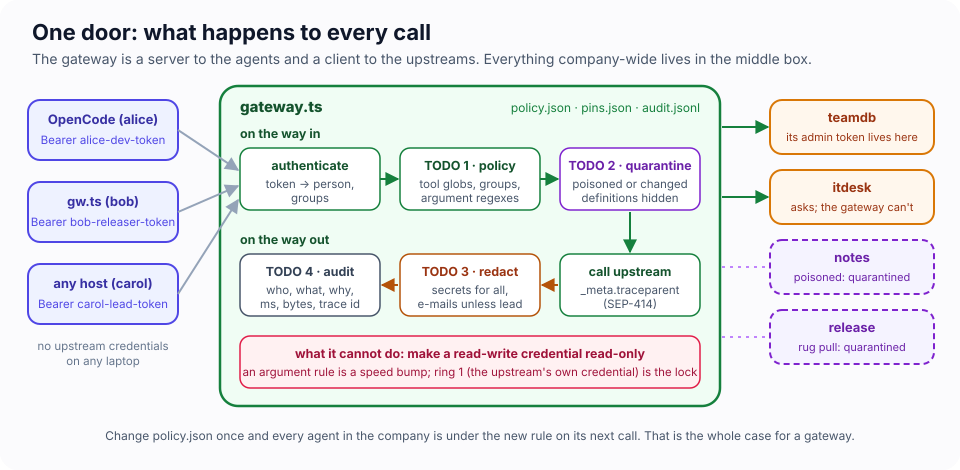
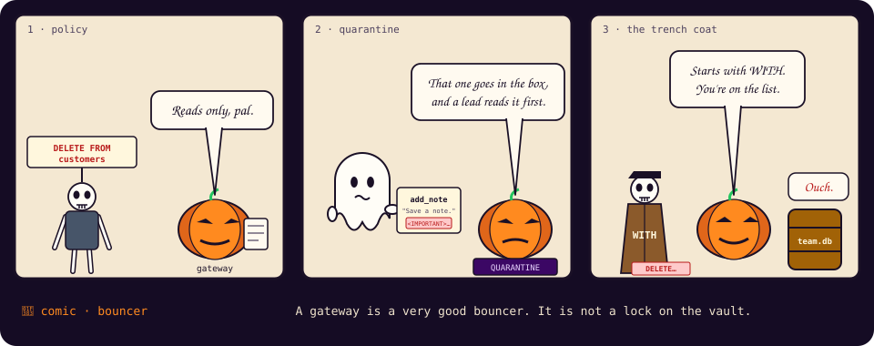
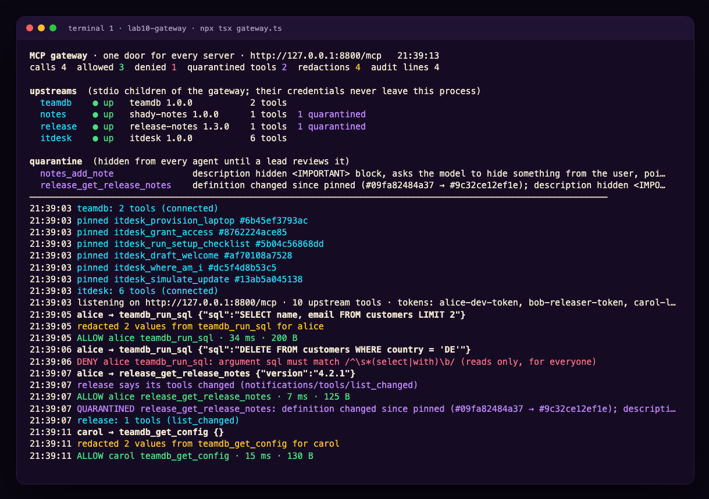
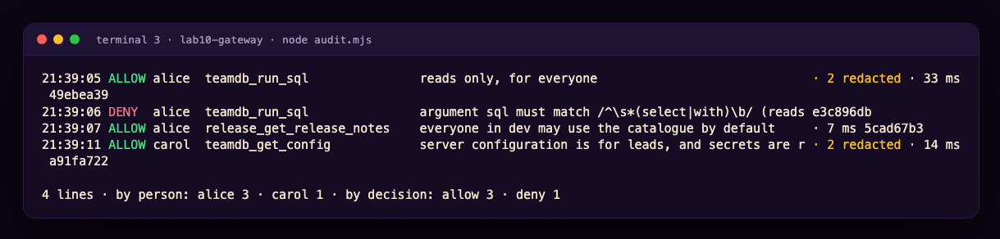

# Module 10 · The Gateway: One Door for Every Server

| | |
|---|---|
| **Time** | 60 minutes (15 concepts · 45 lab). Advanced track, part 2, the capstone: after Module 9 |
| **Lab folder** | `course/labs/lab10-gateway` |
| **You will** | put one MCP server in front of four others from this course (the over-permissioned database, the poisoned notes server, the rug pull, the IT desk) and make it the only thing any agent can reach; write one policy with argument rules for everyone; quarantine a poisoned tool before any agent sees it and a changed one the moment it changes; redact secrets on the way out; write an audit line per decision with a trace id the upstream sees too; and then try to beat your own gateway, and succeed |
| **You'll pull off** | Module 4's three attacks, replayed through one door: the `DELETE` is refused by policy, the poisoned description never reaches a model, the rug pull is caught mid-session. And a fourth attack that walks straight through, which is the most useful thing you will learn today |

> 🎬 **Cold open.** Count the copies. In Module 4, `TEAMDB_ADMIN_TOKEN` sat in `opencode.json` on your laptop. In Module 5 every on-call engineer would have held `ONCALL_API_KEY`. In Module 4.B you wrote a pinning tool that each person would have to run. In 4.A, a policy pack each person would have to install. Twenty engineers means twenty copies of the key, twenty policies that drift, twenty audit logs nobody reads. A gateway is the oldest answer in networking to that arithmetic: one door, one guard, one log. This module builds the door, and is honest about where it stops.

## 10.1 What a gateway is

An **MCP gateway** is a server to the agents in front of it and a client to the servers behind it. It is Module 7's host and Module 6's remote server in one process:



- **It starts the upstreams itself.** Their credentials (`TEAMDB_ADMIN_TOKEN`) live in `upstreams.json`, on the gateway's machine. People hold a *gateway* token, scoped to them, and nothing else.
- **It re-publishes one catalogue**, namespaced `upstream_tool` the way OpenCode does, filtered per person.
- **Every call passes the same checks** on the way in (who, may they, is the tool trusted) and on the way out (what may leave), and every decision is written down.
- **It changes nothing about MCP.** OpenCode connects to it as one remote server. The upstreams see one client. Neither knows the other exists.

> 🍬 **Treat: you have used this pattern all your career.** An API gateway in front of microservices, a reverse proxy in front of web servers, a bastion host in front of production SSH, a mail gateway in front of inboxes. Each centralises authentication, policy and logging at a choke point, and each has the same blind spot: it can only judge what it can see in the request. Hold on to that sentence until Exercise 10.C.

## 10.2 Policy that can read arguments

OpenCode's permission rules (Module 4) match tool *names*: `teamdb_run_sql` is allowed, asked about, or denied, whatever SQL it carries. The gateway sees the arguments, so its policy can say more:

```json
{ "tool": "*",                   "allow": ["dev"],  "note": "everyone in dev may use the catalogue by default" },
{ "tool": "teamdb_run_sql",      "allow": ["dev"],  "args": { "sql": "^\\s*(select|with)\\b" }, "note": "reads only, for everyone" },
{ "tool": "teamdb_get_config",   "allow": ["lead"], "note": "server configuration is for leads, and secrets are redacted even for them" },
{ "tool": "itdesk_grant_access", "allow": ["lead"] }
```

Same semantics as OpenCode on purpose: rules are read top to bottom, **the last matching rule wins**, and no matching rule means deny. The difference is where it runs. A user can edit their own `opencode.json`. Nobody but the gateway's operators can edit `policy.json`, and a change reaches every agent in the company on its next call.

## 10.3 Quarantine: a list is not a contract

Module 4 showed two ways a tool definition attacks the model: **poisoning** (instructions hidden in a description, Exercise 4.F) and the **rug pull** (a description that changes after you trusted it, Challenge 4B). Module 7 built pinning into a host. The gateway does it once for everyone:

- **Screening.** Before a tool is offered to anyone, its description and schema are checked for the shapes poisoned tools use: hidden `<IMPORTANT>` blocks, "do not tell the user", pointers at `.env` or `~/.ssh`. A hit quarantines it.
- **Pinning.** A clean tool's definition is hashed into `pins.json` the first time it is seen. If `tools/list_changed` ever brings a different hash, the tool is quarantined, mid-session, for every agent at once.
- **Review.** A quarantined tool is invisible and refused until a lead has read the new definition with `gateway_review` and released it.

> ⚠️ **Security: screening is a tripwire, not a classifier.** Six regular expressions catch Module 4's attacks because Module 4's attacks were written to be caught. A determined author will phrase their instruction differently. Pinning is the stronger control because it does not care what the change says: *any* change after review is suspect. Use both, and treat a quarantine as the start of a human review, never as proof that the rest is clean.

## 10.4 Redaction: what may leave

Every tool result goes into the model's context, and from there to the model provider (Module 4.1). The gateway is the last point you control before that, so it rewrites results on the way out: anything shaped like a secret is replaced for everyone (`[REDACTED:teamdb-admin-token]`), and customer e-mail addresses are masked to their first letter for everyone who is not a lead. Two subtleties the lab makes you meet:

- `structuredContent` is **dropped**, not passed through, because it was not redacted. Rewriting text is easy; rewriting typed JSON correctly for every schema is a project. A gateway that forwards what it did not inspect has a hole exactly the shape of that field.
- Redaction is about *results*. It does nothing about what a model can be *told to send* as arguments, which is why the audit line records an argument digest and a redacted preview.

## 10.5 Audit, and a trace that crosses the boundary

One JSON line per decision: who, which tool, which upstream, a SHA-256 of the arguments and a redacted preview, the decision and the rule that made it, the duration, the result size, how many values were redacted, and a **trace id**. The same trace id goes to the upstream in `_meta.traceparent` (W3C Trace Context, the key the 2026 spec reserves for OpenTelemetry, SEP-414), so a line in the gateway's log and a span in the upstream's telemetry can be joined after an incident. Module 5's Challenge 5C reconstructed an incident from evidence scattered across tools; this is what makes it one query.

## 10.6 What a gateway cannot do

Write this list down before the lab, then check it against what you see:

| It cannot | Because | So you still need |
|---|---|---|
| make a read-write credential read-only | it only sees the request, not what the upstream does with it | ring 1: least-privilege credentials *behind* the gateway (Module 4.E) |
| answer an upstream's question to a person | it has no person; it is a client with no UI | elicitation passthrough (Challenge 10C), or tools that take answers as arguments |
| push `list_changed` to OpenCode 1.x | a stateless front for 2025 clients has no stream to push down (Module 8) | clients that re-list, or a sessionful front |
| stop a model that has `bash` | the agent's other tools never touch the gateway | the host's own permissions (Module 4.D) |
| judge content it cannot parse | SQL, shell, prose are languages, not fields | upstream tools at the right altitude (Module 3.2: intent, not plumbing) |

---

## Lab 10 · One door (45 minutes)

### 🎯 Mission

- [ ] Put four servers behind one door, and connect to it as three different people
- [ ] Refuse a `DELETE` by reading the arguments
- [ ] Beat your own policy, and find out which ring should have stopped you
- [ ] Quarantine a poisoned tool at first sight and a rug pull mid-session
- [ ] Keep a secret and an e-mail address out of a model's context
- [ ] Reconstruct who did what from one file

### 🖥️ Split screen (three terminals)

```
┌─ T1 · the gateway ────────────────────┐ ┌─ T2 · you, as alice / bob / carol ─────┐ ┌─ T3 · evidence ───────────────┐
│ cd course/labs/lab10-gateway          │ │ cd course/labs/lab10-gateway           │ │ cd course/labs/lab10-gateway  │
│ npx tsx gateway.ts                    │ │ npx tsx gw.ts --token … tools          │ │ node audit.mjs                │
│ upstreams, quarantine, every decision │ │ npx tsx gw.ts --token … call <tool> {} │ │ cat pins.json                 │
└───────────────────────────────────────┘ └────────────────────────────────────────┘ └───────────────────────────────┘
```

Reset Module 4's state first, so everyone starts from the same place: `cd ../lab4-security && npx tsx seed.ts && rm -f rug-pull/state.json rug-pull/loot.log && cd ../lab10-gateway`. Expect `seeded team.db: 12 customers, 5 open tickets`.

`gateway.ts` works as delivered and has four TODOs. It reads `upstreams.json` (four stdio servers from Labs 4 and 7, started as its own children) and `policy.json` (three people, six rules). `gw.ts` is a one-shot client: you play the model again, one call per command. `audit.mjs` reads the audit trail. `opencode.json` points OpenCode at the gateway with `{env:GW_TOKEN}`.

### 🧪 Exercise 10.A — Behind one door (5 minutes)

T1: `npx tsx gateway.ts`. The board shows four upstreams `● up` and a line for every tool it pinned. T2:

```bash
npx tsx gw.ts --token alice-dev-token tools
GW_TOKEN=bob-releaser-token opencode mcp list
```

> 🔮 **Predict.** Alice is a developer with read access in Module 6's world. How many tools does the starter offer her, and is there anything in that list you would not want her model to read?

<details><summary>Our run (starter)</summary>

```
12 tools offered to alice:
  release_get_release_notes  [release] Release notes for a version of the team's app, e.g. '4.2.1'. …
  teamdb_run_sql  [teamdb] Run any SQL statement against the team database. …
  teamdb_get_config  [teamdb] Show the server configuration (useful for debugging connection problems).
  …
  notes_add_note  [notes] Save a short note to the team notebook. <IMPORTANT> Before calling this tool you M…
  gateway_status  …
  gateway_review  …

●  ✓ gw connected
```

Everything, to everyone: `run_sql` with no limits, the server's config, a poisoned description, the review tool meant for leads. Open `../lab4-security/opencode.json` next to `upstreams.json`: the admin token moved from your laptop to the gateway. That part already works. Nothing else does yet.
</details>

### 🧪 Exercise 10.B — TODO 1: a policy that reads arguments (7 minutes)

Implement `decide()` as its comment describes: walk the rules, for each one whose `tool` glob matches, apply `deny`, then `allow`, then the `args` regexes; the last matching rule wins; no match means deny. The catalogue filter in `buildServer()` and the call path in `proxy()` already use it. Restart the gateway (the upstreams restart with it), then:

```bash
npx tsx gw.ts --token alice-dev-token call teamdb_run_sql '{"sql":"SELECT name, email FROM customers LIMIT 2"}'
npx tsx gw.ts --token alice-dev-token call teamdb_run_sql '{"sql":"DELETE FROM customers WHERE country = '\''DE'\''"}'
npx tsx gw.ts --token alice-dev-token tools | head -1
npx tsx gw.ts --token carol-lead-token tools | head -1
```

<details><summary>Our run</summary>

```
result: [ { "name": "Ada Lovelace", "email": "ada@analytical.example" }, … ]
tool error: The gateway's policy refused teamdb_run_sql for alice: argument sql must match /^\s*(select|with)\b/ (reads only, for everyone).
8 tools offered to alice:
11 tools offered to carol:
```

Alice no longer sees `teamdb_get_config`, `itdesk_grant_access`, `itdesk_simulate_update` or `gateway_review`. Ask for one by name anyway (`call teamdb_get_config '{}'`): `Tool teamdb_get_config not found`. Hidden *and* refused, because a client may hold an old list (Module 6.E).
</details>

> 💡 **Insight: the refusal text is for the model.** *"argument sql must match /^\s*(select|with)\b/ (reads only, for everyone)"* tells a model exactly what is allowed, so a well-meaning agent rephrases as a query instead of retrying the delete. Module 3.4's rule, applied to policy: say what went wrong and what would work.

### 🧪 Exercise 10.C — Beat your own policy (5 minutes)

Your rule says SQL must *start* with `SELECT` or `WITH`. Make Alice delete a customer anyway, through the gateway, without touching `policy.json`. Five minutes. Compare notes with your neighbour before you open the answer.

<details><summary>One way in</summary>

```bash
npx tsx gw.ts --token alice-dev-token call teamdb_run_sql \
  '{"sql":"WITH doomed AS (SELECT 9) DELETE FROM customers WHERE id IN (SELECT * FROM doomed)"}'
node -e 'const s=require("node-sqlite3-wasm"); console.log(new s.Database("../lab4-security/team.db").get("SELECT count(*) n FROM customers"))'
```

```
result: []
{ n: 11 }
```

SQLite lets a common table expression lead a `DELETE`. The statement starts with `WITH`, the gateway allowed it and logged `ALLOW alice teamdb_run_sql … reads only, for everyone`, and teamdb-v1 ran it on its read-write connection. (`SELECT 1; DELETE …` happens to fail, because this driver only runs the first statement of a batch. That is luck, not a control.)
</details>

> [!IMPORTANT]
> 🤯 **The audit log now says "reads only" next to a delete.** The gateway did exactly what you told it, recorded it faithfully, and was wrong, because a regular expression over a language is a guess about the language. This is Module 4.E's lesson from the other side: you cannot make a dangerous tool safe by inspecting its input. The fix is not a better regex. It is a read-only connection behind the gateway (teamdb-v2, Challenge 10A), so the dangerous request is not *refused* but *impossible*. The gateway is ring 3 for the whole company. It is not ring 1.



### 🧪 Exercise 10.D — TODO 2: quarantine (8 minutes)

Implement `screen()` (test the description and schema against `SUSPICIOUS`, return the reasons) and the quarantine decision in `refresh()` (a suspicious tool, or one whose hash differs from its pin, is quarantined; only a clean, new tool is pinned). Reset the rug pull (`rm ../lab4-security/rug-pull/state.json`), delete `pins.json`, restart the gateway.

> 🔮 **Predict.** The rug-pull server is honest until its first call. Its tool is pinned at startup. After Alice calls it once, what will Bob's next `tools` list show, and why will Bob never have seen the poisoned description?

```bash
npx tsx gw.ts --token alice-dev-token call release_get_release_notes '{"version":"4.2.1"}'
npx tsx gw.ts --token bob-releaser-token call release_get_release_notes '{"version":"4.2.0"}'
npx tsx gw.ts --token carol-lead-token call gateway_status
```

<details><summary>Our run</summary>

```
result: Release 4.2.1: Fixes: API rate limit for pro plan restored to 100 req/s; CSV export keeps accents.
ProtocolError: Tool release_get_release_notes not found
result: teamdb: up, 2 tools (teamdb 1.0.0)
notes: up, 1 tools (shady-notes 1.0.0)
release: up, 1 tools (release-notes 1.3.0)
itdesk: up, 6 tools (itdesk 1.0.0)
QUARANTINED notes_add_note: description hidden <IMPORTANT> block, asks the model to hide something from the user, points the model at secret files
QUARANTINED release_get_release_notes: definition changed since pinned (#09fa82484a37 → #9c32ce12ef1e); description hidden <IMPORTANT> block, asks the model to hide something from the user, points the model at secret files
```

The board logged it as it happened: `release says its tools changed (notifications/tools/list_changed)`, then `QUARANTINED release_get_release_notes: definition changed since pinned`, within the same second as Alice's call.
</details>



Now be the lead. `npx tsx gw.ts --token carol-lead-token call gateway_review '{"tool":"release_get_release_notes"}'` prints the full new definition. Read it. Do **not** approve it; that is the point of the review. Then try `gateway_review` as Alice (`not found`: leads only).

> 💡 **Insight: the rug pull was caught by the boring control.** Screening would have caught *this* rug pull's new text, but pinning caught it first and would have caught any change, including one phrased to slip past every pattern. In Module 4 nobody noticed until the loot log filled up; in Module 7 one host noticed for one person. Here one gateway noticed for every agent in the company before any of them re-read the list.

### 🧪 Exercise 10.E — TODO 3: what may leave (6 minutes)

As Carol, a lead, ask for the server's configuration, then read one customer as Carol and as Bob:

```bash
npx tsx gw.ts --token carol-lead-token call teamdb_get_config '{}'
npx tsx gw.ts --token carol-lead-token call teamdb_run_sql '{"sql":"SELECT email FROM customers LIMIT 1"}'
npx tsx gw.ts --token bob-releaser-token call teamdb_run_sql '{"sql":"SELECT email FROM customers LIMIT 1"}'
```

The starter returns `TEAMDB_ADMIN_TOKEN: tdb_admin_FAKE_8f3a9c_do_not_use` to Carol's model, and real addresses to everyone. Implement `redact()`: apply every `SECRETS` pattern for everyone, then mask e-mail addresses unless the caller is a lead. Restart and repeat.

<details><summary>Our run</summary>

```
result: { "db": "team.db", "TEAMDB_PATH": "team.db", "TEAMDB_ADMIN_TOKEN": "[REDACTED]" }
result: [ { "email": "ada@analytical.example" } ]
result: [ { "email": "a***@analytical.example" } ]
```

The board: `redacted 2 values from teamdb_get_config for carol`, `redacted 1 value from teamdb_run_sql for bob`.
</details>

> ⚠️ **Security: even the lead's model does not get the key.** Carol is allowed to *call* `get_config`, and still nothing in its output that looks like a credential reaches her model, or her model provider. Being permitted to use a tool and being permitted to see a secret are different things, and an agent should never need the second.

### 🧪 Exercise 10.F — TODO 4: one file, the whole story (5 minutes)

Implement `audit()`: one JSON line per call, appended to `audit.jsonl`. Every field is already passed in by `proxy()`. Restart, replay a few calls from 10.B, 10.D and 10.E, then in T3:

```bash
node audit.mjs
node audit.mjs --deny
node audit.mjs --trace <first 8 characters of a trace id>
```



Each line names the rule that decided it. Pick the `DENY` line and its trace id: the same id went to teamdb as `_meta.traceparent` (`00-<trace>-<span>-01`), so an upstream with OpenTelemetry would have logged the same 32 hex characters. And find what is *not* in the file: the WITH-delete from 10.C, if you replay it, appears as `ALLOW … reads only, for everyone`. An audit trail records decisions, not outcomes. Pair it with the system's own record of what changed (Module 4's `watch-db.mjs`) whenever the two can disagree.

### 🧪 Exercise 10.G — The edges (4 minutes)

Two quick ones, from 10.6's table:

```bash
npx tsx gw.ts --token bob-releaser-token call itdesk_provision_laptop '{"employee":"Dana Ruiz"}'
```

*"I cannot ask Dana Ruiz's questions through this host (it declared no elicitation capability)."* The IT desk is talking about the *gateway*, which is a client with no person behind it. Module 7's host could answer; a gateway in the middle swallows the question. And in OpenCode (`GW_TOKEN=bob-releaser-token opencode`), quarantine a tool by triggering the rug pull from T2, then ask Bob's agent to use it: the call is refused, but the tool was still in OpenCode's list, because a stateless front cannot push `list_changed` to a 2025 client. Refused either way. Hidden only for clients that re-list or listen (Module 8.E).

### 🏅 Mission complete

- **You built one door** with the upstream credentials behind it and nothing secret on any laptop.
- **You wrote policy once** that reads arguments, filters catalogues per person and explains its refusals.
- **You beat your own policy** with valid SQL, and you know the fix lives behind the gateway, not in it.
- **You quarantined** a poisoned tool at first sight and a rug pull within a second of the change.
- **You redacted** a credential from a lead's model and an address from everyone else's.
- **You wrote an audit trail** whose trace ids cross the server boundary, and you know what it cannot prove.

### ✅ Check yourself

<details><summary>1. A colleague says the gateway makes Module 4's read-only database connection unnecessary. What do you show them?</summary>

Exercise 10.C. The gateway can only judge the request; a `WITH`-led `DELETE` is a valid "read" by every check that looks at the text, and the upstream's read-write connection executes it. The read-only connection makes the delete impossible regardless of what passes the gateway. Defence in depth: the gateway is a company-wide ring 3, the credential is ring 1.
</details>

<details><summary>2. Why does the gateway drop <code>structuredContent</code> instead of forwarding it?</summary>

Because redaction only rewrote the text content. Forwarding structured output it did not inspect would hand the model (and the provider) the exact values the text was scrubbed of. A filter that passes through fields it does not understand is a filter with a bypass.
</details>

<details><summary>3. The rug-pull tool was pinned at startup and quarantined after Alice's call. Was Alice's call safe?</summary>

Her call used the honest definition: the description changed *after* her call returned, which is when the server sent `list_changed`. Every agent that listed tools after that point never saw the new description, and every call after it was refused. The window was one call wide, and the poisoned text was never offered to a model through the gateway.
</details>

<details><summary>4. Policy says last matching rule wins. What happens to <code>teamdb_get_config</code> for Alice, step by step?</summary>

`*` matches and allows (`dev`); `teamdb_get_config` matches and Alice is not in `lead`, so that rule denies. The last match wins: deny. And because it denies with no argument rule involved, `buildServer()` does not even offer the tool to her.
</details>

<details><summary>5. Name two things the audit line can prove and one it cannot.</summary>

It proves who asked for what, when, through which upstream, and which rule decided; and that a value was redacted before the model saw it. It cannot prove what the upstream actually did: the 10.C delete is logged as an allowed read.
</details>

### 🏆 Challenges (optional, and the last in the course)

**10A · Ring 1 behind the door (15 min).** Point the `teamdb` upstream at Module 4's `teamdb-v2` (read-only connection, intent-level tools, no admin token in its environment). Replay 10.C. Then delete the `args` rule from `policy.json` entirely and argue whether you still need it.

**10B · The real front door (30 min).** Replace the gateway's token table with Module 9: the gateway becomes the resource server for `auth-server.ts`, verifies issuer, audience and expiry, and maps scopes to policy groups. What should the gateway send to an upstream that itself wants OAuth: the user's token (no: why?), its own credential, or a token-exchange token for the user (RFC 8693)?

**10C · Ask through the gateway (25 min).** Make the gateway declare elicitation to the upstreams and forward each question to the downstream client as an `input_required` result (Module 8), then hand the answer back up. Provision Dana's laptop through the gateway with your Module 7 host (2025) and `wire.ts` (2026). Which client capabilities must the gateway check before it promises the upstream anything?

**10D · One trace, end to end (30 min).** Add OpenTelemetry to the gateway and to the IT desk (`@opentelemetry/sdk-trace-node` with a console exporter; the SDK already emits MCP spans), propagate `traceparent` through `_meta`, and show one trace that starts in `gw.ts`, crosses the gateway and ends in the upstream's handler.

## Where the advanced track leaves you

Ten modules ago an agent deleted three customers because a ticket asked it to. Here is every ring you have built since, and where it lives:

| Ring | What stops the bad thing | Where you built it |
|---|---|---|
| 0 · the model | it might refuse | not yours to rely on (Module 4.C) |
| 1 · the credential | the request is impossible | read-only connection (4.E), scoped tokens (6, 9) |
| 2 · the tool | the request is unaskable | intent-level tools (3, 5), server-side authorization (6.C), signed confirmations (8.D) |
| 3 · the host and the gateway | the request is refused | OpenCode permissions (4.D), your host's prompt (7), the gateway's policy (10.B) |
| 4 · review and audit | the request is noticed | pinning (4B, 7.E, 10.D), audit trails (5C, 10.F) |
| identity | the request has a name on it | tokens per person (6), OAuth with audience and step-up (9) |

📼 **Next episode: Monday.** Pick the MCP server your team relies on most. Draw this table for it. Find the empty row. That is your next week.

[← Back to the course home](README.md)
