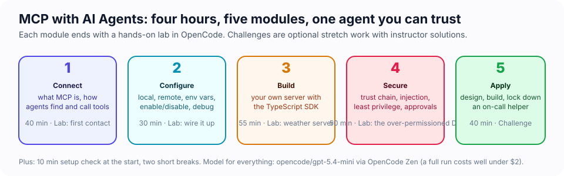

# MCP with AI Agents — Student Course Pack

> Connect, configure, build, and *secure* Model Context Protocol (MCP) integrations for AI agents, using OpenCode as the agent and a cheap model so you can experiment freely.

Before the second break you will have watched an AI agent delete customers from a database because a support ticket asked it to, and you will know four separate places to stop it. Everything before that is how you get there; everything after is proof you can.



**Prefer one page?** [`handout.html`](handout.html) is the student handout: every lab's key commands, predictions that keep score, the cheat sheet, and an operator card that fills in as you go. Open it in a browser next to your terminals.

**Want the concepts in depth?** [`slides/`](slides/index.html) is the reference deck: every concept in the course with diagrams and speaker notes (press `N`), a cheat sheet and a glossary. `R` turns it into one scrolling page.

## The six moments this course is built around

| Lab | You will watch… | Live in terminal 2 |
|---|---|---|
| 1 · First contact | every JSON-RPC message between OpenCode and a server, timed to the millisecond, while the agent answers you | `wiretap-view.mjs` |
| 2 · Wire it up | a red server turn green the second you save the fix, and one server cost 1,200 tokens a turn before it did anything | `context-tax.mjs --watch` |
| 3 · Build | a model you never told about your tool decide to call it, and one deleted sentence change what it does | `tool-card.mjs --watch`, scoring your tool out of 10 |
| 4 · Secure | the agent say "removed 2 customers" while the database loses 3 rows, and then route around the tool you denied | `watch-db.mjs`, `leak-report.mjs` |
| 5 · Apply | a sev4 typo report restart production, and then the same prompt bounce off the agent you built | the status API's own ops board |
| 6 · Go remote *(optional)* | a freeze declared in one terminal make the `deploy` tool vanish from an agent in another, mid-session | the release desk's own board |

Every one of these was captured from a real run with the course model. Your run may differ in the details; when it does, compare with your neighbour. The variance is part of the lesson.

## Who this is for

Software developers, tech leads and security engineers who have completed *Orchestration Fundamentals for Agentic Development* (or have equivalent hands-on experience with an agentic coding tool), are comfortable in a terminal, and can read TypeScript.

## What you will walk away with

- A working mental model of MCP: hosts, clients, servers, and the three capability types (tools, resources, prompts).
- OpenCode configured against local *and* remote MCP servers, with the ability to diagnose connection problems in minutes.
- Your own MCP server (TypeScript, MCP SDK v2) wrapping a real external API, discovered and invoked by an agent in natural language.
- A security playbook you can apply on Monday: trust chain, prompt injection, least privilege, approval controls, logging, and organisational guardrails.
- A completed end-to-end "on-call helper" agent that proves you can do all of the above under time pressure.
- *(Module 6, optional)* A shared Streamable HTTP server with per-person tokens, server-side authorization, progress, cancellation and tools that change at runtime, plus a clear picture of what your host does and does not support.

## Schedule (4 hours)

| Clock | Block | Guide | Minutes |
|---|---|---|---|
| 0:00 | Welcome + setup check | [00 · Setup](00-setup.md) | 10 |
| 0:10 | Module 1 · Connecting AI agents to external systems with MCP | [01 · Connect](01-connecting-agents-with-mcp.md) | 40 |
| 0:50 | Module 2 · Configuring MCP servers with OpenCode | [02 · Configure](02-configuring-mcp-in-opencode.md) | 30 |
| 1:20 | Break | | 10 |
| 1:30 | Module 3 · Building a custom MCP server | [03 · Build](03-building-a-custom-mcp-server.md) | 55 |
| 2:25 | Module 4 · Securing MCP integrations | [04 · Secure](04-securing-mcp-integrations.md) | 50 |
| 3:15 | Break | | 5 |
| 3:20 | Module 5 · Applied MCP agent challenge | [05 · Apply](05-applied-challenge.md) | 40 |
| 4:00 | Done | | |
| *extension* | Module 6 · Advanced MCP: going remote (optional, or a follow-up session) | [06 · Go remote](06-advanced-mcp.md) | 50 |

Every module has a hands-on lab, a short *Check yourself* quiz, and optional 🏆 challenges that get harder as the course goes on: the ones in Modules 4–6 are real engineering problems (pin tool definitions, red-team your own agent, build a human-in-the-loop the model cannot fake). Do them if you are ahead, or after class. Your instructor has worked solutions for every one.

## Folder map

```
course/
├── README.md                     ← you are here
├── 00-setup.md … 06-advanced-mcp.md   ← the student guides, in order (06 is optional)
├── handout.html                  ← the one-page student handout
├── slides/index.html             ← the reference deck
├── images/                       ← diagrams and OpenCode screenshots used by the guides
└── labs/                         ← one folder per lab; run `npm install` here ONCE
    ├── lab1-first-contact/       ← pre-built servers, an MCP wiretap and its live viewer
    ├── lab2-configure/           ← remote servers, env vars, a debugging dojo, the context-tax board
    ├── lab3-weather-server/      ← build your own server (starter code) + the tool-card scorer
    ├── lab4-security/            ← an over-permissioned DB server to break and fix, a live DB watcher
    ├── lab5-oncall/              ← the applied challenge, with a status API that doubles as an ops board
    └── lab6-advanced/            ← a shared Streamable HTTP server with its own board, and a host capability probe
```

## Quick start

```bash
cd course/labs
npm install          # MCP SDK, tsx, zod, sqlite — shared by every lab
npm run check        # verifies Node, OpenCode, your Zen login, network, and warms caches
cd lab1-first-contact
opencode             # the TUI; the lab's opencode.json picks the model and the MCP servers
```

## Model and cost

Every lab's `opencode.json` sets the model to **`opencode/gpt-5.4-mini`** through OpenCode Zen (the built-in `opencode` provider). It is cheap, fast, and calls tools reliably. A typical tool-calling turn costs about a cent; a full run of all five labs costs well under $2. If you want to go even cheaper, `/models` and pick `gpt-5.4-nano`. Please do not switch to frontier models during class.

## How to read the guides

| Marker | Meaning |
|---|---|
| 🎬 **Cold open** | The situation the module is about, before any theory |
| 🎯 **Mission** | What you will have done by the end of the lab; tick them off |
| 💡 **Insight** | The non-obvious thing that makes the rest click |
| 📖 **Key concept** | A term or rule you will use for the rest of the course, defined once |
| 🔬 **Under the hood** | The mechanism behind what you just saw, in a few lines |
| 🧪 **Exercise** | Do this now, in your terminal |
| 🖥️ **Split screen** | Run a live viewer in a second terminal while the agent works in the first |
| 🔮 **Predict** | Commit to a guess before you run it. Being wrong is the point |
| 🤯 **The reveal** | The moment the module is built around. Slow down here |
| 🎲 **Fun** | A playful detour that still teaches something |
| ✅ **Check yourself** | Two-minute self-quiz, answers folded underneath |
| 🏆 **Challenge** | Optional stretch work with an instructor solution |
| ⚠️ **Security** | A risk you will meet in the wild |
| 🏅 **Mission complete** | What you can now do that you could not an hour ago |

Write your 🔮 predictions down, on paper or in a scratch file. A guess you only made in your head is a guess you will remember making correctly.

Most labs work best with **two terminals side by side**: OpenCode in the first, a live viewer in the second. Terminal screenshots in the guides were taken from OpenCode 1.18 with the exact lab files you have. If your screen differs a little (a newer version, a different theme), the commands still apply.
